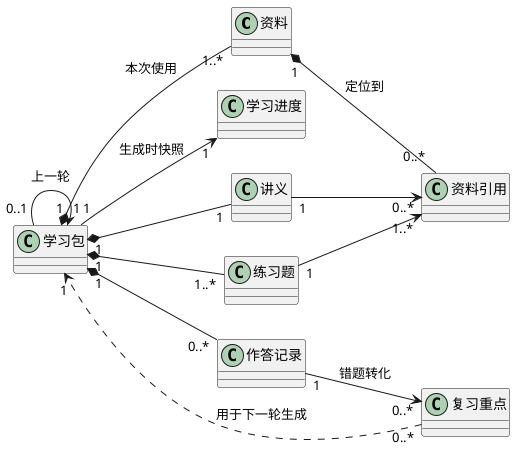

# 循知 · 软件需求规格说明书

| 项目 | 内容 |
| --- | --- |
| 产品名称 | 循知（暂名） |
| 文档名称 | 软件需求规格说明书（SRS） |
| 文档版本 | v1.0（第一阶段交付） |
| 文档状态 | 待阶段评审 |
| 目标用户 | 正在自学的学生（中学生、大学生为主） |
| 首版形态 | 个人单机使用、无需注册账号的本地学习应用 |
| 编写依据 | 项目任务书、贯穿场景（《计算机网络》课件 + 拓扑图）、首版范围约定 |
| 后续阶段 | 软件体系架构与数据设计 → 资料解析与图文模型接入 → 学习工作台与练习流程 → 系统测试与参赛交付 |

**本文件的边界**：本文件只回答"要做什么、做到什么程度算合格、如何验收"，不回答"用什么技术实现"。接口协议、数据结构存储方式、算法与模块划分留待第二阶段架构设计确定。文中出现的任何界面布局描述均为业务交互要求，不代表视觉设计定稿。

---

## 0. 贯穿场景基线

本章给出一个贯穿全文的完整场景，后续所有功能需求、异常场景与验收用例都以此为参照。凡是与本场景冲突的描述，以本章为准；本章未覆盖的场景，由对应功能需求补充。

### 0.1 主场景（场景 A：有基础、有明确薄弱点）

**学生动作**

1. 上传《计算机网络》第 3 章课件 PDF（一份）与一张手绘/截图拓扑图 `网络拓扑.png`（PNG 格式）。拓扑图上标有：主机 PC-A、PC-C、PC-B，一台交换机 SW1，一台路由器 R1，以及三条连接线与两个网段标注（192.168.1.0/24、192.168.2.0/24）。
2. 为 PDF 指定本次学习页码范围：第 12–28 页（其余页面本次不参与）。
3. 在进度描述框中写下一句话：

   > 我学完了交换机转发，还没学路由协议。同一网段和跨网段发包容易混，想用这张图练一下。

4. 保持默认练习设置（巩固难度、5 道单选题），点击「生成学习包」。

**系统应给出的结果（本场景的成功标准）**

| 学习包组成 | 场景 A 的期望内容 |
| --- | --- |
| 学习范围声明 | 明确写出"本次覆盖：交换机转发、同网段与跨网段发送对比；不覆盖：路由协议（OSPF/BGP/RIP）的具体工作机制"。范围声明中的每条"覆盖/不覆盖"都能在进度描述或资料页码中找到依据。 |
| 已掌握内容 | 用不超过全文 20% 的篇幅带过交换机转发的基本定义与 MAC 地址表的作用，不重复讲解学生已声明的已学内容。 |
| 薄弱点讲解 | 围绕"同一网段 vs 跨网段"给出对比式讲解：判断依据（目的 IP 与自身网段是否一致）、是否经过默认网关、交换机与路由器各自参与到哪一步。至少一处使用拓扑图中真实存在的设备名（SW1、R1、PC-A）与真实连接关系来说明。 |
| 图文解释 | 至少一处将讲解文字与拓扑图中的具体区域对应起来（例如"PC-A 与 PC-C 都接在 SW1 上，因此属于同一广播域"），并可通过引用回到该图。 |
| 练习题 | 5 道单选题，其中至少 1 道必须观察拓扑图的连接关系或网段标注才能正确作答；题目考点限定在当前进度可理解范围内，不出现要求比较路由协议优劣、计算路由表之类的超纲题。 |
| 引用 | 讲义与每道题的解析均带至少 1 条资料引用，引用指向本次 PDF 的 12–28 页中的具体段落，或本次上传的拓扑图的具体区域。 |

**读图题示例（用于验收）**

> 题干：图中 PC-A 向 PC-C 发送数据。在 PC-A 已知道 PC-C 的 MAC 地址的前提下，该数据帧在到达 PC-C 之前是否需要经过路由器 R1？请依据图中设备连接关系作答。
>
> 选项：A. 需要，因为跨设备通信都要经过路由器；B. 不需要，因为 PC-A 与 PC-C 连接在同一台交换机上；C. 需要，因为 PC-A 与 PC-C 的 IP 网段不同；D. 无法判断，图中未标注 IP 地址。
>
> 正确答案：B。解析要点：PC-A 与 PC-C 同接 SW1，属同一网段/同一广播域，交换机按 MAC 地址转发即可；R1 不参与。资料依据：拓扑图中 PC-A、PC-C 与 SW1 的连接线，以及 PDF 第 16 页关于交换机在同一网段内转发的段落。

**答错后的路径**

学生选择 A 并提交 → 系统判定错误 → 页面展示正确选项 B、解析、以及支持解析的引用（PDF 第 16 页对应段落 + 拓扑图对应区域）→ 学生点击「针对错题再练」→ 系统给出建议复习重点两条（"同一网段内交换机转发的判断依据""默认网关只在跨网段时参与"），学生可删除、改写或补充 → 沿用同一批资料（PDF 12–28 页 + 同一张拓扑图）生成新的学习包，题量仍为 5 道，且不与上一轮题目重复。

### 0.2 对照场景（场景 B：零基础、只求认图）

**唯一变化**：资料完全相同，进度描述改为：

> 刚开始学习，只想认清图中的设备和作用。

**两份学习包必须出现可观察差异的位置**

| 差异维度 | 场景 A（有基础） | 场景 B（零基础） | 验收方式 |
| --- | --- | --- | --- |
| D1 范围声明 | 覆盖交换机转发与同网段/跨网段对比，明确排除路由协议 | 覆盖设备识别与基本作用，明确排除转发流程、ARP、路由协议 | 对照两份"学习范围"文本，各自至少 1 条排除项且与进度描述对应 |
| D2 术语密度 | 直接使用 MAC 地址表、默认网关等术语并简要解释 | 每个术语首次出现时给出"一句话定义 + 图中对应设备"，不出现未解释的缩写 | 场景 B 讲义中出现的专业术语 100% 有解释；场景 A 允许直接使用已学术语 |
| D3 讲解重心 | 对比"何时需要网关、交换机如何转发" | 说明"主机、交换机、路由器各自负责什么"，不展开转发步骤 | 场景 B 讲义不得出现 MAC 地址表查找步骤、ARP 请求过程；场景 A 必须出现 |
| D4 读图题 | 依据连接关系判断转发是否经过路由器 | 依据图形辨认设备角色（如"图中哪个设备把两个不同网段连接起来"） | 两套题目的读图题考点不同，且各自只能通过看图作答 |
| D5 超纲控制 | 不出现路由协议细节、路由表计算 | 不出现转发流程、网段判断、ARP | 逐题核对考点与两份范围声明的一致性 |
| D6 引用落点 | 多指向 PDF 转发流程段落与拓扑连接关系 | 多指向 PDF 设备介绍段落与图中设备标注 | 抽样各 3 条引用，落点类型与场景匹配 |

**对照场景验收条件（EARS）**

- AC-S1：When 使用同一批资料分别以场景 A 和场景 B 的进度描述生成学习包，the 循知 shall 在两份讲义中产生不少于 5 处可逐条指认的差异，且差异点覆盖 D1–D4。
- AC-S2：When 比较两份讲义的"已掌握/未掌握"处理，the 循知 shall 在场景 A 中略写交换机转发基础，在场景 B 中完整解释设备作用，且两处处理均能在进度描述中找到对应短语。
- AC-S3：If 场景 B 的讲义或题目出现 MAC 地址表查找、ARP 过程、路由协议细节中的任意一项，then the 循知 shall 判定该次生成不合格并允许重新生成。
- AC-S4：When 学生把进度描述从场景 A 改为场景 B 后重新生成，the 循知 shall 保留已选资料与 PDF 页码范围，不要求重新上传。

### 0.3 五步学习闭环（全文的功能归属基准）

本产品的所有首版功能都归属于以下五步。判断一项能力是否进入首版，先看它服务哪一步、缺了它这一步是否无法完成。

| 步骤 | 学生动作 | 系统产物 | 对应需求 |
| --- | --- | --- | --- |
| S1 提供资料 | 上传教材/课件/笔记/截图，指定 PDF 页码范围 | 已选资料清单 | FR-01 |
| S2 说明进度 | 一句话写清"学到哪、哪里不懂、想练什么" | 结构化的进度理解（已学/未学/薄弱/意图） | FR-02 |
| S3 得到学习包 | 点击生成，等待并阅读讲义、浏览题目 | 学习包（讲义 + 练习题 + 引用） | FR-03、FR-04、FR-05 |
| S4 作答与核对 | 作答、提交、看判分与解析、打开引用核对原文 | 作答记录、引用定位结果 | FR-06、FR-07 |
| S5 针对错题再练 | 确认/修改复习重点，再生成 | 新一轮学习包（关联上一轮） | FR-08 |

学习记录（FR-09）贯穿 S1–S5，模型配置与数据外发提示（FR-10）是 S3–S5 能够发生的前提。

---

## 1. 产品目标与首版范围

### 1.1 目标用户

**主要用户：有自学任务、手头已有资料的学生。** 典型特征：

- 手里已有教材 PDF、老师发的课件、自己的笔记或课堂截图，不缺少资料，缺少的是"把资料变成适合当前进度的讲义和练习"的时间。
- 知道自己的学习进度，但说不清具体哪里薄弱，需要被引导着说出来。
- 使用场景多在课后、考前、通勤途中，单次使用时长 10–40 分钟。
- 设备以笔记本为主，手机用于碎片时间复习。
- 不要求注册账号，不希望学习资料被上传到公开空间。

**次要用户：演示与评审场景中的首次使用者。** 没有 API Key、没有自己的资料，需要在 3 分钟内理解产品价值。此类用户由离线示例承接（见 FR-09）。

### 1.2 使用时机

| 时机 | 学生此刻的状态 | 产品要完成的事 |
| --- | --- | --- |
| 课后整理 | 刚上完课，资料齐全，想趁热巩固 | 把本次课的范围压成一份短讲义 + 几道题 |
| 考前复习 | 学过一段时间，薄弱点分散 | 依据"哪里不懂"聚焦讲解与练习 |
| 做错题之后 | 知道错了，但不知道错在哪个概念 | 把错题转成下一轮复习重点 |
| 演示/初次体验 | 没有任何配置 | 用离线示例走完 S1–S5 |

### 1.3 核心问题

学生已有资料与自我认知，但把"这批资料 + 这个进度"转化为"今天能读的讲义 + 今天能做的题"需要付出较高的整理成本。现有工具要么只做问答（不给结构化讲义与成套练习），要么只做题库（不结合学生自己的资料与进度），要么生成内容无法回溯到原文，学生不敢信、不敢用。

**产品要解决的问题可以写成一句话**：让学生用一句话说清进度，就能把手里这批资料变成一份贴合进度、可回溯原文、做完还能接着练的学习包。

### 1.4 产品目标

- **目标 1（贴合）**：同一批资料，在不同进度描述下产出的讲义与题目，应当出现学生可指认的实质差异，而不是换汤不换药。
- **目标 2（可信）**：讲义要点、题目解析中的关键结论都能通过引用回到本次资料的具体位置，学生可以自行核对。
- **目标 3（可续）**：一次练习结束后，错题能转化为下一轮的复习重点，形成"学—练—再学"的连续过程，而不是一次性消耗。
- **目标 4（低门槛）**：不注册、不建课程、不配置多个模型，填一句话就能开始；没有 Key 也能完整体验。

**首版不追求**：覆盖全部学科、自动推断学习进度、长期学习计划编排、多人协作、题库社区化。

### 1.5 首版完成标准

首版达到"可交付评审"需同时满足以下 6 条，缺一不可：

1. **主流程可完成**：一名首次使用者，在只有一份 PDF、一张图片、一句进度描述的条件下，能独立完成 S1–S5，全程无需外部指导，也不需要手工整理资料。
2. **进度敏感**：同一批资料、场景 A 与场景 B 两份学习包在 D1–D4 四个维度均出现差异，人工评审可逐条指认（见 7.2 的人工验收方法）。
3. **引用可核**：随机抽取 10 条引用，全部能打开并定位到本次资料内的对应内容；其中至少 8 条经人工核对后确认"该内容确实支持对应结论"，而非仅仅"链接能打开"。
4. **错误可恢复**：生成失败、模型超时、页码无效、文件损坏等情形下，已选资料与进度描述不丢失，学生可在修正后一键重试。
5. **离线可演示**：断网、无 Key 环境下，离线示例能在 3 分钟内走完 S1–S5，且示例内容带明确标识，不会被误认为真实生成结果。
6. **记录可管理**：任意历史学习包可重新打开、可删除；删除后不可再通过界面访问其内容。

### 1.6 首页设计原则

首页只围绕三个动作组织，不引入课程、班级、知识库等中间概念：

1. **上传资料**：把文件拖入或选择，立即看到文件清单。
2. **描述进度**：一个多行输入框，一句自然语言即可；下方是默认练习设置（巩固 / 5 道单选题），可改。
3. **生成学习包**：唯一主按钮，点击后进入生成等待态。

首页同时提供两个次级入口：「使用离线示例体验」与「学习记录」。除此之外不放置其他功能入口。首版不设注册、登录、引导式多步向导。

### 1.7 首版产品形态与使用约束

- **个人单机使用**：一名使用者、一台设备、本地保存学习记录；不提供账号体系、不提供多人共享与云端同步。
- **无需网络即可打开已有记录**：已生成的学习包与其引用在本地可再次查看（离线示例天然满足；真实生成的记录在资料仍在本地时可查看）。
- **配置集中于服务端一个 Key**：学生界面不出现"聊天模型/识图模型/出题模型/检索模型"的选择项（见第 4 章）。
- **入口与步骤最少化**：从打开应用到拿到学习包，固定为"选文件 → 写一句话 → 点生成"三步；不设置必填的课程名、章节名、学科标签。

### 1.8 首版必须交付的功能

| 编号 | 功能 | 服务步骤 | 进入首版的理由 |
| --- | --- | --- | --- |
| FR-01 | 导入资料（PDF/TXT/Markdown/PNG/JPEG/WebP，移除、PDF 页码） | S1 | 没有资料就没有可追溯的学习包，是产品存在的前提 |
| FR-02 | 一句话描述进度（含默认难度与题量） | S2 | "贴合进度"的全部差异都源自这一步，删除后产品退化为通用问答 |
| FR-03 | 生成讲义（范围声明、要点、易错处、图文解释） | S3 | 学生要"能直接读"的产物，而非聊天记录 |
| FR-04 | 图表识别（文字识别 + 关系理解） | S3 | 学生大量使用课件截图与拓扑图，只识别文字无法支撑读图题 |
| FR-05 | 生成练习（题干、4 选项、答案、解析、依据） | S3 | "能直接作答"的另一半产物，且是 S5 的输入 |
| FR-06 | 查看引用（文本片段/PDF 页/图片区域） | S4 | 可信度的唯一验证通道，缺失则学生无法核对 |
| FR-07 | 作答与判分（四状态、答案可见时机、重复提交） | S4 | 没有判分就没有"错题"，S5 无法启动 |
| FR-08 | 针对错题再练（可编辑复习重点、复用资料、回看上一轮） | S5 | 产品与"一次性生成工具"的核心区别 |
| FR-09 | 学习记录与离线示例 | 全程 | 支撑复习连续性、首次体验与比赛演示 |
| FR-10 | 单一 Key 配置与数据外发提示 | S3–S5 前提 | 决定部署成本与学生知情权，属于产品级约束 |

### 1.9 可留待后续版本的功能

| 功能 | 不进入首版的依据 |
| --- | --- |
| 账号、云端同步、多设备续接 | 首版定义为个人单机；账号体系会显著增加注册与隐私成本，且不服务于 S1–S5 的任何一步 |
| 多门课程/资料库的目录化管理、跨资料包复用 | 首版一次学习包只围绕"本次资料"；目录化是资料量变大后的组织需求，不是首版完成学习闭环的必要条件 |
| 多选题、填空题、判断题、主观题 | 单选题足以验证"读图—判断—作答—错题再练"闭环；多题型会扩大判分与解析的验收面 |
| 自动推断学习进度（扫描教材目录、分析笔记） | 进度描述本身就是产品要保留的"学生自述"；自动推断会削弱可解释性，且准确率风险高 |
| 学习计划、间隔重复排程、掌握度曲线 | 属于长期学习管理，首版只保证"这一轮—下一轮"的连续性 |
| 讲义手工编辑、笔记批注 | 首版以"重新生成"替代编辑，避免引入富文本编辑与版本合并的复杂度 |
| 公式/手写/语音识别 | 首版聚焦文字与图表；公式识别属于独立能力，验收成本高 |
| 导出 PDF、分享链接、打印排版 | 阅读发生在应用内即可满足 S3；导出属于传播需求 |
| 多模型供应商切换、模型参数调节 | 与"一个 Key 完成图文学习"的产品承诺冲突（见第 4 章） |
| 题库收藏、社区共享、排行榜 | 与个人单机定位不符 |

**划分依据（可复用的判断规则）**：① 缺少它，S1–S5 是否有一步无法完成；② 是否存在可接受的手工替代（如用"重新生成"替代"编辑"）；③ 是否会引入新的合规、隐私或运维负担；④ 验收成本是否显著高于其带来的学习收益。四项中任一项为"是"，原则上不进入首版。

### 1.10 比赛演示能力与学生日常使用需求的区分

| 维度 | 比赛演示所需 | 学生日常使用所需 | 首版处理 |
| --- | --- | --- | --- |
| 首次体验 | 无 Key、无资料也能在 3 分钟内看到完整闭环 | 用手头资料得到真实结果 | 离线示例 + 真实生成双通道 |
| 差异展示 | 能现场对比"同资料不同进度" | 改完进度后不必重新上传 | 保留资料与输入，支持就地改进度重生成 |
| 可信度展示 | 引用可点开、可高亮、可放大图片区域 | 能核对原文再决定是否相信 | 引用定位到段落/页/区域，而非仅到文件 |
| 稳定性 | 演示过程不因超时或报错中断 | 失败后可恢复、不重复劳动 | 失败保留输入；离线示例不依赖网络 |
| 数据合规 | 明确告知内容会发往模型服务 | 知道自己上传了什么、发出去了什么 | 生成前的数据外发提示 + 离线示例标识 |

**结论**：演示能力不是额外功能，而是同一套能力在"无 Key、强对比、可回溯"三个方向上的可验证表现；不为演示单独开发只对演示有效的功能。

---

## 2. 术语与业务对象

### 2.1 术语表

**资料（Source Material）**
: 学生为本次学习提供的一个原始文件，是 PDF、TXT、Markdown、PNG、JPEG、WebP 之一。
: 备注：资料是只读的，产品不修改原始文件内容；同一文件可被多个学习包引用。

**资料引用（Citation）**
: 学习包中某条讲义要点或某道题解析所指向的资料内具体位置，位置可以是文本片段、PDF 的某一页、图片的某一区域。
: 备注：引用不是"文件级链接"，必须细到段落、页或区域，否则不满足可核对要求。

**学习进度（Progress Statement）**
: 学生用自然语言写下的自述，需同时表达"学到哪里、哪里不懂、这次想练什么"三类信息。
: 备注：允许只写其中一类或两类，缺失部分由系统按保守策略处理并在讲义范围声明中体现。

**进度理解（Progress Reading）**
: 系统对学习进度文本的结构化解读结果，包含已学内容、未学内容、薄弱点、本次练习意图四项。
: 备注：进度理解必须回显给学生看（至少以范围声明的形式），学生据此判断系统是否理解错了。

**学习包（Study Pack）**
: 一次生成产生的完整学习成果，包含本次资料清单、学习进度快照、进度理解、讲义、练习题集合与生成时间。
: 备注：学习包是学习记录的最小单位，重新打开、删除、错题再练都以学习包为对象。

**讲义（Handout）**
: 学习包中面向阅读的部分，包含学习范围声明、知识要点、易错处与图文解释。
: 备注：讲义不是聊天回答，具有固定结构，可分段引用。

**练习题（Exercise）**
: 学习包中面向作答的单选题，包含题干、四个互异选项、唯一正确答案、解析与资料依据。
: 备注：一道题可以有多条资料依据；无资料依据的题目不允许出现在学习包中。

**作答记录（Attempt）**
: 学生对某个学习包中题目的选择与提交结果，包含每题所选选项、对错判定、提交时间与重开次数。
: 备注：同一学习包可以有多份作答记录；错题再练以"最近一次已提交的作答记录"为依据。

**复习重点（Review Focus）**
: 由答错题目的考点转化而来、可由学生编辑的一条待复习内容，用于指导下一轮学习包的生成。
: 备注：复习重点是学生可改的"意图输入"，不是系统对学生的能力评级。

**离线示例（Offline Sample）**
: 内置在应用中的一套完整示例资料与学习包，无需网络与 Key 即可体验 S1–S5。
: 备注：离线示例必须带持续可见的标识，且不得与真实资料混合生成。

**模型密钥（Model Key）**
: 部署者或学生在服务端配置的唯一 DEEPSEEK_API_KEY，用于文字理解、图表理解、讲义生成与出题。
: 备注：Key 不出现在学习界面，不作为学生逐项选择的模型参数。

### 2.2 业务对象关系



### 2.3 对象之间的业务关系（必须保留的关系）

1. **资料 ↔ 学习包：多对多，但每次生成固定一批。** 同一批资料可以用于多次生成；每个学习包记录下自己使用的那批资料与页码范围。后续删除资料时，已生成学习包的引用是否仍可打开，取决于资料是否仍在本地（见 6.4）。
2. **学习包 → 学习进度：快照关系。** 学习包必须保存生成时使用的进度描述原文与系统解读结果，之后学生再修改进度，不影响旧学习包的展示。学生回看旧学习包时，应能看到"当时为什么练这些题"。
3. **学习包 → 讲义/练习题：整体归属。** 讲义与题目不能脱离学习包单独存在；删除学习包即删除其下全部内容与引用。
4. **练习题/讲义 → 资料引用：每条引用必须落在本次资料范围内。** 引用不得指向未上传的文件、未选中的 PDF 页码之外的页面，或图片之外的臆测内容。
5. **学习包 → 作答记录：一对多。** 重新打开并再次提交会新增一份作答记录或更新当前未提交记录；历史作答结果保留，可回看。
6. **作答记录 → 复习重点：错题转化。** 只有被判定为错误的题目才产生复习重点候选；学生可编辑候选集合后再生成。
7. **学习包 → 学习包：可追溯的再练链。** 由错题再练产生的新学习包应记录其上一轮学习包，学生可从新一轮回到上一轮查看原题与原作答。

### 2.4 关键业务约束（供架构阶段转化为数据约束）

| 编号 | 约束 |
| --- | --- |
| C-01 | 每个学习包必须且只能有一个学习进度快照，快照内容生成后不可被后续编辑覆盖。 |
| C-02 | 学习包内的每道题必须关联至少一条资料引用，且引用必须属于该学习包的资料集合。 |
| C-03 | 同一学习包内题目数量等于学生生成时选定的题量；选项数为 4 且互不相同；正确答案唯一。 |
| C-04 | 复习重点只能由已提交作答记录中的错题产生，且必须允许学生删除或改写任意一条。 |
| C-05 | 删除学习包时，其讲义、题目、作答记录、引用一并不可再访问；原始资料文件是否保留由学生单独决定。 |
| C-06 | 学习包必须记录生成来源：真实生成或离线示例，二者在界面上必须可区分。 |

---

## 3. 功能需求

编号规则：`FR-xx` 为功能需求，`AC-xx.n` 为该功能下的验收条件。验收条件统一采用 EARS 句式，触发词与固定短语保留英文（When / If / While / Where / The system shall），其余内容为中文。每条验收条件都必须能在不使用开发者口头解释的情况下被第三方复现。

### FR-01 导入资料

**用户目的**：把手头已有的教材、课件、笔记、截图一次性交给系统，并精确限定本次要用的范围，避免无关页面干扰生成结果。

**触发条件**：学生在首页点击「上传资料」、拖入文件，或在文件清单中执行移除 / 修改页码范围操作。

**输入**：

- 一个或多个本地文件，格式限定为 PDF、TXT、Markdown（`.md`）、PNG、JPEG、WebP。
- PDF 可选填本次学习的物理页码范围（如 `12-28`，或单页 `12`）。"物理页码"指用 PDF 阅读器打开时显示的页序，不是教材印刷页码。

**系统行为**：

1. 对每个文件做格式、可读性、大小的即时校验；通过后加入"本次已选资料"清单。
2. 清单逐条显示：文件名、格式、文件大小；PDF 额外显示总页数与本次选定的页码范围（未指定时显示"全部 N 页"）。
3. PDF 页码范围支持起止页与单页两种写法；填写后立即校验是否为正整数、是否满足 `起始页 ≤ 结束页`、是否落在 1 至总页数之间。
4. 支持移除任意单个文件；若被移除的是 PDF，其页码范围设置一并失效。支持清空全部。
5. 同一文件被重复选择时，提示"该文件已在本次资料中"，不重复加入清单。
6. 资料清单在页面刷新、生成失败、返回修改进度后保持不变（在本次会话内有效）。

**成功结果**：学生看到与本地选择一致的资料清单，PDF 的页码范围与预期一致，可以进入描述进度。

**异常反馈**：

| 情形 | 反馈 |
| --- | --- |
| 格式不在支持列表（如 DOCX、PPTX） | 该文件不进入清单，提示"暂不支持该格式，可另存为 PDF 或截图后上传"，并列出支持的 6 种格式 |
| 文件损坏或无法读取 | 该文件条目标记为"无法读取"，给出重新选择入口；不影响其他文件加入 |
| PDF 页码范围非法 | 输入框标红并说明原因（超出总页数 / 起止颠倒 / 非数字），「生成学习包」不可点击 |
| 未指定 PDF 页码范围 | 允许生成，但清单上持续显示"将使用全部 N 页"，生成前的确认区再次提示 |
| 超出数量或大小上限 | 拒绝超出部分并说明上限值与当前已用量（上限值见 6.6） |

**验收条件**：

- AC-01.1 When 学生选择一个受支持的 PDF，the 循知 shall 在资料清单中显示该文件名、格式、大小与总页数。
- AC-01.2 When 学生为一个 40 页的 PDF 填写 `12-28`，the 循知 shall 将本次学习范围标记为第 12–28 页，并在生成时仅使用这 17 页。
- AC-01.3 If 学生为 40 页的 PDF 填写 `30-45`，then the 循知 shall 阻止生成并提示页码范围超出总页数。
- AC-01.4 When 学生移除清单中的一个文件，the 循知 shall 立即从清单移除该条并把题量/进度的可生成状态重新计算。
- AC-01.5 If 学生重复选择同一文件，then the 循知 shall 保持清单条数不变并给出"已存在"提示。
- AC-01.6 When 学生上传一张 PNG 拓扑图，the 循知 shall 将其作为独立资料加入清单，且不要求填写页码。

### FR-02 描述进度

**用户目的**：用一句自己习惯的话，同时说清"学到哪里、哪里不懂、这次想练什么"，不再填表单。

**触发条件**：学生在进度输入框中输入文本，或修改练习设置。

**输入**：

- 一段自然语言文本，建议不超过 500 字；允许只描述其中一类或两类信息。
- 练习设置：
  - **难度**：可选「基础」「巩固」两档，默认「巩固」。「基础」侧重识别概念、读懂图表和单步判断；「巩固」侧重比较易混概念、解释原因和把知识应用到资料中的情境。无论选择哪一档，难度都不得突破学生填写的学习进度。
  - **题量**：可选 3 / 5 / 8 道，默认 5 道。
  - **题型**：首版固定单选题，不可改。

**系统行为**：

1. 保存进度原文，并在生成前将其解析为四项进度理解：已学内容、未学内容、薄弱点、本次练习意图。
2. 在生成结果中以"学习范围声明"的形式回显这四项理解，使学生能判断系统是否理解偏差。
3. 文本为空或明显不足（少于 6 个汉字，或仅为"不会""不懂""随便"等无效表达）时，允许生成，但采用保守策略：学习范围取本次资料全部内容、讲义以基础概念为主、题目以识记与辨析为主，并在结果页顶部明确标注"本次进度描述信息不足，已按资料全范围生成"。
4. 练习设置不作为必填项；学生不修改时使用默认值（巩固难度、5 道单选题）。
5. 修改进度或练习设置后，已选资料与页码范围保持不变。
6. 难度只改变同一考点的考察深度与干扰项强度，不改变题量，也不扩大本次范围声明；进度与难度冲突时，一律以进度为准。

**成功结果**：系统给出的四项进度理解与学生的原话一致，尤其"未学内容"不得被误判为已学。

**异常反馈**：

| 情形 | 反馈 |
| --- | --- |
| 进度文本为空 | 「生成学习包」不可点击，提示"写一句你学到哪、哪里不懂即可" |
| 进度文本过于笼统 | 允许生成，结果页标注"进度信息不足，已按全范围处理"，并提供"补充进度"入口 |
| 进度描述与资料明显无关（如资料是计算机网络，描述写"我想复习英语语法"） | 允许生成但在结果页提示"本次资料与进度描述可能不匹配，建议确认资料或修改进度"，不静默丢弃描述 |
| 进度中同时出现矛盾信息（如"我学完了路由协议"与"还没学路由"） | 保留原文，在范围声明中把冲突点显式列出，请学生确认后再生成下一轮 |

**验收条件**：

- AC-02.1 When 学生输入场景 A 的原话，the 循知 shall 解析出"已学：交换机转发""未学：路由协议""薄弱：同网段与跨网段混淆""意图：用拓扑图练习"四项，且四项均可被人工对照原文确认。
- AC-02.2 When 学生未修改练习设置，the 循知 shall 使用"巩固难度 + 5 道单选题"生成。
- AC-02.3 If 学生把进度改成场景 B 的原话，then the 循知 shall 在结果页的范围声明中不再声明"交换机转发已掌握"。
- AC-02.4 When 进度文本为空，the 循知 shall 禁用生成按钮并给出一句示例文案。
- AC-02.5 While 学生修改进度，the 循知 shall 保留已选资料清单与 PDF 页码范围。
- AC-02.6 When 学生选择「基础」难度，the 循知 shall 以识别概念、读懂图表、单步判断为主要考法，且不出现需要多步推导的题目。
- AC-02.7 When 学生选择「巩固」难度，the 循知 shall 以比较易混概念、解释原因、把知识应用到资料情境为主要考法。
- AC-02.8 If 所选难度与进度描述冲突（例如巩固题涉及学生声明未学的内容），then the 循知 shall 以进度为准，不生成超出进度的题目。

### FR-03 生成讲义

**用户目的**：拿到一份 5–10 分钟能读完、直接围绕自己薄弱点的讲义，而不是一篇覆盖全章的通用科普。

**触发条件**：学生点击「生成学习包」，且资料清单非空、进度文本非空、页码合法。

**输入**：本次资料集合（含 PDF 页码范围）、进度原文与进度理解、难度与题量。

**系统行为**：

1. 讲义固定包含四部分，顺序不可调换：
   - **学习范围**：本次覆盖什么、不覆盖什么，各 2–5 条；每条能对应到进度描述或资料页码。
   - **知识要点**：3–6 条，围绕薄弱点展开；每条 2–5 句，尽量使用本次资料中的术语与例子。
   - **易错处**：2–4 条，说明"容易怎么错、为什么错、如何区分"。
   - **图文解释**：至少 1 处，当资料含图片或含图的 PDF 页时必须包含；解释文字要与图中的设备名、标注或连接关系对应。
2. 学生已声明"学完"的内容，讲义用不超过全文 20% 的篇幅简述，不重复推导。
3. 学生已声明"未学"的内容，讲义不得展开讲解其工作机制，只能在必要处点明"此处涉及 X，将在后续学习"。
4. 讲义中的每个要点段落至少带 1 条资料引用；无引用支撑的推断性表述必须显式标注为"延伸理解"，且不得作为出题依据。
5. 讲义生成后，学生可就地修改进度并重新生成，无需重新上传资料。

**"符合当前进度"的判定标准（人工与自动共用的 5 条）**：

| 编号 | 判定标准 | 不合格示例 |
| --- | --- | --- |
| H-1 范围一致 | 范围声明中的"覆盖/不覆盖"与进度描述的三类信息不矛盾 | 学生说"还没学路由协议"，讲义却用一节讲 OSPF 选路 |
| H-2 已学略写 | 已学内容占比不超过全文 20%，且不重复基础定义推导 | 学生说"学完了交换机转发"，讲义仍用一半篇幅讲交换机是什么 |
| H-3 未学不展开 | 未学内容只做提示性提及，不出现机制、步骤、算法 | 讲"跨网段要交给网关"时展开路由表查找全过程 |
| H-4 薄弱点为主 | 薄弱点相关内容占全文 50% 以上，且有对比或辨析结构 | 通篇按教材顺序复述，薄弱点只在结尾提一句 |
| H-5 术语匹配 | 术语使用与学生进度匹配：已学术语可直接用，未学术语首次出现必须有解释 | 零基础场景直接使用"广播域""默认网关"而不解释 |

**成功结果**：讲义可独立阅读，读者不看题目也能说出"这次学了什么、哪里容易错"。

**异常反馈**：

| 情形 | 反馈 |
| --- | --- |
| 资料内容不足以支撑薄弱点（如 PDF 页码只覆盖交换机简介，未涉及跨网段） | 仍生成讲义，但在范围声明中标注"本次资料未覆盖 X，相关部分仅作提示"，并建议补充页码范围 |
| 讲义生成结果缺少范围声明或缺少引用 | 判定为不合格，提供"重新生成"；连续两次不合格时提示"可缩小页码范围或补充一句进度" |
| 讲义内容与资料无关（出现资料中不存在的设备名、章节） | 判定为不合格，不得展示为可学习结果，给出重新生成入口 |
| 生成过程中学生关闭页面 | 重新打开后可在学习记录中看到"生成中断"，已选资料与进度仍保留 |

**验收条件**：

- AC-03.1 When 以场景 A 生成讲义，the 循知 shall 输出四部分结构，且"学习范围"中至少包含一条明确的不覆盖项"路由协议细节"。
- AC-03.2 When 以场景 A 生成讲义，the 循知 shall 使交换机转发基础内容占比不超过全文 20%，并使同网段/跨网段辨析内容占比不低于 50%。
- AC-03.3 If 讲义某段落在资料中找不到任何支撑，then the 循知 shall 将其标注为"延伸理解"或不展示该段落。
- AC-03.4 When 以场景 B 生成讲义，the 循知 shall 对 MAC 地址表、默认网关等术语在首次出现处给出一句话解释。
- AC-03.5 When 学生修改进度并重新生成，the 循知 shall 保留原资料清单与页码范围，且旧学习包仍可在学习记录中打开。

### FR-04 识别图表

**用户目的**：让课件截图、拓扑图、流程图真正参与讲解和出题，而不是被当成一张"看不懂的附件"。

**触发条件**：本次资料中包含 PNG/JPEG/WebP 图片，或 PDF 选中页中含图片/图表。

**输入**：图片文件或含图 PDF 页；可附带学生进度描述中的指向（如"想用这张图练一下"）。

**系统行为**：

1. **识别图上的文字**：读出图中可见的文字标注（设备名、网段、箭头旁文字、图例），并在讲义和题目中使用这些文字时保持与原图一致。
2. **理解图中的关系**：识别图中对象之间的连接、包含、层级、方向关系，并能在讲解中描述"谁与谁相连、数据从哪到哪、经过哪些对象"。
3. 两类识别结果都必须能作为引用被定位：文字识别结果指向图中区域；关系理解结果指向构成该关系的对象与连线区域。
4. 识别置信度不足时（文字模糊、连线被遮挡、标注缺失），只能用于辅助说明，不得作为题目正确答案的唯一依据。

**两类能力的可验收示例**

| 能力 | 验收示例（场景 A 拓扑图） | 通过标准 |
| --- | --- | --- |
| 识别文字 | 图中标注 `192.168.2.0/24`、`R1`、`SW1`、`PC-A`、`PC-C` | 讲义与解析中出现的设备名、网段与图中完全一致；不得把 `192.168.2.0/24` 写成 `192.168.3.0/24`，不得把 SW1 写成 SW2 |
| 理解关系 | 判断"PC-A 与 PC-C 是否连接在同一台交换机上""PC-A 到 PC-B 是否必须经过 R1" | 系统给出的关系结论与图中连线一致；讲义能写出结论所依据的连接（如"PC-A、PC-C 均连至 SW1"）；图中未连线的两个对象不得被判为直连 |

**成功结果**：至少 1 道练习题必须观察图才能作答，且该题的正确答案可由图中可见信息唯一确定。

**异常反馈**：

| 情形 | 反馈 |
| --- | --- |
| 图片中文字过小或模糊 | 不使用该文字作为关键条件；讲义中以"图中标注不清"标注，并建议重新截图或提供更清晰版本 |
| 图中缺少图例或设备名 | 仍可做关系层面的讲解，但不出"辨认设备名称"类题目 |
| 图片与 PDF 内容冲突 | 以学生本次选定的资料为准并列展示，冲突处在讲义中提示，请学生确认 |
| 图片损坏或格式伪装（扩展名与内容不符） | 该图片标记"无法识别"，其余资料继续可用 |

**验收条件**：

- AC-04.1 When 学生上传场景 A 的拓扑图并生成学习包，the 循知 shall 至少输出 1 道必须依据图中连接关系才能作答的单选题。
- AC-04.2 When 系统在讲义中描述拓扑，the 循知 shall 使用图中实际存在的设备名，且设备名与图中文字逐字一致。
- AC-04.3 If 图中 PC-A 与 PC-B 之间没有直接连线，then the 循知 shall 不得生成"PC-A 与 PC-B 直连"的判断或以此为正确答案的题目。
- AC-04.4 When 学生点击一条由图关系产生的引用，the 循知 shall 打开原图并标出支撑该结论的设备与连线区域。
- AC-04.5 If 图片文字无法可靠识别，then the 循知 shall 不以该文字作为题目正确答案的唯一依据，并在讲义中提示标注不清。

### FR-05 生成练习

**用户目的**：拿到一组题量正好、难度合适、每题都能在资料里找到依据的单选题，做完就能判断自己是否真的分清了易混点。

**触发条件**：与 FR-03 同一次生成（学习包同时产出讲义与练习）。

**输入**：资料集合、进度理解、题量、难度、讲义中的知识要点与易错处。

**系统行为**：

1. 每道题固定包含：题干、4 个互异选项（A/B/C/D）、唯一正确答案、解析、至少 1 条资料依据。
2. 题干必须自足：不依赖"如上文所述""根据讲义"等指代；涉及图的题目必须说明看哪张图。
3. 干扰项必须是学生常见的真实误解（如"跨网段必须经过交换机""同网段也要经过网关"），禁止使用"以上都对""以上都不对""无法判断"作为凑数选项（确需"无法判断"时，必须存在图中信息不足的真实情形）。
4. 题目考点必须落在本次范围声明之内：不考未学内容，不考资料未覆盖的页码。
5. 题量与学生选择一致（3、5 或 8 道）；难度影响的是辨析深度与干扰项强度，不影响题量，也不改变范围声明。
6. 两档难度的考法分工如下，且均须遵守学生填写的学习进度：

| 难度 | 主要考法 | 场景 A 示例 |
| --- | --- | --- |
| 基础 | 识别概念、读懂图表、单步判断 | 认出拓扑图中哪台设备是路由器；判断 PC-A 与 PC-B 是否处于同一网段 |
| 巩固 | 比较易混概念、解释原因、应用到资料中的情境 | 解释同网段与跨网段发包路径的差异；判断图中某次跨网段发包是否需要经过网关 |
7. 同一学习包内不得出现题干重复或仅更换选项顺序的重复题。
8. 每道题的解析必须解释"为什么正确、为什么其他选项错"，并指向资料中的具体位置；解析不得只写"见教材第 X 页"。

**成功结果**：学生可以不看讲义直接作答，且每道题都能通过引用回到资料核对。

**资料不足以支持所选题量时的可操作反馈**：

| 反馈内容 | 要求 |
| --- | --- |
| 说明缺口 | 明确写出"当前资料在本次进度范围内只能支持 N 道有依据的题" |
| 给出选项 | 提供至少两条可执行路径：改为 N 道题；或补充资料/扩大页码范围（给出建议页码区间） |
| 保留输入 | 学生选择任一路径时，已选资料与进度不丢失 |
| 禁止凑数 | 不得为凑满题量生成无资料依据的题、重复题或超纲题 |

**异常反馈**：

| 情形 | 反馈 |
| --- | --- |
| 选项不足 4 个或存在重复选项 | 该题判定不合格，重新生成该题；不得展示残缺题目 |
| 正确答案不唯一或无正确答案 | 该题判定不合格，不得进入学习包 |
| 题目引用指向未选页码或未上传文件 | 该题判定不合格，必须重新定位或重出 |
| 题目难度明显超出进度（如零基础场景出现路由表计算） | 该题判定不合格，替换为范围内题目 |
| 生成的题量少于选择值且未说明 | 视为生成失败，需给出 6 条中的可操作反馈 |

**验收条件**：

- AC-05.1 When 学生选择 5 道题，the 循知 shall 生成恰好 5 道单选题，每题 4 个互异选项且仅 1 个正确答案。
- AC-05.2 When 查看任意一道题的解析，the 循知 shall 提供至少 1 条指向本次资料具体位置的引用。
- AC-05.3 If 资料只能支持 3 道有依据的题，then the 循知 shall 明确告知缺口，并同时提供"改为 3 道"与"补充资料/扩大页码"两个可执行选项。
- AC-05.4 When 以场景 B 生成练习，the 循知 shall 不出现要求解释路由协议或计算转发表的题目。
- AC-05.5 If 同一学习包内出现题干相同或仅选项顺序不同的两道题，then the 循知 shall 判定为重复并替换其中一道。
- AC-05.6 When 学生选择 3 道或 8 道题，the 循知 shall 分别生成恰好 3 道或 8 道单选题，不因题量变化改变题目结构要求。
- AC-05.7 When 学生选择「基础」难度，the 循知 shall 使每题只考查识别概念、读懂图表或单步判断之一，不出现需要比较两种机制或解释原因才能作答的题目。
- AC-05.8 When 学生选择「巩固」难度，the 循知 shall 使至少一半题目考查比较易混概念、解释原因或应用到资料情境，且不涉及进度中声明未学的内容。

### FR-06 查看引用

**用户目的**：不轻信生成结果，能一键回到原文或原图，确认这条结论确实来自自己的资料。

**触发条件**：学生点击讲义段落末尾或题目解析中的引用标记。

**输入**：引用对象（文本片段 / PDF 页 / 图片区域）。

**系统行为（用户将看到什么）**：

| 引用类型 | 打开后的表现 | 定位准确的自检标准 |
| --- | --- | --- |
| 文本片段（TXT/Markdown/PDF 抽取文本） | 显示命中片段原文，并附前后各一段上下文；命中处高亮；显示所属文件名 | 高亮片段包含引用所声称的关键词或结论；上下文语义连贯，不是被截断的半句 |
| PDF 页 | 直接打开对应物理页，页面内命中段落高亮；页眉显示"第 X 页 / 共 Y 页"；可前后翻页 | 打开页与引用声明的页码一致；高亮段落读得通，且确实讨论该结论 |
| 图片区域 | 打开原图，用边框标出命中区域，可放大/缩小；显示"区域 i / 共 n 处" | 标注区域覆盖图中支撑结论的设备、连线或文字；区域不落在空白处或无关装饰上 |

1. 引用以侧栏或浮层方式打开时，不得丢失当前作答进度与滚动位置；关闭后回到原位置。
2. 题目解析中的引用应能同时展示"解析结论"与"原文片段"，便于对照。
3. 引用信息包含：资料名称、位置（页/段落/区域）、命中内容摘要。

**异常反馈**：

| 情形 | 反馈 |
| --- | --- |
| 原资料已被删除 | 引用标记变为"来源资料已删除"，打开后显示引用时保存的文字摘要，并注明"无法定位原文"；不打开空白页、不跳转首页 |
| PDF 页码存在但抽取不到文字（扫描页） | 打开该页图片视图并高亮整页或指定区域，明确标注"该页为扫描页，按图像定位" |
| 引用位置越界（页码超出、区域坐标无效） | 视为引用失效，不得静默跳到文件首页；提示"引用定位失败"并提供反馈入口 |
| 同一段落被多条结论引用 | 允许多条引用指向同一位置，打开时高亮相同区域 |

**验收条件**：

- AC-06.1 When 学生点击一条 PDF 文本引用，the 循知 shall 打开对应物理页并高亮包含该结论的段落，页眉显示正确页码。
- AC-06.2 When 学生点击一条图片引用，the 循知 shall 在原图上标出支撑该结论的区域，且标注区域包含图中对应设备或连线。
- AC-06.3 When 学生关闭引用浮层，the 循知 shall 保持其打开前的作答选择与页面位置。
- AC-06.4 If 引用的来源资料已被删除，then the 循知 shall 显示"来源资料已删除"与引用摘要，并明确标注"无法定位原文"，不得打开空白页、错误页，也不得通过旧地址重新打开已删除的文件或预览。
- AC-06.5 When 引用指向扫描页，the 循知 shall 以图像方式打开该页并标注定位方式。

### FR-07 作答与判分

**用户目的**：像做纸质练习一样一次做完、提交后立刻知道对错和原因，并能回头重做而不混淆记录。

**触发条件**：学生选择选项、点击「提交」、点击「重新作答」，或重新打开一个已提交的学习包。

**输入**：每道题所选选项（可为空）。

**系统行为与四种状态**：

| 状态 | 定义 | 界面表现 | 允许的操作 |
| --- | --- | --- | --- |
| 未作答 | 所有题均未选择 | 选项均未选中，底部显示"已作答 0 / 5" | 选择选项；提交（会触发未作答提示） |
| 部分作答 | 至少 1 题已选、至少 1 题未选，且尚未提交 | 已选题高亮；底部显示"已作答 k / 5"；提交按钮可用 | 继续选择、改选、提交 |
| 已提交 | 已提交且判分完成 | 显示对错标记、正确答案、解析与引用；选项锁定不可改 | 查看引用；「针对错题再练」；「重新作答」 |
| 重新打开 | 已提交后离开、再次进入该学习包 | 默认展示上次提交的结果与作答 | 查看结果；「重新作答」生成新的作答记录 |

1. **答案可见时机**：提交前，界面不得以任何形式泄露正确答案（包括不显示正确项样式、不在选项中出现解析、不在题干中暗示）。提交后一次性展示全部题目的对错、正确答案、解析与引用。
2. **未作答处理**：未作答的题在提交后计为"未作答"，不计为"答错"，不进入错题再练候选，但在结果统计中单独列出。
3. **部分作答提交**：允许提交，但提交前必须提示"还有 N 题未作答，未作答将计为未作答，是否继续"。
4. **重复提交**：已提交状态下再次点击「提交」不重复判分、不新增作答记录，提示"本轮已提交，如需重做请点击重新作答"。
5. **重新作答**：清空本轮选择并生成新的作答记录，旧记录保留可回看；重新作答不改变题目与讲义内容。
6. **判分规则**：单选题选对得分，选错或未作答不得分；不设部分分。
7. **统计展示**：结果页显示答对题数、答错题数、未作答题数与正确率（正确率分母为题目总数）。

**异常反馈**：

| 情形 | 反馈 |
| --- | --- |
| 无任何选择时点击提交 | 阻止提交，提示"请先作答至少一题，或确认全部跳过" |
| 提交过程中生成内容仍在加载 | 提交按钮置为不可用并提示"题目正在准备中" |
| 重复点击提交（快速连点） | 只产生一次判分与一条作答记录 |
| 提交后网络中断（真实生成记录） | 已选答案保留；恢复后可继续提交；不得丢失已选内容 |
| 已提交后修改选项 | 选项已锁定，不响应修改，提示需先「重新作答」 |

**验收条件**：

- AC-07.1 When 学生选择 3 题后点击提交，the 循知 shall 提示仍有 2 题未作答，并在学生确认后按"3 题已判分、2 题未作答"记录结果。
- AC-07.2 While 学生尚未提交，the 循知 shall 不在界面上以任何形式显示正确答案或解析。
- AC-07.3 When 学生提交后，the 循知 shall 一次性显示全部题目的对错、正确答案、解析与引用。
- AC-07.4 When 已提交状态下再次点击提交，the 循知 shall 不新增作答记录且提示本轮已提交。
- AC-07.5 When 学生点击「重新作答」，the 循知 shall 清空选择并新增一条作答记录，旧记录仍可回看。
- AC-07.6 If 学生在提交前离开并重新打开学习包，then the 循知 shall 保留未提交的选项选择。

### FR-08 针对错题再练

**用户目的**：答错的题不只是看一眼答案，而是能把错因变成下一轮要重点看的内容，并用同一批资料马上再练一次。

**触发条件**：学生在已提交的结果页点击「针对错题再练」。

**输入**：最近一次已提交的作答记录中的错题、系统生成的复习重点候选（可编辑）、沿用或调整后的资料与页码范围、题量。

**系统行为**：

1. 仅当本轮存在答错题目时，才展示「针对错题再练」入口；全部答对或全部未作答时，入口不显示，改为提示"本轮无错题，可修改进度后再练"。
2. 将每道错题的实际考点转化为一条复习重点，重复考点合并；每条复习重点包含：考点表述、对应错题（可查看原题）、建议关注方向。
3. 复习重点以可编辑列表呈现，学生可以：删除任意一条、改写表述、补充新的一条；首版建议上限 5 条，超出时提示合并。
4. 生成前展示"本次将沿用：资料 X、页码 12–28、题量 5"，学生可调整题量与页码范围，但默认沿用上一轮资料。
5. 新学习包必须：与上一轮属于同一批资料（除非学生主动调整）、记录上一轮学习包、题目不与上一轮重复（题干相同或仅选项顺序不同均视为重复）。
6. 新学习包生成后，学生可以一键回到上一轮，查看原题、自己的错误选择、正确答案与原解析。
7. 复习重点的编辑不改变上一轮的作答记录与统计。

**异常反馈**：

| 情形 | 反馈 |
| --- | --- |
| 学生删除了全部复习重点后点击生成 | 阻止生成并提示"至少保留 1 条复习重点，或返回按原错题再练" |
| 复习重点与本次资料无关 | 提示"该复习重点可能需要补充资料"，允许继续但需确认 |
| 上一轮资料已被删除 | 提示"原资料不可用，无法沿用"，提供重新上传或改用现有资料的入口 |
| 新题与旧题重复 | 判定不合格并重出该题，不计入题量 |
| 学生未提交就点击再练入口 | 入口不可用，提示"请先提交本轮作答" |

**验收条件**：

- AC-08.1 When 学生在场景 A 中答错 1 题并点击「针对错题再练」，the 循知 shall 展示由该错题考点转化的复习重点，且默认至少 1 条。
- AC-08.2 When 学生删除一条复习重点并生成，the 循知 shall 按剩余重点生成新学习包，且新学习包的范围声明只围绕剩余重点。
- AC-08.3 When 生成的新学习包，the 循知 shall 沿用上一轮的资料与页码范围，并在界面上明确显示沿用关系。
- AC-08.4 If 新学习包出现与上一轮题干相同或仅选项顺序不同的题目，then the 循知 shall 判定该题重复并替换。
- AC-08.5 When 学生从新学习包点击"查看上一轮"，the 循知 shall 展示上一轮的原题、学生所选答案、正确答案与解析。
- AC-08.6 If 学生本轮全部答对，then the 循知 shall 不显示「针对错题再练」入口，并给出修改进度再练的提示。

### FR-09 学习记录与离线示例

**用户目的**：隔天回来还能找到上次的学习包继续练；第一次接触产品、没有 Key 时也能完整体验一遍，不用先配置任何东西。

**触发条件**：学生打开「学习记录」、重新打开某条记录、删除某条记录，或在首页点击「使用离线示例体验」。

**输入**：记录选择、删除确认、离线示例入口。

**系统行为**：

1. **记录列表**：按生成时间倒序展示，每条显示：进度描述摘要（截取原文前 40 字）、资料数量、题量与难度、生成来源（真实生成 / 离线示例）、最近一次作答状态（未作答 / 已提交 k 题 / 无作答）。
2. **重新打开**：完整还原学习包（范围声明、讲义、题目、引用），并恢复最近一次作答状态；已提交的记录显示结果，未提交的显示上次选择。
3. **删除学习包**（学习包与原始资料分别管理）：
   - **删除范围**：仅删除该学习包的讲义、题目、该包的作答记录与引用关联；原始资料一律保留，供其他学习包继续使用。
   - **确认**：二次确认，说明"将删除该学习包的讲义、题目与作答记录；原始资料不受影响"，并明示删除不可撤销。
   - **结果**：该学习包在列表与详情中不可再访问；同一批资料的其他学习包不受影响。
4. **删除原始资料**（在资料管理入口单独操作）：
   - **删除前**：提示"这份资料被 N 个学习包引用"，可展开查看引用它的学习包；说明删除后将无法再从这些学习包定位原文或查看图片预览，并请求确认。
   - **确认后**：删除原文件、由该文件提取的文本与图片预览；已有学习包保留其讲义、题目、成绩与解析；原引用位置显示"来源资料已删除"，且已删除的文件、文本与预览不得再通过旧地址打开。
   - **错题再练依赖**：若发起再练所需资料已被删除，提示"原资料已删除，需重新选择或上传"，提供重新选择或上传入口，不得静默替换为其他文件。
   - **取消后**：资料条目、提取文本、图片预览、引用映射与全部学习包保持完整，不产生任何变更。
5. **离线示例**：
   - 内置至少 1 套完整示例（建议采用场景 A 的计算机网络资料），无需网络、无需 Key 即可体验完整流程。
   - 示例支持完整交互：阅读讲义、打开引用、作答、判分、查看解析、错题再练；再练内容按错题考点从预置题库中选取，不调用模型服务。
   - 示例中全部答对时显示完成反馈，并停止提供「针对错题再练」入口。
   - 示例必须在三处持续标识：首页入口按钮文案、学习包顶部横幅、学习记录列表条目标签，文案统一包含"离线示例"字样。
   - 示例中的资料、讲义、题目、引用均为预置内容，不发起网络请求。
   - 示例允许重置，重置后回到初始状态（未作答、原始示例内容）；示例操作全程独立于个人学习记录，不新增、不修改真实记录，重置也不影响真实记录。
6. **无 Key 时的首页**：真实生成入口置为不可用，说明"未配置模型密钥，可先用离线示例体验完整流程"，并提供配置说明入口（面向部署者）。
7. **有 Key 时**：首页同时保留离线示例入口，供对比与演示使用。

**异常反馈**：

| 情形 | 反馈 |
| --- | --- |
| 记录对应的原始资料已被删除 | 记录仍可打开，讲义、题目与成绩可读；引用处显示"来源资料已删除"（见 FR-06） |
| 记录数据损坏无法读取 | 该条显示"记录损坏，无法打开"，提供删除入口，不影响其他记录 |
| 离线示例被误认为真实结果 | 顶部横幅持续可见，导出的任何截图区域均应包含标识（在结果页标识不得随滚动消失） |
| 删除学习包过程中应用中断 | 删除为原子操作：要么完整保留，要么完整删除，不得出现只删了题目留下作答记录的状态 |
| 取消删除原始资料 | 资料、文本、预览、引用与学习包全部保持原状，可直接关闭确认框继续使用 |

**验收条件**：

- AC-09.1 When 学生在无网络、无 Key 的环境点击「使用离线示例体验」，the 循知 shall 在 3 分钟内支持其完成 S1–S5，且全程无网络请求。
- AC-09.2 When 打开任意离线示例学习包，the 循知 shall 在结果页持续显示"离线示例"标识。
- AC-09.3 When 学生重新打开一条已提交的真实记录，the 循知 shall 恢复其题目、选择、判分结果与引用。
- AC-09.4 When 学生确认删除一条学习包记录，the 循知 shall 使该学习包的讲义、题目与作答记录不可再访问，同时保留原始资料与其他学习包。
- AC-09.5 If 删除过程中被打断，then the 循知 shall 保持该记录完整或完全删除，不出现部分残留。
- AC-09.6 When 无 Key 时点击真实生成，the 循知 shall 禁用该按钮并说明原因与替代路径。
- AC-09.7 When 学生在资料管理删除一份被 2 个学习包引用的资料，the 循知 shall 在确认前提示"这份资料被 2 个学习包引用"，确认后删除原文件、提取文本与图片预览，并使两个学习包的引用显示"来源资料已删除"。
- AC-09.8 While 学生取消删除原始资料，the 循知 shall 保持资料、文本、预览、引用定位与所有学习包不变。
- AC-09.9 If 学生发起错题再练而所需资料已删除，then the 循知 shall 提示"原资料已删除，需重新选择或上传"，并保留上一轮成绩与解析可回看。
- AC-09.10 When 在离线示例中全部答对，the 循知 shall 显示完成反馈且不显示「针对错题再练」；重置示例后回到未作答的初始状态，个人学习记录条数保持不变。

### FR-10 模型密钥配置与数据外发提示

**用户目的**：部署者只配置一次；学生知道自己上传的内容会被发送到哪里，不需要理解"聊天模型/识图模型/出题模型"的区别。

**触发条件**：应用启动、学生首次点击「生成学习包」、配置缺失或失效。

**输入**：服务端配置的唯一 DEEPSEEK_API_KEY；学生首次生成前的确认操作。

**系统行为**：

1. 全系统只使用一个 Key 配置，文字理解、图表理解、讲义生成、出题与检索共用；学习界面不得出现模型名称、模型选择、温度、上下文长度等参数项。
2. 首页资料区下方常驻一行说明："生成时会将你选择的资料内容与进度描述发送至模型服务，用于生成讲义与练习。"并可展开查看完整清单（见第 4 章）。
3. 学生首次点击生成时，展示一次确认提示，列出将发送的内容范围，确认后本次会话内不再重复打断；学生可在设置中重新查看该说明。
4. 未配置 Key 或 Key 无效时，真实生成不可用，错误提示面向部署者（"服务端模型密钥未配置/无效"），面向学生给出替代路径（离线示例）。
5. 离线示例全程不读取、不使用 Key，不发起网络请求。

**异常反馈**：

| 情形 | 反馈 |
| --- | --- |
| Key 缺失 | 首页显示配置缺失状态；真实生成禁用；不暴露 Key 字段内容 |
| Key 无效或额度不足 | 生成失败，提示"模型服务暂不可用"，保留资料与进度，提供重试 |
| 学生在确认框中选择取消 | 不发起生成，返回首页，输入全部保留 |
| 界面被要求展示 Key | 任何学生界面均不得回显 Key 明文，仅显示"已配置/未配置" |

**验收条件**：

- AC-10.1 When 部署者仅配置一个 DEEPSEEK_API_KEY，the 循知 shall 支持包含图片与文字资料的完整生成流程，无需第二项模型配置。
- AC-10.2 While 学生使用学习界面，the 循知 shall 不展示任何模型选择或模型参数控件。
- AC-10.3 When 学生首次点击生成，the 循知 shall 展示将发送至模型服务的内容范围，并获得确认后才发起生成。
- AC-10.4 If Key 未配置，then the 循知 shall 禁用真实生成并引导至离线示例，且不在界面上显示 Key 明文。
- AC-10.5 When 使用离线示例，the 循知 shall 不发起任何模型服务请求。
---

## 4. 模型接入与使用约束

本章只记录业务层约束与用户可见承诺。接口协议、请求参数、重试策略、上下文组织方式等实现内容，由第二阶段架构设计确定。

### 4.1 单一配置原则

- 学生或部署者只需配置**一个**服务端 `DEEPSEEK_API_KEY`。
- 该配置同时支撑：文字理解、图表理解、讲义生成、出题、引用定位所需的检索判断。
- 学习界面不出现"聊天模型 / 识图模型 / 出题模型 / 检索模型"等逐项选择，也不出现模型名称、版本、温度、最大长度等参数。
- 学生侧不接触 Key：既不输入、也不查看，界面最多显示"模型服务：已配置 / 未配置"。
- 配置由部署者完成，配置方式以一段可照做的说明呈现（首版不要求图形化配置向导）。

**为什么这是一条产品约束而不是实现细节**：它直接决定"一个新用户从拿到产品到生成第一份学习包需要几步"。每增加一个模型配置项，就多一次失败可能和一次解释成本，与 1.7 的"入口与步骤最少化"冲突。

### 4.2 能力共用矩阵

| 学习环节 | 需要的能力 | 使用的配置 | 学生可见的模型选项 |
| --- | --- | --- | --- |
| 读懂进度描述 | 文字理解 | 同一个 Key | 无 |
| 读 PDF 文本 | 文字理解 + 引用定位 | 同一个 Key | 无 |
| 读拓扑图/截图 | 图表理解（文字 + 关系） | 同一个 Key | 无 |
| 生成讲义 | 文字生成 + 图文组织 | 同一个 Key | 无 |
| 生成练习 | 出题 + 解析 + 依据定位 | 同一个 Key | 无 |
| 错题再练 | 文字理解 + 出题 | 同一个 Key | 无 |
| 离线示例 | 不使用模型 | 无 | 无 |

### 4.3 数据外发范围与提示

**会发送至模型服务的内容（仅限本次生成所需）**：

1. 学生本次选中的资料内容：TXT/Markdown 全文；PDF 仅限所选页码范围内的文本与页面图像；所选图片文件本身。
2. 学生的学习进度原文。
3. 练习设置（难度、题量、题型）。
4. 错题再练时：学生确认后的复习重点，以及必要的上下文（上一轮错题题干与解析摘要）。
5. 生成所需的系统指令（不含其他学生的学习内容）。

**不会发送的内容**：

1. 未选中的 PDF 页码、未加入本次清单的文件。
2. 其他学习包、其他学习记录、作答历史。
3. 设备信息、账号信息（首版无账号）、文件路径。
4. 离线示例的任何内容（示例全程不联网）。

**提示位置（三处，缺一不可）**：

| 位置 | 形式 | 要求 |
| --- | --- | --- |
| 首页资料区下方 | 常驻一行说明 | 不折叠、不因滚动隐藏；可展开查看 4.3 的完整清单 |
| 首次点击「生成学习包」 | 一次性确认提示 | 列出将发送的资料数量、页码范围、进度描述；提供"继续"与"取消"；取消后输入全部保留 |
| 结果页/记录详情 | 可再次查看的说明入口 | 学生事后可确认"这次发出去了什么" |

### 4.4 离线示例的隔离要求

- 离线示例的内容、引用、题目全部为预置数据，生成过程不调用模型、不发起网络请求。
- 示例必须以"离线示例"字样在三处持续标识（首页入口、结果页横幅、记录列表标签）。
- 示例数据不得与真实资料混合生成；在示例中修改进度只影响示例的重放，不产生真实学习包。
- 示例可重置；重置不影响真实学习记录。

### 4.5 本章的产品验收项

- **PA-01**：仅配置一个 `DEEPSEEK_API_KEY`，即可完成"上传 PDF + 上传拓扑图 → 生成含读图题的学习包 → 作答 → 错题再练"的完整图文流程。
- **PA-02**：学生界面不出现任何模型选择项与 Key 明文。
- **PA-03**：首次生成前，学生能看到"哪些内容会被发送"，并可取消且不丢失输入。
- **PA-04**：断网、无 Key 时，离线示例仍能完成 S1–S5，且界面标识不会消失。

---

## 5. 页面与交互要求

本章用文字线框描述三个页面与两个关键状态。线框只表达信息层级与操作去向，不约束视觉样式；所有"保留输入"的要求均为硬性要求。

### 5.1 首页

```
┌──────────────────────────────────────────────────────┐
│ 循知                              [学习记录]          │
│                                                      │
│  把这次要学的内容，变成一份能读的讲义和能做的题。      │
│                                                      │
│  ① 上传资料                                           │
│  ┌────────────────────────────────────────────────┐  │
│  │  拖入文件，或点击选择                            │  │
│  │  支持 PDF / TXT / Markdown / PNG / JPEG / WebP  │  │
│  └────────────────────────────────────────────────┘  │
│  [文件1.pdf  12–28页 / 共40页  移除]                  │
│  [拓扑图.png  移除]                                   │
│  生成时会将所选资料与进度描述发送至模型服务，用于生成   │
│  讲义与练习。展开查看                                │
│                                                      │
│  ② 描述进度                                           │
│  ┌────────────────────────────────────────────────┐  │
│  │ 我学完了交换机转发，还没学路由协议……             │  │
│  └────────────────────────────────────────────────┘  │
│  难度 [巩固 ▾]   题量 [5 ▾]   题型：单选题（固定）     │
│                                                      │
│              [ 生成学习包 ]                           │
│                                                      │
│  没有 Key？[使用离线示例体验]                         │
└──────────────────────────────────────────────────────┘
```

- **首先看到**：标题区、上传区（唯一显眼的虚线框）、进度输入框、生成按钮。
- **主要按钮**：「生成学习包」（唯一主按钮）、「使用离线示例体验」（次级）。
- **完成操作后**：进入生成等待态；成功后进入学习包结果页；失败留在首页并保留输入。
- **禁用规则**：资料为空、进度为空、页码非法、Key 缺失时，主按钮不可用，且在按钮附近说明具体原因（不同原因给不同文案，不共用"操作失败"）。

### 5.2 生成等待态

```
┌──────────────────────────────────────────────────────┐
│  正在为你生成学习包                        [取消]     │
│                                                      │
│  ✓ 已读取资料（2 份，PDF 第 12–28 页）                │
│  ✓ 已理解进度（已学：交换机转发 / 未学：路由协议）     │
│  ◌ 正在编写讲义                                       │
│  ○ 正在出题（5 道）                                  │
│                                                      │
│  约需 30–60 秒，可以先去喝口水。                       │
└──────────────────────────────────────────────────────┘
```

- 等待态必须展示分阶段进度（读取资料 → 理解进度 → 编写讲义 → 出题），而不是一个无限旋转的图标；已完成阶段打勾，当前阶段可见。
- 「取消」立即生效，回到首页，资料、页码、进度、练习设置全部保留。
- 等待超过 180 秒自动终止并给出超时反馈（见 6.2），同样保留输入。
- 等待期间离开页面（刷新/关闭），重新打开后：若生成已完成则进入结果页；若中断则显示"上次生成未完成"，可一键重试。

### 5.3 学习包结果页

```
┌──────────────────────────────────────────────────────┐
│  [学习记录 / 首页]   计算机网络 · 2026-11-20 14:30     │
│  进度：我学完了交换机转发，还没学路由协议……            │
│  学习范围：覆盖 交换机转发 / 同网段与跨网段对比         │
│            不覆盖 路由协议（OSPF/BGP/RIP）             │
│  ──────────────────────────────────────────────────  │
│  讲义                                                 │
│   1. 先分清：同网段与跨网段                            │
│      PC-A 与 PC-C 都接在 SW1 上 [引用 3]               │
│   ...                                                │
│   易错处：以为跨设备就要经过路由器 [引用 5]             │
│   图：PC-A → SW1 → PC-C（同网段）[查看拓扑]            │
│  ──────────────────────────────────────────────────  │
│  练习（已作答 0 / 5）                                  │
│   Q1 ...                                             │
│   [提交]                                              │
│  ──────────────────────────────────────────────────  │
│  [针对错题再练]（提交后且有错题时出现）                 │
└──────────────────────────────────────────────────────┘
```

- **首先看到**：进度原文（让学生确认系统记住的是自己的话）、学习范围声明、讲义第一部分；题目在讲义之后，可折叠。
- **主要按钮**：「提交」「针对错题再练」「查看引用」。
- **去向**：提交后留在本页显示结果；点击「针对错题再练」进入复习重点编辑；点击引用打开浮层；点「学习记录」返回列表。
- **引用标记**：数字角标或下划线均可，但必须在视觉上可辨认为"可打开的来源"，不能与普通文字混同。

### 5.4 引用浮层

```
┌──────────────────────────────────────────────┐
│  引用 · 计算机网络.pdf            第 16 / 40 页 │
│  ┌────────────────────────────────────────┐  │
│  │ ……交换机根据目的 MAC 地址在本地转发……   │  │
│  │ ██████ 命中段落高亮 ██████              │  │
│  └────────────────────────────────────────┘  │
│  图片引用：拓扑图.png   区域 1 / 2            │
│  ┌────────────────────────────────────────┐  │
│  │  [原图，边框标出 SW1 与 PC-A/PC-C 连线] │  │
│  └────────────────────────────────────────┘  │
│  [关闭]                                      │
└──────────────────────────────────────────────┘
```

- 浮层打开不得重置作答状态；关闭后回到原滚动位置与焦点位置（键盘操作时焦点回到触发引用的元素）。
- 图片区域支持放大，放大后标注框同步缩放。
- 引用失效时，浮层展示已保存的引用摘要与"无法定位原文"说明，而不是空白。

### 5.5 学习记录入口与列表

```
┌──────────────────────────────────────────────────────┐
│  学习记录                              [返回首页]     │
│  ──────────────────────────────────────────────────  │
│  今天 14:30  计算机网络 · 2 份资料 · 5 题 · 已提交 4/5 │
│             「我学完了交换机转发……」        [打开][删除]│
│  今天 14:52  计算机网络 · 2 份资料 · 5 题 · 未作答     │
│             「针对错题再练：同网段判断」      [打开][删除]│
│  ──────────────────────────────────────────────────  │
│  离线示例                                             │
│  示例        「计算机网络入门示例」  [打开] [重置]     │
└──────────────────────────────────────────────────────┘
```

- 每条记录展示识别所需的最少信息：时间、进度摘要、资料数、题量、作答状态、来源标识。
- 「打开」恢复完整结果页；「删除」二次确认并说明影响范围。
- 空列表时给出"从首页生成第一份学习包"的引导，而不是空白页。

### 5.6 状态保留规则（防止重复劳动）

| 场景 | 必须保留 | 不得发生 |
| --- | --- | --- |
| 生成失败（模型报错/超时） | 资料清单、PDF 页码、进度原文、练习设置 | 清空表单、要求重新上传 |
| 返回修改进度 | 同上 | 已选文件丢失、页码重置为全部 |
| 页面刷新 | 同上（本次会话内） | 进度文本被清空 |
| 取消生成 | 同上 | 跳到空白首页 |
| 关闭应用后重开 | 已生成的学习包与最近一次未提交选择 | 未提交选择被当作已提交 |
| 引用浮层开关 | 作答选择、滚动位置、键盘焦点 | 关闭后回到页面顶部 |
| 删除学习记录 | 原始资料文件（独立决定是否删除） | 删除记录时静默删除原始文件 |

---

## 6. 边界情况与质量要求

### 6.1 四类影响学习体验的问题

**判定原则**：能生成"部分有用且不误导"的内容时，就生成并标注局限；只能生成误导内容时，停止并明确告诉学生补什么。任何情况下都不允许"看起来正常、实际上没有资料依据"的输出。

| 编号 | 问题 | 何时仍可生成有用内容 | 何时应停止并提示补充 |
| --- | --- | --- | --- |
| E-01 | 进度描述含糊（如"我不太会""帮我复习一下"） | 资料清晰时：按资料全范围生成，讲义偏基础、题目偏识记辨析，顶部标注"进度信息不足" | 资料也不足时：不生成，提示"写一句学到哪、哪里不懂，并至少上传 1 份资料" |
| E-02 | 学习目标超出资料范围（如只有第 12–15 页却要求练"路由协议"） | 资料能覆盖目标的一部分时：生成已覆盖部分，范围声明列出未覆盖项，并给出建议页码范围 | 资料完全无法支撑目标时：不生成学习包，提示"当前资料未涉及该内容"，给出补充资料/调整页码两条路径 |
| E-03 | 图表标签模糊（文字过小、遮挡、缺图例） | 关系仍可辨认时：讲解连接关系，不出依赖模糊文字的辨认题；引用标注"图中文字不清晰" | 连关系都无法辨认时：不将该图作为出题依据，提示"请重新截图或提供更清晰图片"，其余资料继续生成 |
| E-04 | 扫描页没有可提取文字 | 页面图像清晰时：按图像理解生成讲解与题目，引用以整页/区域图像定位，并标注"扫描页" | 图像模糊或倾斜严重时：跳过该页并在范围声明中说明"第 X 页无法读取"，提示重新扫描或补文字版 |

每条边界的用户感知必须具体，禁止统一用"生成失败"：

| 编号 | 用户看到的提示（示例文案） | 可执行动作 |
| --- | --- | --- |
| E-01 | "这次进度写得比较笼统，已按资料全部内容准备；补充一句'哪里不懂'会更贴合。" | 返回补充进度 / 直接阅读 |
| E-02 | "当前页码没有覆盖'路由协议'，这部分无法出题。可补充第 29–35 页，或只练已覆盖的部分。" | 修改页码 / 继续已覆盖部分 |
| E-03 | "拓扑图上的网段标注看不清，已跳过依赖该标注的题目，其余题目不受影响。" | 重新上传清晰图 / 继续 |
| E-04 | "第 18 页是扫描页且不够清晰，已跳过；如需要，请提供文字版或重新扫描。" | 补充文件 / 继续 |

### 6.2 输入与系统异常

| 编号 | 异常 | 系统行为 | 用户感知 |
| --- | --- | --- | --- |
| X-01 | PDF 页码范围无效（0、负数、起止颠倒、超出总页数、非数字） | 阻止生成，标记输入框 | "页码范围需在 1–40 之间，且起始页不大于结束页" |
| X-02 | 文件损坏 / 扩展名与内容不符 | 单文件标记不可读，其余资料继续可用 | "`xxx.pdf` 无法读取，请重新选择；其他资料不受影响" |
| X-03 | 缺少 Key | 禁用真实生成，保留离线示例入口 | "模型服务未配置，可先用离线示例体验完整流程" |
| X-04 | Key 无效 / 额度不足 | 生成失败，保留全部输入，提供重试 | "模型服务暂不可用，资料与进度已保留，可稍后重试" |
| X-05 | 模型超时（超过 180 秒或连续无进展 60 秒） | 终止本次生成，保留输入，提示可缩小范围后重试 | "生成超时。可缩小页码范围或减少题量后重试" |
| X-06 | 生成结果中的引用不存在 / 页码越界 | 该条内容判定不合格：重新定位或移除；不得展示失效引用 | 内容不出现，或标注"该条暂无资料依据"（仅限非关键说明） |
| X-07 | 生成结果为空白或结构残缺 | 判定失败，不写入学习记录 | "本次生成结果不完整，已为你保留输入，请重试" |
| X-08 | 作答提交时应用崩溃 | 保留已选答案，恢复后回到未提交状态 | 重新打开时选择仍在 |
| X-09 | 存储空间不足 | 阻止新记录写入，提示清理旧记录 | "存储空间不足，可删除部分历史记录后重试" |
| X-10 | 同时打开两个学习包并提交 | 各自独立记录，互不覆盖 | 两条记录都能在学习记录中找到 |

### 6.3 隐私要求

- 首版不采集姓名、学校、手机号、账号信息；不要求登录。
- 原始资料与学习记录仅保存在本地；除第 4.3 列明的内容外，不外发任何数据。
- 外发提示在三处可见（见 4.3），首次生成必须经学生确认。
- 删除学习包时，讲义、题目、作答记录一并删除；原始资料一律保留，由学生单独删除。删除学习包与删除资料的影响范围必须在确认框中分别说明。
- 删除原始资料前必须提示"这份资料被 N 个学习包引用"；确认后删除原文件、提取文本与图片预览，历史学习包的讲义、题目、成绩与解析继续保留。
- 引用摘要可能在原文件删除后保留（用于显示"来源资料已删除"与引用摘要），但不得保留超出摘要范围的全文副本；已删除文件的旧地址不得再返回内容。
- 任何界面不得回显 Key；日志与错误提示中不得出现 Key 或资料全文。

### 6.4 历史记录完整性

- 学习包一旦生成成功，其进度快照、讲义、题目、引用不得被后续操作改写；重新生成产生新的学习包。
- 作答记录只追加、不覆盖；"重新作答"新增记录，旧记录可回看。
- 删除为原子操作，不出现"题目已删、作答记录还在"的中间态。
- 删除学习包不得影响其原始资料，也不得影响引用同一资料的其他学习包。
- 删除原始资料后，历史学习包的讲义、题目、成绩与解析必须保持不变；相关引用统一显示"来源资料已删除"，不得出现空白引用或指向其他资料的错误定位。
- 学习包之间的再练链必须可双向追溯（新包能找到上一轮，上一轮能列出由其派生的下一轮）；上一轮资料被删除时，链路本身仍保留并可查看历史内容。
- 记录损坏时单条隔离，不影响列表其他条目与离线示例。

### 6.5 可读性与可操作性（可测试）

| 编号 | 要求 | 验证方式 |
| --- | --- | --- |
| Q-01 | 桌面端 1280×720 及以上分辨率下，首页无需横向滚动即可看到上传区、进度框与生成按钮 | 在 1280×720 窗口截图检查 |
| Q-02 | 手机端 375×667 宽度下，正文不小于 15px，按钮可点区域不小于 44×44px，无横向滚动 | 真机或模拟器检查 |
| Q-03 | 讲义正文与题目选项的行长不超过 40 个汉字/行（手机端），避免阅读串行 | 抽样截图测量 |
| Q-04 | 全部核心操作可用键盘完成：Tab 到达、Enter/Space 激活、Esc 关闭浮层 | 全程不碰鼠标完成 S1–S5 |
| Q-05 | 焦点可见：任何可聚焦元素都有清晰焦点框；引用浮层关闭后焦点回到触发元素 | 键盘走查 |
| Q-06 | 文本与背景对比度满足 4.5:1（正文），不依赖颜色单独传达对错（同时使用图标/文字） | 取色核对 + 灰度截图检查 |
| Q-07 | 图片引用提供文字替代描述（如"拓扑图：PC-A 与 PC-C 连接至 SW1"） | 关闭图片加载后仍能理解引用内容 |
| Q-08 | 页面缩放至 200% 不丢失功能，不出现内容重叠 | 浏览器缩放检查 |
| Q-09 | 生成等待态有文字状态说明，不以动画作为唯一进度表达 | 关闭动画后检查 |

### 6.6 尚未确定的数值（建议值、依据与待验证事项）

| 项目 | 建议首版值 | 依据 | 待验证事项 |
| --- | --- | --- | --- |
| 单次资料数量 | 最多 10 个文件 | 覆盖"课件 + 笔记 + 几张截图"的典型组合；过多会显著拉长生成时间并稀释范围 | 真实学生一次会传几个文件 |
| 单文件大小 | PDF ≤ 50 MB，图片 ≤ 20 MB，文本 ≤ 5 MB | 常见扫描课件与手机截图大小；超过后解析耗时与内存占用上升明显 | 大文件解析失败率与等待时间 |
| 单次总大小 | ≤ 150 MB | 与单文件上限配合，控制单机内存与生成时长 | 低配笔记本上的表现 |
| PDF 单次选中页数 | ≤ 40 页 | 一次学习通常是一章；40 页足以覆盖，且能在可接受时间内完成图文理解 | 40 页含大量图时的生成耗时 |
| 进度描述长度 | ≤ 500 字 | 一句话通常 20–80 字，500 字足够描述多个薄弱点 | 更长描述是否提升贴合度 |
| 题量选项 | 3 / 5 / 8，默认 5 | 3 道适合碎片时间，5 道为默认巩固量，8 道适合考前 | 已定稿，见第 8 章 D-01 |
| 难度档位 | 基础 / 巩固两档，默认巩固 | 基础侧重识别概念、读懂图表、单步判断；巩固侧重比较易混概念、解释原因与情境应用；"挑战"档对资料深度要求高，易产生超纲题 | 已定稿，见第 8 章 D-01 |
| 生成等待上限 | 180 秒硬超时；60 秒无阶段进展即提示 | 图文理解 + 讲义 + 5 题在常见网络下约 30–90 秒；超时应有明确终点 | 真实网络下的 P50/P90 耗时 |
| 讲义篇幅 | 800–1800 字（5–10 分钟阅读） | 符合单次学习时长；过短无法覆盖薄弱点，过长会被跳过 | 学生实际阅读完成率 |
| 复习重点条数 | 最多 5 条 | 与 5 道题对应，便于一一映射；过多会分散下一轮范围 | 错题较多时的合并效果 |
| 学习记录保留 | 最近 50 个学习包，不自动删除 | 单机存储可控；50 个约覆盖一学期的章节练习 | 已定稿删除粒度，见第 8 章 D-02 |

以上数值均为**建议默认值**，不是最终结论；第 8 章只把其中影响产品形态的 3 项提交决策，其余在测试阶段依据实测调整。

---

## 7. 需求验收矩阵

### 7.1 用例矩阵

验证方式说明：**自动**指可由脚本或固定操作复现的检查；**人工**指需评审者阅读内容后判断；**混合**指先自动取数、再人工判定。

| 用例编号 | 关联需求 | 前置条件 | 输入与操作 | 预期结果 | 验证方式 |
| --- | --- | --- | --- | --- | --- |
| UC-01 主流程 | FR-01/02/03/05/06/07 | 已配置有效 Key；无历史记录 | 上传场景 A 的 PDF（12–28 页）与拓扑图，输入场景 A 进度，默认设置，点击生成 | 90 秒内产出学习包：范围声明含"不覆盖路由协议"；讲义四部分齐全；5 道单选题；每条要点/解析有引用 | 自动计时 + 人工核对结构 |
| UC-02 资料管理 | FR-01 | 首页 | 上传 1 个 PDF、1 张 PNG、1 个 DOCX；移除 PNG；PDF 填 12–28 | DOCX 被拒并提示格式；清单剩 1 个 PDF；页码显示 12–28/共 40 页 | 自动 |
| UC-03 无效页码 | FR-01/6.2 | 已上传 40 页 PDF | 页码填 30–45，点击生成 | 输入标红，生成按钮不可用，提示范围超界；已上传文件保留 | 自动 |
| UC-04 进度解析 | FR-02 | 已上传资料 | 输入场景 A 原话，生成前查看进度理解回显 | 四项（已学/未学/薄弱/意图）与原文一致，未学项不被归入已学 | 人工 |
| UC-05 默认设置 | FR-02 | 未修改设置 | 直接生成 | 巩固难度、5 道单选题 | 自动 |
| UC-06 进度不足 | FR-02/E-01 | 已上传资料 | 进度填"不太会"并生成 | 允许生成，结果页顶部标注"进度信息不足，已按全范围处理"，提供补充入口 | 自动 + 人工 |
| UC-07 讲义贴合 | FR-03/H-1~H-5 | 场景 A 学习包 | 人工阅读讲义，逐条核对 5 条标准 | 已学内容 ≤20%，薄弱点 ≥50%，无路由协议机制展开，术语与进度匹配 | 人工（见 7.2 方法一） |
| UC-08 同资料不同进度 | FR-02/03/05/0.2 | 同一批资料 | 分别用场景 A、场景 B 生成两份学习包，对比 D1–D4 | 至少 5 处可指认差异；D1–D4 全部出现；场景 B 无 MAC 表/ARP/路由协议内容 | 人工（差异清单） |
| UC-09 读图题（文字） | FR-04 | 场景 A 学习包 | 查看题目与讲义中出现的设备名、网段 | 与图中文字逐字一致（SW1、R1、192.168.2.0/24 等） | 自动比对 + 人工 |
| UC-10 读图题（关系） | FR-04/05 | 场景 A 学习包 | 找出需看图作答的题，隐藏讲义后仅看图作答 | 至少 1 道；仅凭题干与图可唯一确定答案；答案与连线关系一致 | 人工 |
| UC-11 引用定位（PDF） | FR-06 | 已生成学习包 | 点击一条 PDF 引用 | 打开对应物理页，命中段落高亮，页眉页码正确 | 自动 + 人工 |
| UC-12 引用定位（图片） | FR-06 | 已生成学习包 | 点击一条图片引用 | 原图打开并标出支撑区域，区域包含对应设备/连线，可放大 | 人工 |
| UC-13 引用支持度 | FR-06/7.2 | 随机抽取 10 条引用 | 逐条打开并阅读原文，判断是否支持对应结论 | ≥8 条为"直接支持"；0 条为"能打开但无关" | 人工（见 7.2 方法二） |
| UC-14 作答状态 | FR-07 | 学习包未作答 | 选 2 题后提交 → 确认 → 查看结果 → 重新打开 | 提交前无答案泄露；提示 2 题未作答；提交后显示对错/解析；重开后保持已提交状态 | 自动 |
| UC-15 重复提交 | FR-07 | 已提交 | 连点提交 3 次 | 仅 1 条作答记录，提示"本轮已提交"，统计不变 | 自动 |
| UC-16 错题再练 | FR-08 | 已提交且有 1 道错题 | 点击再练 → 删除 1 条复习重点 → 生成 | 新学习包沿用原资料与页码；范围围绕剩余重点；题目不与上轮重复；可回看上一轮 | 自动 + 人工 |
| UC-17 无错题 | FR-08 | 全部答对 | 查看结果页 | 不显示再练入口，提示可修改进度再练 | 自动 |
| UC-18 生成失败恢复 | FR-03/5.6/X-04/X-05 | 模拟模型超时 | 生成中断后查看首页 | 资料、页码、进度、设置全部保留；可一键重试；无残缺记录写入 | 自动 |
| UC-19 损坏文件 | FR-01/X-02 | 上传一个改扩展名的损坏 PDF + 一个正常 PNG | 生成 | 损坏文件标记不可读，PNG 与进度可继续生成；提示指向具体文件 | 自动 |
| UC-20 缺少 Key | FR-09/FR-10/X-03 | 清空 Key | 打开首页，点击真实生成，进入离线示例 | 生成按钮禁用并说明；示例 3 分钟内完成 S1–S5；全程无网络请求；标识持续可见 | 自动（断网 + 抓包/请求日志） |
| UC-21 删除学习包 | FR-09/C-05 | 有 1 条已提交记录，其资料另被 1 个学习包引用 | 删除该学习包并确认 | 该包讲义、题目、作答记录不可再访问；原始资料仍在；引用同一资料的另一学习包不受影响；不可撤销提示明确 | 自动 |
| UC-22 断网重开 | FR-09 | 已有真实学习包 | 断网后重新打开该记录 | 讲义、题目、上次作答可读；引用按 6.2 提示原资料状态 | 自动 |
| UC-23 键盘走查 | Q-04/05 | 无 | 全程仅用键盘完成 S1–S5 | 所有操作可达；焦点可见；Esc 关闭浮层后焦点归位 | 人工 |
| UC-24 手机可读 | Q-02/03 | 375×667 视口 | 打开首页、结果页、引用 | 无横向滚动；正文字号与点击区达标；引用可读 | 人工 + 截图测量 |
| UC-25 资料不足 | FR-05 | 仅上传 2 页且要求 8 题 | 生成 | 明确告知可支持题量，给出"改为 N 道"与"补充页码"两条路径；不出现凑数题 | 人工 |
| UC-26 删除资料（确认） | FR-09/FR-06 | 同一资料被 2 个学习包引用 | 在资料管理删除并确认 | 删除前提示"被 2 个学习包引用"；确认后原文件、提取文本、图片预览删除；两个学习包讲义与成绩保留；引用显示"来源资料已删除"，旧地址不可再打开 | 自动 + 人工 |
| UC-27 取消删除资料 | FR-09 | 同上 | 在确认框点击取消 | 资料、文本、预览、引用定位与所有学习包保持完整；引用可正常打开 | 自动 |
| UC-28 失效资料再练 | FR-08/FR-09 | 学习包 A 有错题，其原始资料已删除 | 点击「针对错题再练」 | 提示"原资料已删除，需重新选择或上传"；提供重新选择/上传入口；上一轮成绩与解析仍可回看；不静默替换资料 | 自动 |
| UC-29 离线示例闭环 | FR-09 | 无 Key、断网 | 读讲义→打开引用→作答→判分→答错→再练→全部答对→重置 | 各步可用；再练内容来自预置题库且按错题考点选取；全对显示完成反馈、无再练入口；重置回初始状态；个人学习记录条数不变 | 自动 + 人工 |

### 7.2 两项参考抽查方法（可选，不设签核；不能以"链接能打开"代替）

#### 方法一：讲义贴合度判定

**目的**：判断讲义是否真的围绕学生这次写的进度，而不是一份通用讲解。

**做法**：

1. 取同一批资料，分别在场景 A、场景 B 下生成讲义（不去看生成日志，只看结果）。
2. 抽查者先读进度原文，用笔标出原文中的"已学 / 未学 / 薄弱 / 意图"四个短语。
3. 按 H-1～H-5 逐条打分（0 = 不满足，1 = 部分满足，2 = 完全满足）：

| 维度 | 检查动作 | 2 分 | 0 分 |
| --- | --- | --- | --- |
| H-1 范围一致 | 把范围声明逐条对照原文四个短语 | 每条都能对上，且不覆盖项正确 | 出现与原文矛盾的覆盖/排除 |
| H-2 已学略写 | 统计已学内容字数占比 | ≤20%，且无基础定义复述 | >40% 或整段复述教材 |
| H-3 未学不展开 | 搜索未学内容的关键机制词 | 仅提示性提及 | 出现机制、步骤、算法展开 |
| H-4 薄弱点为主 | 统计薄弱点相关段落占比，检查是否有对比结构 | ≥50% 且有对比/辨析 | <30% 或按教材顺序平铺 |
| H-5 术语匹配 | 列出所有专业术语，核对是否与进度匹配 | 未学术语均有解释 | 未学术语无解释直接使用 |

4. **通过标准（供参考）**：单份讲义总分 ≥ 8/10，且 H-1、H-3 不得为 0；两份讲义的差异点 ≥ 5 处。由项目负责人按同一标准自查即可；不要求 2 名评审者独立打分，不设第三人复核或签核，不作为交付阻塞。

#### 方法二：引用支持度判定

**目的**：判断引用是否真的支撑了它所附着的结论，而不是"文件能打开、页码存在"。

**做法**：

1. 从一份学习包中随机抽取 10 条引用（讲义 5 条、题目解析 5 条），覆盖文本、PDF 页、图片区域三类。
2. 对每条引用，先记录它附着的**结论原句**，再打开引用，按四级判定：

| 等级 | 定义 | 是否计入通过 |
| --- | --- | --- |
| L3 直接支持 | 原文/图中内容直接包含该结论，或可由其直接推出 | 是 |
| L2 部分支持 | 相关内容存在，但结论有超出原文的推断 | 否（需标注为"延伸理解"） |
| L1 仅相关 | 主题相同但未支持该结论 | 否 |
| L0 无法定位/无关 | 打不开、页码错、区域落在空白处 | 否 |

3. 记录判定理由（一句话），例如："L3：第 16 页原文明确写'同一网段内由交换机按 MAC 转发'，与结论一致。"
4. **通过标准**：L3 ≥ 8/10，且 L0 = 0，L1 ≤ 1。若某条引用为 L2，则该结论必须已在界面上标注"延伸理解"，否则计为不合格。
5. **明确不作为通过依据的情形**：引用文件能打开；页码在范围内；图片能显示；引用文字与结论用词相似但语义不同。以上任一情形单独出现，均不能判定为"有资料依据"。

### 7.3 阶段准出检查

| 检查项 | 判定 |
| --- | --- |
| 10 条 FR 全部有验收条件，且每条验收条件可在不知情的情况下复现 | 必须 |
| UC-01、UC-07、UC-08、UC-13、UC-16 全部通过 | 必须 |
| 场景 A 与场景 B 的差异清单可由项目负责人自查确认（可选，不设签核、不阻塞） | 可选 |
| 离线示例在断网环境完成 S1–S5 | 必须 |
| 所有"建议值"均有依据与待验证说明 | 必须 |
| 第 8 章第一阶段决策（D-01～D-03）已定稿并回写需求与用例 | 必须 |

---

## 8. 第一阶段决策记录（已定稿）

以下 3 项由产品负责人于 2026-11-20 定稿，已回写至对应功能需求与验收用例；其余数值（文件大小、超时、讲义篇幅等）按 6.6 的建议值执行，测试阶段再调。

### D-01 练习规格（原 Q1）

- **决定**：题量可选 3 / 5 / 8 道，默认 5 道。难度提供「基础」「巩固」两档，默认「巩固」。「基础」侧重识别概念、读懂图表和单步判断；「巩固」侧重比较易混概念、解释原因和把知识应用到资料中的情境。难度变化仍须遵守学生填写的学习进度。不设"挑战"档。
- **理由**：3/5/8 覆盖碎片复习、常规巩固、考前集中三种真实场景；两档难度足以验证"同一考点不同考法"，而"挑战"档对资料深度要求高、易超纲，首版验收成本不划算。
- **回写位置**：FR-02（输入、系统行为 4–6、AC-02.2/02.6–02.8）、FR-05（系统行为 5–6、AC-05.1/05.6–05.8）、6.6 数值表。

### D-02 删除规则（原 Q2）

- **决定**：学习包与原始资料分别管理。删除学习包时，一并删除讲义、题目与该包的作答记录，保留原始资料供其他学习包使用。删除原始资料前提示"这份资料被 N 个学习包引用"，说明影响并请求确认；确认后删除原文件、提取文本与图片预览。已有学习包保留生成内容和成绩，原引用位置显示"来源资料已删除"。若发起错题再练需要这份资料，提示重新选择或上传。取消删除时，各项数据保持完整。
- **理由**：同一批资料往往被多轮学习包复用（错题再练是典型），分开删除既保护再练链，也让学生对"删了什么、影响了谁"有明确预期。
- **回写位置**：FR-06（异常反馈、AC-06.4）、FR-09（系统行为 3–4、异常反馈、AC-09.4/09.7–09.9）、6.3 隐私、6.4 历史完整性、C-05、UC-21/UC-26–UC-28。

### D-03 离线示例（原 Q3）

- **决定**：支持阅读讲义、打开引用、作答、判分、查看解析和错题再练，使用自制的预置资料与练习，示例内清楚标明"离线示例"。再练内容按错题考点从预置题库选择，全部答对时显示完成反馈。示例允许重置，重置后回到初始状态。示例操作独立于个人学习记录，全程无需 API Key。
- **理由**：比赛演示需要在一条连续叙事中展示"错题 → 复习重点 → 再练"；预置题库可在断网、无 Key 下稳定复现，同时必须与真实数据严格隔离。
- **回写位置**：FR-09（系统行为 5、AC-09.1/09.2/09.10）、PA-04、UC-20/UC-29。

---

## 附录 A 本阶段成果对下一阶段的输入

第二阶段（软件体系架构与数据设计）应能仅凭本文件回答以下三个问题：

| 架构阶段的问题 | 本文件中的答案位置 |
| --- | --- |
| 要支持哪些完整使用场景？ | 0.1 主场景、0.2 对照场景、0.3 五步闭环、5.1–5.5 页面流程、7.1 用例矩阵（29 条） |
| 业务数据需要保留哪些关系？ | 2.2 对象关系图、2.3 七条关系、2.4 六条约束（C-01～C-06）、6.4 历史完整性 |
| 每项核心能力最终如何验证？ | 3 章各 FR 的 AC 条目、6.1/6.2 边界与异常、6.5 可读性检查、7.2 两项人工验收方法、7.3 准出检查 |

**第一阶段已定稿的产品决策**（架构阶段必须遵守）：

- 题量 3/5/8（默认 5），难度仅「基础 / 巩固」（默认巩固），两档均不得超出学生进度（第 8 章 D-01）。
- 学习包与原始资料分别删除；删资料前提示被 N 个学习包引用，删后历史学习包保留成绩、引用显示"来源资料已删除"（第 8 章 D-02）。
- 离线示例支持完整交互（含按考点再练、全对完成反馈、可重置），且与个人记录严格隔离、全程无 Key（第 8 章 D-03）。

**架构阶段需要自行决定、本文件不预设的内容**：文件解析与页码映射方式、图片区域定位的表示方法、生成上下文如何截取与组织、学习包与作答记录的持久化形式、模型调用失败的重试与降级策略、离线示例数据的组织方式。

## 附录 B 需求索引

| 需求 | 名称 | 主要验收条件 | 关联用例 |
| --- | --- | --- | --- |
| FR-01 | 导入资料 | AC-01.1～01.6 | UC-02、UC-03、UC-19 |
| FR-02 | 描述进度 | AC-02.1～02.8 | UC-04、UC-05、UC-06、UC-08 |
| FR-03 | 生成讲义 | AC-03.1～03.5 | UC-01、UC-07、UC-18 |
| FR-04 | 识别图表 | AC-04.1～04.5 | UC-09、UC-10 |
| FR-05 | 生成练习 | AC-05.1～05.8 | UC-01、UC-25 |
| FR-06 | 查看引用 | AC-06.1～06.5 | UC-11、UC-12、UC-13、UC-26 |
| FR-07 | 作答与判分 | AC-07.1～07.6 | UC-14、UC-15 |
| FR-08 | 针对错题再练 | AC-08.1～08.6 | UC-16、UC-17、UC-28 |
| FR-09 | 学习记录与离线示例 | AC-09.1～09.10 | UC-20、UC-21、UC-22、UC-26、UC-27、UC-29 |
| FR-10 | 模型配置与数据外发 | AC-10.1～10.5 / PA-01～04 | UC-20 |

## 附录 C 变更记录

| 版本 | 日期 | 变更内容 | 状态 |
| --- | --- | --- | --- |
| v1.0 | 2026-11-20 | 首版需求规格：贯穿场景、首版范围、10 条功能需求、模型约束、页面交互、边界与质量、验收矩阵、3 项待确认 | 已评审 |
| v1.1 | 2026-11-20 | 定稿并回写第一阶段 3 项决策：练习规格（D-01）、删除规则（D-02）、离线示例（D-03）；新增 AC-02.6～02.8、AC-05.6～05.8、AC-09.7～09.10、UC-26～UC-29；同步 FR-06/FR-09、6.3、6.4、6.6、C-05 口径 | 已定稿，进入第二阶段 |

> **阶段说明**：本文件为第一阶段（需求分析与验收标准）交付物，v1.1 已定稿。第二阶段（软件体系架构与数据设计）以本文件为唯一需求基线，见 `docs/02-软件体系架构与数据设计.md`。