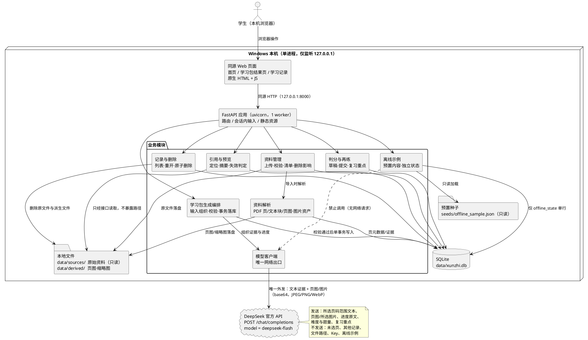
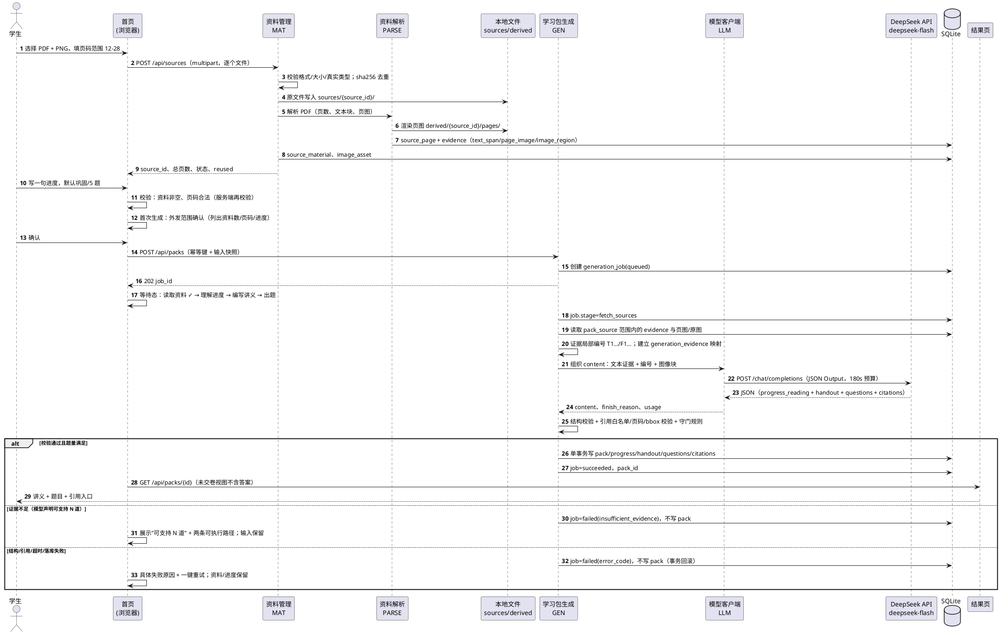
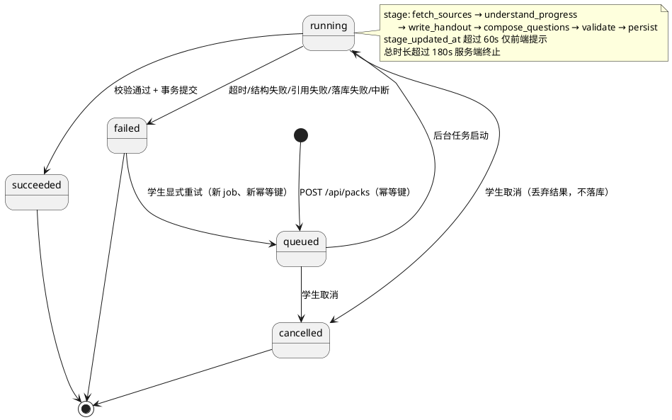
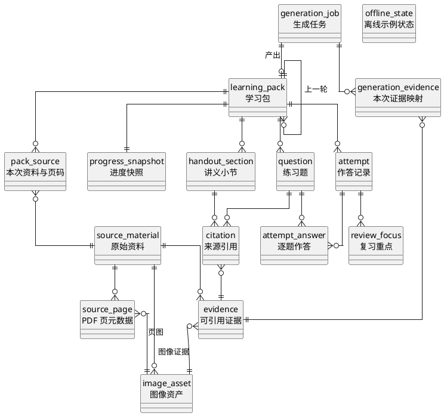

# 循知 · 软件体系架构与数据设计

| 项目 | 内容 |
| --- | --- |
| 产品名称 | 循知（暂名） |
| 文档名称 | 软件体系架构与数据设计 |
| 文档版本 | v1.0（第二阶段交付，待评审） |
| 需求基线 | `docs/01-软件需求规格说明书.md` v1.1（已定稿，唯一需求基线） |
| 基线范围 | FR-01～FR-10、C-01～C-06、第 8 章 D-01～D-03、7.1 的 29 条用例、7.2 两项人工验收方法 |
| 模型文档核对 | DeepSeek 官方 API 文档，核对日期 2026-11-20（核对记录见附录 B） |
| 交付边界 | 本阶段只交付设计文档、架构图、数据模型与接口契约；不交付实现代码 |
| 后续阶段 | 第三阶段：资料解析与图文模型接入；第四阶段：学习工作台与练习流程；第五阶段：系统测试与参赛交付 |

**本文件不重新决定任何已定稿产品决策。** 题量 3/5/8（默认 5）、难度仅「基础/巩固」（默认巩固）、学习包与原始资料分别删除、离线示例完整闭环且与真实记录隔离，均按需求文档第 8 章执行；本文件只回答"如何实现、数据如何落地、接口如何约定、如何验证"。

---

## 一、总体架构与运行方式

### 1.1 设计目标与约束

| 目标 | 架构上的落法 |
| --- | --- |
| Windows 上容易安装、启动、演示 | 单进程 Python 应用 + 原生网页，无 Node 构建、无数据库服务、无容器、无反向代理 |
| 个人单机、无账号 | 仅监听 `127.0.0.1`，SQLite + 本地目录，不做鉴权与多租户 |
| 一个 Key 支撑图文全流程 | 服务端唯一 `DEEPSEEK_API_KEY`，模型名固定 `deepseek-flash`，学生界面不出现任何模型参数 |
| 无 Key 也能完整演示 | 离线示例走独立状态表与预置 JSON，全程不触达模型客户端 |
| 引用必须可核对、可失效 | 资料只读 + 稳定 ID + 证据表；引用保存定位快照；删资料后按墓碑状态返回 410 与摘要 |
| 生成失败不产生半成品 | 单事务落库 + 生成任务状态机 + 幂等键；失败只留任务记录，不写学习包 |
| 一个人可在比赛周期内维护 | 技术栈限定为 Python/FastAPI/SQLite/PyMuPDF/Pillow/httpx/原生 JS，模块边界按"可替换、可假实现"划分 |

**不被采纳的方案及原因**（明确结论，避免中途摇摆）：

| 方案 | 不采纳原因 |
| --- | --- |
| React/Vue + Vite 前端 | 只有 3 个页面，引入 Node 工具链会让 Windows 首次启动多一步构建，演示环境风险高于收益 |
| PostgreSQL/MySQL | 单用户、数据量在数百 MB 内，独立数据库服务增加安装与排障成本 |
| Celery/Redis 异步队列 | 单机单用户无并发需求；进程内异步任务 + 数据库任务表足以支撑 180 秒等待与页面刷新恢复 |
| 客户端直接调用 DeepSeek | Key 会暴露在浏览器；且无法在服务端做引用白名单与落库校验 |
| 客户端 PDF.js 渲染 + 前端定位 | 文本抽取坐标、扫描页图像、图片区域三套坐标系难以统一；改为服务端统一渲染页图，前端只叠加归一化高亮框 |
| 向量数据库/RAG 检索 | 首版资料单次 ≤10 份、选中 ≤40 页，可整批送入 1M 上下文；引入检索会新增索引与召回评测负担，且引用归属更难校验 |
| 自动 OCR 服务（额外模型/接口） | 与"唯一 Key、最少配置"冲突；扫描页直接交给支持图像理解的 `deepseek-flash`，保留页图作为定位依据 |

### 1.2 总体架构图



**这张图回答三件事：**

1. **用户文件存到哪里**：原始文件在 `data/sources/{source_id}/`，页图与缩略图在 `data/derived/{source_id}/`，结构化数据在 `data/xunzhi.db`；全部在本机，删除由应用执行。
2. **哪些处理在本机完成**：格式校验、PDF 解析、文本块与坐标抽取、页面渲染、证据编号、结构校验、判分、删除、离线示例，全部本地完成。
3. **哪一步把哪些数据发给外部模型**：只有"学习包生成"一步，经模型客户端向 DeepSeek 发送本次所选资料范围内的文本证据、页图/图片（base64）、进度原文、难度与题量、确认后的复习重点；其他数据一律不出本机。

### 1.3 模块职责表

| 模块 | 负责什么 | 输入 | 输出 | 调用关系 | 明确不做什么 |
| --- | --- | --- | --- | --- | --- |
| 页面层（WEB） | 首页三动作、生成等待态、结果页、引用浮层、学习记录、离线示例入口；状态保留与键盘可达 | 用户操作、API 响应 | 表单草稿、页面状态、请求 | 只调用 API，不读文件、不读数据库、不持有 Key | 不做判分、不做引用定位、不拼模型请求 |
| 资料管理（MAT） | 6 种格式校验、大小/数量上限、去重、PDF 页码范围校验、资料清单、删除前影响统计、删除执行 | multipart 文件、页码范围、删除确认 | `source_material`、`image_asset`、影响清单 | 调解析模块；读写 DB 与文件系统 | 不生成讲义、不判分 |
| 资料解析（PARSE） | PDF 物理页解析、文本块与 bbox、页面渲染、扫描页判定、图片真实格式校验与尺寸、证据生成 | 原始文件 | `source_page`、`evidence`、页图文件 | 被资料管理调用；向生成模块提供证据 | 不调用模型、不做语义理解 |
| 学习包生成（GEN） | 组织本次输入、证据局部编号、调用模型、结构校验、引用归属校验、事务落库、失败分类 | 资料+页码、进度、难度题量、复习重点、上一轮包 | `learning_pack`、讲义、题目、引用、任务状态 | 调解析结果与模型客户端；写 DB | 不做自由聊天、不修改原始资料、不自动重复付费调用 |
| 模型客户端（LLM） | 唯一外发出口：拼装 content 块、base64 图片、超时、错误码映射、脱敏日志、用量记录 | 文本证据、图像证据、提示词 | 模型 JSON 文本、`finish_reason`、用量 | 只被生成模块调用 | 不做业务校验、不落库、不记录资料全文 |
| 引用与预览（CITE） | 引用元数据、页图/原图读取、命中高亮框、失效判定、文字替代 | `citation_id`、资料状态 | 预览 JSON、图像字节、410 状态 | 读 DB 与派生文件 | 不直接暴露静态文件路径 |
| 判分与再练（GRADE） | 草稿保存、提交判分、统计、重复提交幂等、错题转复习重点、再练候选 | 作答选择、`question.answer_index` | `attempt`、`attempt_answer`、`review_focus` | 读写 DB；调生成模块发起再练 | 不重新生成题目、不修改题库与讲义 |
| 记录与删除（REC） | 记录列表、重开恢复、学习包删除（级联）、原始资料删除编排、再练链展示 | 记录 ID、删除确认 | 列表视图、删除结果、墓碑状态 | 读写 DB；调资料管理删除 | 不删除原始资料（除非学生单独确认）、不跨包级联 |
| 离线示例（OFF） | 加载预置内容、独立的作答/再练/重置状态、持续标识 | 预置 JSON、示例操作 | 示例视图与判分结果 | 复用讲义展示/引用展示/判分逻辑；不调模型 | 不写 `learning_pack`/`attempt`，不发网络请求 |

**模块间调用规则**：页面层只走 HTTP；业务模块之间只通过服务函数与数据对象交互，不共享全局可变状态；模型客户端是唯一允许出网的组件；文件系统只由资料管理、解析、引用、记录四个模块访问，且都经存储层封装。

### 1.4 数据落位

| 内容 | 位置 | 说明 |
| --- | --- | --- |
| 结构化业务数据 | `data/xunzhi.db`（SQLite，WAL） | 资料元数据、证据、学习包、讲义、题目、引用、作答、复习重点、任务、离线状态 |
| 原始资料 | `data/sources/{source_id}/original.{ext}` | 只读保存，不改写；同名文件按 `source_id` 隔离 |
| PDF 页图 | `data/derived/{source_id}/pages/p{page:04d}.png` | 首次需要时渲染并缓存；删除资料时一并删除 |
| 图片缩略图 | `data/derived/{source_id}/thumbs/{asset_id}.jpg` | 列表与浮层预览用；原图仍是 `original` |
| 生成临时文件 | `data/tmp/{job_id}/` | 仅本次任务使用；任务结束或启动恢复时清理 |
| 离线示例内容 | `seeds/offline_sample.json` | 随程序分发的只读预置内容，带版本号 |
| 日志 | `data/logs/app.log` | 不含 Key、不含资料全文，只记 `source_id`/`job_id`/错误码 |
| 备份/导出 | 首版不提供 | 需求 1.9 已将导出列入后续版本 |

### 1.5 运行方式与三条路径

**启动方式**：双击 `run.bat`（内部创建/复用 `.venv`、安装 `requirements.txt`、执行 `python -m uvicorn app.main:app --host 127.0.0.1 --port 8000`，并打开默认浏览器）。不要求学生输入命令；部署者只需在同一目录的 `.env` 中写一行 `DEEPSEEK_API_KEY=...`。

**配置项（唯一必需项只有一个）**：

| 配置 | 必需 | 默认值 | 说明 |
| --- | --- | --- | --- |
| `DEEPSEEK_API_KEY` | 真实生成必需 | 空 | 只从服务端环境变量/`.env` 读取；不入库、不回显、不写日志 |
| `XUNZHI_DATA_DIR` | 否 | `./data` | 数据根目录，便于演示前清空或换盘 |
| `XUNZHI_MODEL` | 否 | `deepseek-flash` | 固定值，仅部署者可改；学生界面不出现 |
| `XUNZHI_GENERATE_TIMEOUT` | 否 | `180` | 生成硬超时（秒），对应 6.6 |
| `XUNZHI_STALL_HINT` | 否 | `60` | 无阶段进展提示阈值（秒），仅前端提示 |
| `XUNZHI_MAX_SOURCES` / `XUNZHI_MAX_PAGES` | 否 | `10` / `40` | 与 6.6 建议值一致 |
| `XUNZHI_MAX_TOTAL_MB` / `XUNZHI_MAX_PROGRESS_CHARS` | 否 | `150` / `500` | 单次总大小与进度描述长度上限；单文件上限按类型内置（PDF 50 MB / 图片 20 MB / 文本 5 MB） |
| `XUNZHI_HOST` / `XUNZHI_PORT` | 否 | `127.0.0.1` / `8000` | 默认只监听本机 |

不提供温度、最大长度、模型选择等配置项：它们既属于需求 4.1 明确禁止的学生可见项，也会扩大演示环境的配置面。

#### 路径 1：首次启动（无数据库、无 Key）

1. 进程启动，计算 `data/` 绝对路径，创建 `sources/`、`derived/`、`tmp/`、`logs/`。
2. 打开 SQLite（`journal_mode=WAL`、`foreign_keys=ON`、`busy_timeout=5000`），执行 `schema.sql` 建表；`app_setting.schema_version` 不存在则写入当前版本。
3. 执行启动恢复：`generation_job` 中 `queued/running` 的任务改为 `failed(interrupted)`；扫描 `data/tmp/` 与无数据库记录的 `sources/` 孤儿目录并清理（只清理本次启动前遗留、且无 `source_material` 记录的目录）。
4. 读取 `DEEPSEEK_API_KEY`：为空则 `GET /api/settings/model-status` 返回 `configured=false`；首页真实生成按钮禁用，说明"未配置模型密钥，可先用离线示例体验完整流程"。
5. 加载离线示例种子（校验 `seed_version`），初始化 `offline_state` 单行（若不存在）。
6. 首页可用：资料上传可用（本机处理），离线示例入口可用，真实生成不可用。不产生任何网络请求。

#### 路径 2：无 Key 体验离线示例

1. 学生点击「使用离线示例体验」→ `GET /api/offline/sample` 返回预置讲义、题目、引用（**不含答案与解析**）。
2. 页面在顶部显示不可随滚动消失的"离线示例"横幅；结果页、记录列表入口同样带标识。
3. 学生阅读讲义、点引用（预置图片区域与文本片段）、选择、提交 → `POST /api/offline/attempts` 由本地判分逻辑判分并返回答案、解析、引用。
4. 答错后点「针对错题再练」→ `POST /api/offline/retry` 按考点从预置题库选下一轮题，更新 `offline_state.round_no`。
5. 全对时返回完成反馈，不再提供再练入口；`POST /api/offline/reset` 将 `offline_state` 恢复初始值。
6. 全程不读取 Key、不调用模型客户端、不发起任何网络请求（可用断网 + 服务端请求日志验证，见 UC-20/UC-29）。

#### 路径 3：配置 Key 后的真实生成

1. 部署者在 `.env` 写入 `DEEPSEEK_API_KEY`，重启应用；`model-status` 返回 `configured=true`（只返回布尔值）。
2. 学生上传资料 → 解析完成，资料清单显示文件名、格式、大小、PDF 总页数与本次页码范围。
3. 学生写进度、选难度与题量 → 首次点生成弹出一次外发确认（列出资料数量、页码范围、进度原文摘要）；确认后本次会话不再重复。
4. 前端生成 `idempotency_key`，`POST /api/packs` 返回 `202 + job_id`；页面进入分阶段等待态，轮询 `GET /api/jobs/{job_id}`。
5. 服务端组织证据与提示词 → 模型客户端单次请求 `deepseek-flash` → 校验结构与引用归属 → 单事务写入学习包 → 任务 `succeeded`。
6. 前端跳转结果页；若失败，任务记录 `error_code`，首页表单草稿与资料全部保留，可一键重试（新任务、新幂等键）。
7. 学生作答、提交、再练；每次再练都是新学习包，旧包与旧作答保留。

### 1.6 技术选型结论

| 层 | 选型 | 结论与理由 | 放弃项 |
| --- | --- | --- | --- |
| 运行时 | Python 3.12 | 与 PDF/图像生态匹配，Windows 安装简单；比赛周期内一人可维护 | Node 全栈（前端构建 + 后端双语言） |
| Web 框架 | FastAPI + Uvicorn（单 worker） | 同源提供 API 与静态页；Pydantic 直接承担请求/响应的强类型契约；单 worker 规避 SQLite 多写竞争 | Flask（需额外类型校验）、Django（过重） |
| 持久化 | SQLite 3（WAL）+ SQLAlchemy 2.0 ORM | 零安装、单文件、事务可靠；ORM 负责关系与级联，启动时 `create_all` + `schema_version` 迁移 | 独立数据库服务、内存数据库（无法满足"隔天回来"） |
| PDF 解析 | PyMuPDF（fitz） | 一次依赖同时提供文本块 bbox、页面渲染、页数、图片提取，是"一个人在比赛周期内"成本最低的方案；许可证为 AGPL-3.0，本项目按开源参赛交付可接受；若后续闭源，替换点为 `infra/pdf_engine.py`（改 pypdfium2） | pypdf + poppler（两套依赖、坐标处理更繁琐） |
| 图片处理 | Pillow | 校验真实格式（防扩展名伪装）、读取尺寸、生成缩略图、WebP 支持 | 前端压缩（无法在服务端做格式与安全校验） |
| 模型调用 | httpx（同步客户端 + 显式超时） | 单一 HTTP 出口，便于统一处理 401/402/429/5xx、`finish_reason`、请求体大小与脱敏日志；无需额外 SDK 版本跟踪 | OpenAI SDK（多一层版本耦合，收益有限） |
| 模型 | `deepseek-flash`（DeepSeek-V4.1-Flash-1017） | 官方文档确认同时支持文本与图像理解、JSON Output、1M 上下文、384K 输出；单模型即可覆盖进度理解、图文理解、讲义与出题（核对记录见附录 B） | 双模型/多供应商（违反 FR-10） |
| 前端 | 原生 HTML + ES Module JS + CSS；Jinja2 仅注入启动配置 | 无构建、刷新快、同源；三个页面与一个浮层的交互复杂度可控；键盘与焦点行为可直接控制 | 前端框架、组件库 |
| 任务执行 | 进程内 `asyncio` 任务 + `generation_job` 表 | 满足 180 秒等待、刷新恢复、取消与启动恢复；无外部队列依赖 | Celery/Redis、线程池 + 内存状态 |
| 测试 | pytest + httpx TestClient + 固定 fixture | 解析、校验、判分可脱离 Key 单测；离线示例可端到端跑通 | 依赖真实网络的自动化测试（改为手动 smoke） |

**并发与一致性约定**：Uvicorn 固定 1 worker；SQLite 写操作全部走短事务（`BEGIN IMMEDIATE`），读多写少；文件写入先写临时文件再 `os.replace` 原子改名；删除采用"先改数据库状态、后删文件、失败登记重试"的顺序。

---

## 二、从资料到学习包的完整链路

### 2.1 端到端时序图



**时序说明（与需求用例对应）**：

- 上传阶段一次只处理一个文件，失败只影响该文件（UC-02、UC-19）。
- 解析在导入时完成，生成阶段不再重新解析，保证 180 秒预算主要留给模型（UC-01）。
- 模型返回后先校验再落库，"失败不写学习包"从流程上消除半成品（UC-18）。
- 未交卷视图不返回 `answer_index` 与 `explanation`（AC-07.2）。

### 2.2 稳定标识与资料复用（问题 1）

**本地稳定标识**

| 对象 | 标识 | 生成时机 | 稳定性 |
| --- | --- | --- | --- |
| 原始资料 | `src_` + ULID | 上传校验通过、文件原子落盘后 | 永久不变；删除后行保留为墓碑，ID 不复用 |
| 证据 | `ev_` + ULID | 解析该资料时逐条生成 | 与该资料同生命周期；同一资料被多次使用仍是同一 ID |
| 学习包 | `pack_` + ULID | 生成校验通过后 | 永久不变 |
| 讲义小节 / 题目 / 引用 / 作答 | 各自前缀 + ULID | 落库时 | 永久不变 |
| 生成任务 | `job_` + ULID | 学生点击生成时 | 一次点击一个；重试生成新任务 |

不使用文件名、路径、页码或内容哈希作为主键：文件名可重复、可修改，页码只在某次生成内有意义。内容哈希（`sha256`）只用于"是否同一文件"的判定与复用提示。

**同一份资料被多个学习包复用的机制**

1. 上传时计算 `sha256 + size`，在 `source_material` 的活动记录中查找；命中则直接复用同一 `source_id`，返回 `reused=true`，不重复落盘、不重复解析。若命中的资料已在**本次清单**中，前端按 `source_id` 去重，提示"该文件已在本次资料中"并不重复加入（AC-01.5）；跨会话再次上传同一文件则复用同一资料，其删除会影响所有引用它的学习包（界面按"被 N 个包引用"提示，见 3.3）。
2. 学习包与资料通过 `pack_source` 关联，只记录"这次用了哪份资料、页码范围是多少"，不复制资料内容。
3. 引用通过 `evidence_id` 指向资料内证据；同一份资料被 10 个学习包引用，仍只有一份原文件、一套证据。
4. 每次生成把页码范围写入 `pack_source`，因此"同一份 PDF、第 12–28 页"与"同一份 PDF、第 1–10 页"可以是两个互不影响的包（C-01、C-02 的落地方式）。
5. 删除资料时按 `source_id` 删除一次原文件与派生文件；所有包的引用通过该 ID 同时失效，不需要逐包处理（见第三章）。

**为什么不用"上传时间 + 文件名"**：同名课件在不同章节很常见，按名字去重会把两份不同内容误判为同一份；哈希只回答"字节是否相同"，不承担业务身份。

### 2.3 PDF 页码、文本与图像的对应关系（问题 2）

**坐标基准**：所有页内位置统一使用"归一化页面坐标"——以页面左上角为原点，`x/y/w/h` 取值 `0..1`，与渲染分辨率无关。前端页图按容器宽度等比缩放后，直接用 `left = x * 显示宽` 定位高亮框；缩放、200% 浏览器缩放都不会破坏对应关系（Q-08）。

**物理页码**：`page_no = PyMuPDF 页索引 + 1`，即 PDF 阅读器显示的页序，不使用教材印刷页码、不使用 PDF 页标签（`page labels`）。`source_material.page_count` 与 `source_page.page_no` 都以该口径为准（AC-01.2、AC-01.3）。

**一张页面的解析结果**

| 页面类型 | 判定 | 文本证据（`text_span`） | 图像证据 | 引用落点 |
| --- | --- | --- | --- | --- |
| 纯文字页 | 可抽取字符数 ≥ 阈值，且页面无有效图像块 | 按文本块生成，记录 `page_no`、`block_no`、归一化 `rects`、`quote_text`、前后上下文 | 仍渲染页图，供浮层展示与高亮；默认不作为图像证据发给模型（省 token） | 文本片段：页图 + 高亮框；`page_no` 必填 |
| 含矢量图的页面 | 文本可抽取，页面绘制路径或图像块存在 | 同纯文字页 | 生成整页 `page_image` 证据（矢量图无法可靠切出独立位图，整页渲染最稳）；`label_text` 由模型读图后回填 | 文本落点或整页图落点；区域框由模型输出的 `box_2d` 换算 |
| 嵌入位图的页面 | 页面含可提取的位图对象 | 同纯文字页 | 提取该位图为 `image_region`（`image_asset.kind=pdf_image`），同时保留整页图 | 位图区域或整页；两者都有同一页坐标系 |
| 扫描页 | 可抽取字符数低于阈值，且页面大部分被图像覆盖 | 不生成文本证据（宁可没有，也不生成乱码） | 整页 `page_image`，标记 `is_scanned=true`，引用按图像定位 | 按图像定位；浮层标注"该页为扫描页，按图像定位"（AC-06.5） |

**对应关系的存储**：`source_page` 保存该页的 `char_count`、`has_text`、`is_scanned`、`page_image_asset_id`；每条证据保存 `source_id + page_no + locator_json`；引用（`citation`）保存生成时的 `locator_json` 快照与 `quote_snapshot`。三层都带 `page_no`，所以"文本片段—页图—引用"可以通过页码和归一化坐标互相对应，不依赖运行时的 OCR 结果。

**渲染参数**：页图长边不超过 1600 px（A4 约 150 dpi），PNG 输出；单页文件通常 150–600 KB。选择 PNG 而非 JPEG，是为了保证小字标注（如 `192.168.2.0/24`）在模型读图与前端高亮时都不糊。页图在首次被引用或首次生成时渲染并缓存，避免导入 40 页时长时间阻塞。

**文字与图的关系**：讲义中的图文解释段落可同时挂两类引用——文本证据指向 PDF 页的段落，图像证据指向拓扑图区域；前端浮层按引用类型分别展示，不把"图的区域"错误地画到 PDF 页上。

### 2.4 页码范围如何变成硬约束（问题 3）

以学生选择 PDF 第 2–4 页为例，约束在五个位置逐层生效：

| 层 | 做法 | 失败表现 |
| --- | --- | --- |
| 上传/表单 | 前端与 `POST /api/packs` 双重校验：`1 ≤ start ≤ end ≤ page_count`，且 `end - start + 1 ≤ 40`；不合法直接拒绝，不创建任务 | 输入标红，生成按钮不可用（AC-01.3） |
| 任务快照 | 创建任务时把 `sources:[{source_id, page_start, page_end}]` 写入 `job.request_json`，后续步骤只读这份快照 | 任务创建后表单再变也不影响本次生成 |
| 证据装配 | `SELECT ... FROM evidence WHERE source_id=? AND page_no BETWEEN ? AND ?`，只取范围内证据；渲染页图也只渲染范围内页 | 范围外证据根本不会进入提示词 |
| 模型请求 | 提示词中显式声明"可用证据仅限 T1…/F1…，不得引用清单外内容"；PDF 只发送范围内页图/文本，不发送整份文件 | 模型没有范围外内容可读 |
| 返回校验 | 每条引用的 `local_ref` 必须存在于本次 `job` 的 `generation_evidence` 映射；`page_no` 必须落在该资料的 `pack_source` 区间；bbox 必须在 `0..1` | 不满足即该条引用无效；题目引用为 0 时整题不合格 |

**双重保险的意义**：第 4 层减少模型"看到范围外内容"的可能，第 5 层保证即使模型编造页码或引用编号，也不会进入学习包。前者是提示词约束（概率性），后者是程序约束（确定性），验收以第 5 层为准。

第 2–4 页被选中时，模型实际收到的内容 = 第 2、3、4 页的文本证据（若有）+ 第 2、3、4 页的页图（含图/扫描页）+ 本批图片；最终可引用的内容 = 这五层过滤后仍存在的证据。两者是同一集合的两个视角，不存在"模型多看了几页但界面不显示"的情况。

### 2.5 一次生成的输入如何组织（问题 4）

**输入快照（`job.request_json`）**

| 部分 | 内容 | 来源 | 缺失时 |
| --- | --- | --- | --- |
| 资料清单 | `source_id`、显示名、类型、页码范围、页数、图片尺寸 | `pack_source`/`source_material` | 资料为空：拒绝生成 |
| 证据清单 | 文本证据全文（按页序、块序）、图像证据元信息与标签 | `evidence` | 范围内无证据：直接失败并提示补充页码 |
| 学习进度原文 | 学生原话（≤500 字，超出拒绝并提示压缩） | 表单 | 为空：按钮禁用；<6 字或无效表达：标记 `insufficient` |
| 练习设置 | `difficulty`（basic/consolidate）、`question_count`（3/5/8）、题型固定单选 | 表单，默认巩固/5 | 未填用默认值（AC-02.2） |
| 上一轮上下文 | 仅再练时：上一轮题目题干、错题考点与解析摘要、学生确认后的复习重点 | `review_focus` | 缺复习重点：拒绝再练 |
| 生成来源 | `real` | 系统 | 离线示例不走此流程 |

**提示词组织（单次请求，四段）**

1. **系统段**：角色与硬规则——只使用给定证据；讲义四部分顺序固定；已学略写、未学不展开；每题 4 个互异选项、唯一答案、至少 1 条引用；引用只能写清单中的编号；输出必须是 JSON；以学习进度为准，难度不得突破进度。
2. **学生输入段**：进度原文（原样引用，不做改写）、难度、题量、资料页码范围、复习重点。
3. **证据段**：文本证据按 `[T1] 文件｜第 N 页｜原文…` 排列；图像证据先给"图 F1｜文件名｜尺寸｜可见标签候选"，再紧跟图像块。
4. **输出契约段**：给出 JSON 结构样例与字段含义（不写业务代码），要求先输出 `progress_reading`，再输出 `handout` 与 `questions`，最后输出 `insufficient_evidence`（无缺口时为 `null`）。

**只写一句自然语言也成立**：模型在同一个 JSON 里先产出 `progress_reading`（`learned/unlearned/weak_points/intent` 四个数组，允许空数组），再据此生成内容。程序不要求四项齐全，只做三件事：

- 四个字段必须存在且为数组（类型校验）；
- 原文少于 6 个汉字或命中无效表达表（"不会/不懂/随便/帮我复习一下"）时，强制 `insufficient=true`，结果页顶部标注"本次进度描述信息不足，已按资料全范围生成"（UC-06、E-01）；
- 若 `progress_reading` 为空但资料证据充足，仍允许生成，范围声明必须写明"按资料全范围"。

这样"一句话"与"结构化四项"共用同一流程，不需要学生填表，也不需要额外一次模型调用。

**再练输入**：`parent_pack_id` + 复习重点（学生编辑后的最终文本）+ 沿用资料/页码；同时把上一轮题干摘要（规范化后的题干哈希集合）放入提示段，要求"不得与上一轮题干相同或仅换选项顺序"，作为生成约束与落库前查重依据（AC-08.4）。

### 2.6 证据编号与图文同请求（问题 5）

**编号规则**

| 类型 | 格式 | 示例 | 说明 |
| --- | --- | --- | --- |
| 文本证据 | `T` + 序号 | `T1`、`T7` | 本次请求内顺序编号，按资料顺序、页序、块序 |
| 图像证据（独立图片） | `F` + 序号 | `F1` | 如 `网络拓扑.png` |
| PDF 页图 | `P` + 本次任务内页图序号 | `P1`、`P2` | 跨资料唯一；真实物理页码以 `page_no` 与资料文件名/页码为准，不从短号推导 |
| PDF 页内位图 | `I` + 序号 | `I2` | 需要单独定位嵌入图时使用 |

编号只在一个 `job` 内有效，写入 `generation_evidence(job_id, local_ref, evidence_id)`。模型输出中的 `citations[].ref` 只能取这些值；落库时把 `local_ref` 换成稳定的 `evidence_id`，并把 `local_ref` 留在 `citation.local_ref` 供审计。界面永远展示稳定引用，不展示 `T1`。

**图像与编号如何进入同一请求**

```json
{
  "model": "deepseek-flash",
  "messages": [
    { "role": "system", "content": "……只可使用下列证据；输出 JSON……" },
    { "role": "user", "content": [
        { "type": "text", "text": "【文本证据】\n[T1] 计算机网络.pdf｜第16页｜交换机根据目的 MAC 地址在同一网段内转发……\n[T2] 计算机网络.pdf｜第17页｜……\n【图像证据清单】F1=网络拓扑.png；P16=计算机网络.pdf 第16页（含矢量图）" },
        { "type": "text", "text": "【图 F1】网络拓扑.png｜1200×800｜可见标签：PC-A、PC-C、PC-B、SW1、R1、192.168.1.0/24、192.168.2.0/24" },
        { "type": "image_url", "image_url": { "url": "data:image/png;base64,<F1_BASE64>", "detail": "original" } },
        { "type": "text", "text": "【图 P16】计算机网络.pdf 第16页（含矢量图，整页）" },
        { "type": "image_url", "image_url": { "url": "data:image/png;base64,<P16_BASE64>", "detail": "original" } },
        { "type": "text", "text": "【任务】难度=巩固；题量=5；进度原文=……；请输出 JSON。" }
      ] }
  ],
  "response_format": { "type": "json_object" },
  "max_tokens": 12000,
  "thinking": { "type": "disabled" }
}
```

约定：

- **编号块紧邻图像块**：每个图像块前都有一个只描述该图的文本块，形成"编号—图像"配对；不使用"一串图后统一编号"，避免模型错配。
- **同一请求**：文本证据与图像证据在同一个 `user` 消息的 `content` 数组中，模型能在一次推理中同时看到文字与图，满足 FR-04 的"文字识别 + 关系理解"。
- **`detail=original`**：拓扑图与 PDF 页图需要读小字与连线，不用 `low`（会把图缩到 512×512，标注易丢失）。
- **图片预处理**：长边 ≤1600 px、单图 ≤2 MB；PNG 用于页图与含小字截图，JPEG 用于照片类图片；WebP 直接按原格式传（官方支持）。发送前用 Pillow 校验真实格式，扩展名与内容不符的资料在导入阶段已被拒。
- **JSON Output**：`response_format={"type":"json_object"}`，系统提示含 `json` 字样并给结构样例；`max_tokens` 按题量设置（3 题 8000、5 题 12000、8 题 16000），防止截断。
- **思考模式**：`thinking={"type":"disabled"}`。生成任务有 180 秒硬超时，结构化输出不需要长链思考；关闭后可显著降低首字延迟。若后续评测发现讲义质量不足，可在不改接口的前提下改为 `enabled`（仅部署者配置，不对学生暴露）。

**为什么另一学习包的合法编号不能直接用**：编号是"本次请求的局部命名空间"，`T1` 在不同 `job` 中指向完全不同的证据。服务端校验时以 `(job_id, local_ref)` 查映射，若把另一包的 `T1` 塞进本次结果，要么映射不存在（拒绝），要么映射到本次另一条证据（语义错位）。因此落库前必须换回 `evidence_id`，并在 `pack_source` 范围内二次校验，双重阻断跨包引用。

**模型与接口核对结论（核对日期 2026-11-20）**

| 核对项 | 官方文档结论 | 本设计采用 |
| --- | --- | --- |
| 图文模型 | `deepseek-flash` 支持图像理解；由 DeepSeek-V4.1-Flash-1017 提供服务；旧名 `deepseek-v4-flash-vision-exp` 已下线但仍被路由到 Flash | `deepseek-flash`，全系统唯一模型名 |
| 接口 | OpenAI 兼容 `POST https://api.deepseek.com/chat/completions`；也支持 Anthropic 与 Responses API | 选 OpenAI 兼容 chat completions（生态最通用） |
| 图片传法 | base64 data URL、公开 URL、Files API `file_id` 三种 | base64 内联（本地文件，无需公网 URL，也无需额外上传步骤） |
| 内容块 | `content` 为块数组；图片块 `{"type":"image_url","image_url":{"url":"data:image/png;base64,...","detail":"original"}}` | 文本块 + image_url 块混排，编号紧邻图像 |
| 图片格式 | JPEG、PNG、GIF、WebP，按文件实际内容判断 | JPEG/PNG/WebP（与 FR-01 一致）；GIF 不在需求范围，不接收 |
| 图片限制 | 请求体 48 MiB；inline 单图 32 MiB；单请求最多 600 张；单图 token 上限约 1024；长边 8192 px（≥15 张时 4096） | 单图 ≤2 MB、长边 ≤1600 px、单次 ≤50 张，远低于上限 |
| 结构化输出 | `response_format={"type":"json_object"}` 保证合法 JSON；提示词必须含 `json` 与样例；`finish_reason=length` 表示截断 | 强制 JSON + 结构校验 + 截断即失败 |
| 上下文/输出 | 上下文 1M，单次输出最大 384K | 40 页文本 + 50 图约 80K tokens，余量充足 |
| 思考模式 | 支持思考/非思考，默认开启 | 生成任务关闭（延迟优先），保留配置开关 |

> 核对来源：`https://api-docs.deepseek.com/zh-cn/guides/vision`、`/zh-cn/api/create-chat-completion`、`/zh-cn/guides/json_mode`、`/zh-cn/quick_start/pricing`、`/zh-cn/quick_start/models`，核对日期 2026-11-20。若官方能力或模型名变更，只改模型客户端与本文附录 B，不改变上层契约。

### 2.7 模型返回后如何校验（问题 6）

**两层校验，边界清楚**

| 层 | 能验证什么 | 验证手段 | 失败处理 |
| --- | --- | --- | --- |
| 程序可验证（结构正确性） | JSON 合法、字段齐全、类型正确；讲义四部分与条数；题量等于选择值；4 个选项互异；答案索引唯一且在 0–3；每题 ≥1 条引用；引用编号属于本次映射；页码在范围内；bbox 在 0–1；题干不重复；再练题不与上一轮重复 | Pydantic 模型 + 纯函数校验器 + SQL 白名单查询 | 整体失败（不落库）或该题不合格；给出具体字段与原因 |
| 程序可弱校验（启发式） | 设备名/网段是否出现在图像标签或 PDF 文本中；场景 B 是否出现未学机制词（MAC 地址表、ARP、OSPF 等）；范围声明是否包含"不覆盖"项 | 词表比对 + 正则 + `concept_guard` 规则 | 命中即判不合格；重生成或提示补充资料 |
| 只能靠样例评测/人工（内容正确性） | 讲解是否正确、引用是否真的支持结论（L3）、难度是否贴合、两份讲义差异 ≥5 处 | 7.2 参考方法一/方法二；固定样例回归集；项目负责人可选自查 | 参考抽查判定不合格时记录问题样例；不伪装成程序保证 |

**结构校验清单（逐条对应验收条件）**

| 编号 | 检查 | 失败后的处理 |
| --- | --- | --- |
| V-01 | 顶层字段：`progress_reading`、`handout{scope,key_points,pitfalls,visual}`、`questions[]`、`insufficient_evidence` | 整体失败 `invalid_structure`（X-07） |
| V-02 | 讲义四部分顺序固定；范围声明覆盖/不覆盖各 2–5 条；要点 3–6 条；易错 2–4 条；图文解释 ≥1（资料含图时） | 整体失败 `handout_incomplete`（AC-03.1） |
| V-03 | 讲义总字数 800–1800（可配置）；已学段占比、薄弱点段占比由模型标注 `section_role` 计算，超阈值记为"内容告警"交人工复核，不直接判死 | 告警 + 人工（H-2/H-4 属内容正确性） |
| V-04 | `questions.length == question_count`；`ordinal` 连续唯一 | 少于要求且 `insufficient_evidence` 有值 → 转"资料不足"；否则失败（AC-05.1） |
| V-05 | 每题选项恰好 4 个，`key` 为 A–D，文本去空白后互异 | 该题不合格；全部失败则不落库（AC-05.1） |
| V-06 | 每题 `answer_index ∈ 0..3`，且只有一个；`explanation` 非空且不是"见教材第 X 页"式 | 该题不合格 |
| V-07 | 每题 `citations.length ≥ 1`；每条 `ref` ∈ 本次映射；`page_no` ∈ 该资料范围；bbox 四值在 0–1 且面积 > 0 | 该题引用无效 → 该题不合格（AC-05.2、X-06） |
| V-08 | 讲义每个要点/易错段 `citations.length ≥ 1`；无引用的段落必须 `is_extension=true` | 段落不合格；范围声明缺失则整体失败（AC-03.3） |
| V-09 | 题干规范化后不重复；再练时与上一轮题干哈希集合无交集、选项顺序归一化后不相同 | 重复题替换（AC-05.5、AC-08.4） |
| V-10 | 图像标签与正文专名比对：正文中的设备名/CIDR 若不在（该图 labels ∪ 本次 PDF 文本词表）中 → 标记 `unknown_entity` | 该条内容/该题不合格（AC-04.2 的弱校验） |
| V-11 | `image_dependency=required` 的题，其图像证据 `confidence` 必须为 `high` | 该题不合格（AC-04.5） |
| V-12 | `concept_guard`：进度理解把某概念标为未学/资料范围外时，正文出现该概念机制词 → 命中 | 整体失败 `out_of_scope`，提示缩小范围或补资料（AC-S3、AC-05.4） |

**"资料不足"与"生成失败"的区分**：模型可在 JSON 中返回

```json
"insufficient_evidence": {
  "supportable_question_count": 3,
  "reason": "所选第 2–4 页仅覆盖交换机简介，未涉及跨网段",
  "suggested_pages": [12, 28]
}
```

程序据此返回"当前资料在本次进度范围内只能支持 N 道有依据的题"，并给两条路径：改为 N 道，或补充资料/扩大页码（AC-05.3）。这不是失败，不显示"生成失败"，也不写入残缺学习包。

**引用不存在/越界的处理**：不静默丢弃后照常展示。规则是"引用无效 → 该题不合格 → 若剩余题量不足，则按资料不足处理"。任何情况下不允许出现"题目还在、引用没了"的卡片（X-06、AC-06.4）。

**输出截断**：`finish_reason != "stop"` 或 JSON 解析失败 → 整体失败 `output_truncated`。不自动重试付费接口，前端展示"本次生成结果不完整，已保留输入"，由学生点击重试。

**为什么不校验"答案是否真的正确"**：单选题答案由模型生成，程序只能保证"答案索引合法、唯一、有引用"，不能保证"这个答案在学科上正确"。后者由 7.2 的引用支持度与讲义贴合度人工验收，以及固定样例回归覆盖。文档与实现都不得把结构校验通过说成"内容正确"。

### 2.8 生成成功的判定与失败隔离（问题 7）

**成功的定义（四个条件同时满足）**

1. 任务状态为 `succeeded`；
2. 学习包与其讲义、题目、引用在**同一个 SQLite 事务**中提交完成，且提交后读回校验题量、引用数一致；
3. 每条引用都通过范围与白名单校验；
4. 学生端能通过 `GET /api/packs/{id}` 打开完整内容。

任一条件不满足，学习包不存在，任务为 `failed`，数据库中没有"半个学习包"。

**任务状态机**



**重复点击 / 页面刷新 / 超时 / 写库失败的隔离**

| 情形 | 机制 | 结果 |
| --- | --- | --- |
| 快速重复点击"生成" | 前端在输入未变时复用同一 `idempotency_key`；服务端 `generation_job.idempotency_key` 唯一约束，命中则返回已有 `job_id` | 只产生一个任务、一次模型计费 |
| 生成中刷新/关闭页面 | 任务在服务端继续；`job_id` 与表单草稿存 `localStorage`；重开后 `GET /api/jobs/{id}` | 完成则进结果页；中断则显示"上次生成未完成"并给重试 |
| 应用重启 | 启动恢复把 `queued/running` 改为 `failed(interrupted)`；清理 `tmp/{job_id}` | 不留下永久"生成中"；可重试 |
| 超过 180 秒 | 服务端 `asyncio.wait_for` 终止，任务 `failed(timeout)`；已发出的请求无法撤回，但结果丢弃 | 无学习包写入；提示缩小页码/题量 |
| 模型 401/402/429/5xx | 模型客户端映射为 `auth_error`/`quota_error`/`rate_limited`/`upstream_error`；只对 429/5xx 做一次短退避重试（≤2 秒，仍在预算内） | 失败可重试；不产生重复记录 |
| 结构校验失败 | 不重试模型，任务 `failed(validation_error)`，保存脱敏原因 | 输入保留，学生可调整后重试 |
| 写库失败 | 单事务回滚；任务 `failed(persist_error)`；已渲染页图保留（可复用），无 pack 记录 | 无半成品；重试不重复解析 |
| 存储空间不足（X-09） | 捕获 `SQLITE_FULL`/`OSError`，任务 `failed(storage_full)`；启动时检查数据目录可写 | 提示"存储空间不足，可删除部分历史记录后重试"，不写残缺记录 |
| 落盘成功、写库失败（资料导入） | 原文件已原子落盘但 `source_material` 未写入 → 该目录成为孤儿；启动扫描清理，或本次请求立即回滚删除 | 不出现"文件在、记录不在"的长期残留 |
| 写库成功、落盘失败（资料导入） | 不可能发生：先落盘成功再写库；落盘失败直接返回错误，不写库 | 不出现"记录在、文件不在"；若用户手工删文件，则标记 `missing` 并让引用失效 |
| 学生取消 | 任务 `cancelled`；结果若已返回则丢弃；已选输入全部保留 | 不回首页空白，不产生记录 |

**事务边界**：`generation_job` 的创建是独立短事务（保证幂等键立即可见）；模型调用期间不持有任何数据库写锁；校验完成后用一个 `BEGIN IMMEDIATE` 事务写入 `learning_pack + progress_snapshot + handout_section + question + citation`，并更新 `job=succeeded, pack_id`，一次提交。这样"任务成功"与"内容存在"永远一致。

**为什么不自动重试模型**：每次调用都计费，且失败原因多为输入问题（页码太窄、证据不足、进度冲突）。自动重试只会把同一错误重复付费。首版只对 429/5xx 做一次短退避，其余交给学生显式重试。

---

## 三、引用与删除设计

### 3.1 一条引用的全链路追踪

以"讲义第 2 节引用《网络基础.pdf》物理第 3 页的一张拓扑图"为例。这条引用属于**图像区域**类型：它指向 PDF 第 3 页渲染图上的一块区域，而不是整个文件。

**链路（从原资料到界面）**

| 步骤 | 发生什么 | 写入/读取的数据 |
| --- | --- | --- |
| ① 导入 | 学生上传《网络基础.pdf》；服务端分配 `src_01J8...`，文件写到 `data/sources/src_01J8.../original.pdf`；解析得到总页数 40，第 3 页判定为"含矢量图页" | `source_material(src_id, page_count=40, status=active)` |
| ② 建页图 | 第 3 页渲染为 `data/derived/src_01J8.../pages/p0003.png`（1240×1754），登记为图像资产 | `source_page(source_id, page_no=3, has_text=true, page_image_asset_id=ast_...)`；`image_asset(ast_..., kind=pdf_page_render, rel_path=..., width=1240, height=1754)` |
| ③ 建证据 | 解析器把"第 3 页拓扑区域"登记为可引用证据：页码 3、资产 ID、归一化区域（示例 `[0.42,0.18,0.86,0.62]`）、图中可见标签（`PC-A、SW1、R1、192.168.1.0/24`） | `evidence(ev_..., source_id, kind=image_region, page_no=3, locator_json={asset_id, boxes}, label_text=..., confidence=high, status=active)` |
| ④ 生成前 | 学生本次选第 2–4 页且包含这张图；证据装配只取第 2–4 页证据，给该页内区域分配本次短编号 `I1`（若作为本次第 1 张整页页图则为 `P1`；真实页码仍是 `page_no=3`） | `generation_evidence(job_id, local_ref='I1', evidence_id=ev_...)` |
| ⑤ 模型返回 | 模型输出 `{"ref":"I1","boxes_2d":[[420,180,860,620]],"claim":"PC-A 与 PC-C 同接 SW1"}`（0–1000 整数坐标） | 无写入；只在内存校验 |
| ⑥ 校验换算 | `ref` 命中本次映射；`page_no=3` 在 2–4 内；四值均在 0–1000；除以 1000 得归一化框并 clamp 到 `[0,1]` | 失败则不落库（见 2.7） |
| ⑦ 落库 | 引用写入：归属讲义第 2 节、指向 `ev_...`、保存页码/区域/摘要快照与本次短编号 | `citation(cit_..., pack_id, owner_type=section, owner_id=sec_..., evidence_id=ev_..., source_id=src_..., page_no=3, locator_json={boxes:[0.42,0.18,0.86,0.62]}, quote_snapshot='...', claim_text='...', local_ref='I1')` |
| ⑧ 前端取结果 | `GET /api/packs/{id}` 的讲义段落带 `citations:[{id, kind:'image_region', label:'第 3 页 · 区域 1 / 1', source_name:'网络基础.pdf', source_status:'active', text_alternative:'拓扑图：PC-A 与 PC-C 连接至 SW1'}]` | 只读 `citation` + `source_material.status` |
| ⑨ 点击引用 | `GET /api/citations/{cit_...}` 返回预览：页码 3/40、区域框、摘要、`asset_url=/api/citations/{id}/asset`；浮层显示第 3 页页图并叠加高亮框，可放大；关闭后焦点回到触发元素 | 读 `citation`、`evidence`、`image_asset`、`source_material` |
| ⑩ 取图像 | `GET /api/citations/{id}/asset` 校验包未删、资料未删后，以流返回 `p0003.png`，`Cache-Control: no-store` | 读派生文件；不暴露真实路径 |

**后端保存什么**：稳定 ID、归属（哪个包、哪一节/哪道题）、`evidence_id`、页码、归一化坐标、摘要快照、被支持的结论原句（`claim_text`）、生成时的短编号（审计用）。
**前端拿到什么**：引用 ID、类型、可读位置标签、资料名与状态、文字替代、按需的资源 URL。前端不拿文件路径、不拿 base64、不拿全文。
**学生点击后看到什么**：原页图（或原图）+ 高亮框 + 页眉"第 3 页 / 共 40 页" + 区域计数 + 摘要；资料已删时看到"来源资料已删除｜无法定位原文"+ 已保存摘要，不打开空白页。

### 3.2 两类标识：稳定标识与本次短编号

| 类别 | 形态 | 何时建立 | 生命周期 | 谁能看到 |
| --- | --- | --- | --- | --- |
| 稳定标识 | `src_`/`ev_`/`ast_`/`pack_`/`cit_`/`q_`/`att_` + ULID | 对象首次落库时 | 与对象同生命周期；资料删除后行保留为墓碑 | 服务端与接口；学生界面只用于路由，不要求理解 |
| 本次短编号 | `T1`/`F1`/`P1`/`I1` | 证据装配阶段，为本次 `job` 建立 | 仅本次生成请求；任务结束后只用于审计 | 只在服务端提示词与模型输出中出现，界面不展示；`P` 是任务内页图序号，不是物理页码 |

**建立映射的准确时机**：在调用模型之前、证据清单确定之后。映射关系写入 `generation_evidence`，一次任务一份；任务失败也保留，便于复现"当时给模型看了什么"。

**为什么另一学习包的合法编号不能直接用在本次结果里**

1. **命名空间不同**：`T1` 是"本次请求的第 1 条文本证据"，不是全局名称。两个包各自的 `T1` 指向不同资料、不同页。
2. **服务端按 `(job_id, local_ref)` 查白名单**：跨包的 `T1` 在本次映射中要么不存在（拒绝），要么对应到另一条证据（结论与依据错位）。两种都必须拒绝。
3. **页码与资料归属二次校验**：即使编号碰巧存在，引用的 `source_id` 必须属于本包 `pack_source`，`page_no` 必须在本次页码范围。跨包引用会在这层被拦住。
4. **落库只写稳定 ID**：`citation.evidence_id` 是最终依据，`local_ref` 只是审计字段。若直接信任短编号，删除资料后引用就无法统一失效。

这三层（映射白名单、资料归属、页码范围）共同保证 C-02"引用必须属于该学习包的资料集合"。

### 3.3 删除的状态设计（按 D-02，不改变规则）

#### 3.3.1 删除原始资料

| 状态 | 数据库 | 文件系统 | 界面 | 引用 |
| --- | --- | --- | --- | --- |
| **删除前** | 无任何写操作 | 无变化 | 资料管理点删除 → 显示"这份资料被 N 个学习包引用"，可展开看包名/日期/进度摘要；说明"删除后无法再从这些学习包定位原文或查看图片预览"，提供「取消」「确认删除」 | 正常可打开 |
| **确认后** | 单事务：`source_material.status=deleted`、`deleted_at`；`evidence.status=orphaned`，清空 `quote_text/context_*/locator_json` 中的正文与坐标（保留行、类型、标签、页码）；`source_page.page_image_asset_id` 置空；`image_asset` 删除行；`pack_source`/`citation` 不动 | 事务提交后删除 `sources/{id}/original.*`、`derived/{id}/pages/*`、`thumbs/*`；删除失败登记 `cleanup_pending`，启动重试 | 资料清单不再显示；历史包仍可打开，成绩/解析/讲义不变；引用标记变为"来源资料已删除" | 预览接口返回 `status=source_deleted` 与摘要；`asset` 端点 410；不得打开空白页 |
| **取消后** | 无任何写操作 | 无变化 | 关闭确认框，停留在资料管理；条目、引用、学习包原样 | 正常可打开（AC-09.8） |

**"删除前"不产生记录的保证**：影响统计是 `GET`，确认框是前端本地状态；只有 `DELETE` 带 `confirm=true` 才写库。这样取消删除不可能留下"半删除标记"。

#### 3.3.2 删除学习包

| 状态 | 数据库 | 文件系统 | 界面 | 再练链 |
| --- | --- | --- | --- | --- |
| **删除前** | 无写操作 | 无变化 | 二次确认："将删除该学习包的讲义、题目与作答记录；原始资料不受影响"，明示不可撤销 | — |
| **确认后** | 单事务删除：`learning_pack` 及其 `progress_snapshot`、`handout_section`、`question`、`citation`、`attempt`、`attempt_answer`、`review_focus`（属于该包的）；原始资料行不动 | 学习包没有自有文件，不涉及文件删除 | 列表与详情 404；其他包不受影响；资料删除影响统计中的 N 减一 | 子包保留 `parent_pack_id` 与生成时快照的 `parent_label`，显示"上一轮学习包已删除"；父包不再能打开（C-05） |
| **取消后** | 无任何写操作 | 无变化 | 关闭确认框，记录仍在 | 不变 |

**为什么学习包删除要"真删"而不是软删**：C-05 要求讲义、题目、作答"不可再访问"；软删需要每个读接口都过滤状态，容易漏。真删 + 单事务最直接，也满足"原子"要求（AC-09.5）。原始资料保留由 `pack_source` 的删除不影响 `source_material` 保证。

**再练链的处理**：`learning_pack.parent_pack_id` 不加外键约束，另存 `parent_label`（生成时的进度摘要/日期快照）。父包被删后，子包的 `parent_pack_id` 成为悬空引用，但 `parent_label` 仍在，界面可显示"上一轮已删除"；这比 `ON DELETE SET NULL` 更利于解释，也不会因外键阻止删除。生成时若父包已删或其资料已删，则拒绝再练（AC-09.9）。

#### 3.3.3 D-02 规则对照

| D-02 要求 | 本设计的落点 |
| --- | --- |
| 学习包与原始资料分别管理 | 两套删除接口、两套确认文案；`pack` 删除不触达 `source_material` |
| 删学习包连带讲义/题目/该包作答，保留资料 | 单事务级联；`pack_source` 删除不影响 `source_material` |
| 删资料前提示"被 N 个学习包引用" | `GET /api/sources/{id}/impact` 统计未删除包的 `pack_source` 行数 |
| 确认后删原文件、提取文本、图片预览 | 墓碑 + 清空证据正文/坐标 + 删除 `image_asset` 行与派生文件 |
| 历史包保留内容与成绩，引用显示已删除 | 包/题/作答不写；引用状态由 `source.status` 动态计算 |
| 再练缺资料时提示重新选择/上传 | 再练前置校验：`pack_source.source.status=active`，否则 409 `source_deleted` |
| 取消不改动任何数据 | 确认前不写；取消只关前端状态 |

### 3.4 失效引用与旧地址防护

| 风险 | 防护 |
| --- | --- |
| 静止文件被直接访问 | 不把 `data/` 挂成静态目录；所有预览经 `/api/citations/{id}` 与 `/asset`，每次校验包未删、资料未删 |
| 删除后旧 URL 仍能打开 | 删除后 `source.status=deleted` 立即生效，接口返回 410；前端不缓存 blob、不使用 `localStorage` 存图片 |
| 引用越界（页码错、坐标无效） | 落库前校验；读取时再校验一次，失败返回 `locator_invalid`，提示"引用定位失败"并给反馈入口，不跳首页 |
| 摘要保留超出范围 | `citation.quote_snapshot` 截断到 200 字，只保留支持结论所需片段；`evidence` 正文在删除时清空 |
| 多条引用指向同一位置 | 共用同一 `evidence_id`，删除后一起失效；界面各自显示摘要，不重复存全文 |
| 删除中断 | 先提交数据库墓碑，再删文件；文件删除失败只影响磁盘占用，接口已按墓碑拒绝访问；`cleanup_pending` 启动重试 |
| 引用指向未选页码 | 生成时范围校验 + 落库前二次校验 + 读取时按 `pack_source` 再校验 |

---

## 四、业务数据模型

### 4.1 设计目标与存储分工

**目标**

1. 同一批资料可产生多个学习包，每个包都能还原"当时用了哪些资料、哪些页、什么进度、什么题量"（C-01、2.3 第 1–2 条）。
2. 讲义与题目都能挂多条引用，引用可定位到文本片段、PDF 物理页或图片区域（FR-06）。
3. 一次交卷能关联到具体题目；重开学习包时成绩与解析与首次提交一致（FR-07、6.4）。
4. 错题再练可追溯到上一轮，沿用仍存在的资料，形成新记录（FR-08）。
5. 删除学习包与删除原始资料互不影响（D-02、C-05）。

**容量估算（首版上限）**：保留最近 50 个学习包，**不自动删除**；达到上限时在首页提示清理旧记录，由学生手动删除（与 6.6"不自动删除"一致）。单包讲义约 10 段、5 题、20 条引用、1 份进度快照，合计约 40 行；50 包约 2000 行。资料按 10 份计，证据约 400–2000 行。SQLite 文件预计 < 50 MB；页图按 40 页 × 0.3 MB × 10 份约 120 MB。单机完全可控，不需要分库或归档策略。

**SQLite 与文件系统的分工**

| 数据 | 存放 | 理由 |
| --- | --- | --- |
| 资料元数据、页元数据、证据定位、学习包、讲义、题目、引用、作答、复习重点、任务、示例状态 | SQLite | 需要事务、外键、查询、唯一约束与原子删除 |
| 原始文件 | 文件系统 | 二进制大对象不入库；保持"原始资料只读" |
| PDF 页图、缩略图 | 文件系统 | 可按需重建；删除资料时随资料删除；不入库避免数据库膨胀 |
| 预置离线内容 | 只读 JSON | 随程序分发，版本可控；重置不需要改内容 |

### 4.2 实体关系图



**关系说明（与需求 2.3 的七条对应）**：资料 ↔ 学习包经 `pack_source` 多对多、按次固定；学习包 → 进度快照 1:1 且不可覆盖；讲义/题目随包级联删除；引用必须指向本包资料集合内的证据；学习包 → 作答记录一对多；作答记录 → 复习重点；学习包自关联保留再练链。离线示例不进入上述任何表，只有 `offline_state` 单行。

### 4.3 实体字段说明

> 类型为业务类型；SQLite 以 TEXT/INTEGER/REAL 存储；时间为 UTC ISO-8601 文本；ID 均为"前缀 + ULID"。

#### 4.3.1 `source_material` 原始资料

| 字段 | 类型 | 约束/默认 | 说明 |
| --- | --- | --- | --- |
| `id` | ID | PK | `src_...`，永久不变，删除后不复用 |
| `display_name` | 文本 | 非空 | 界面显示名，默认原文件名，可去扩展名 |
| `original_name` | 文本 | 非空 | 上传时的文件名，仅用于展示与审计 |
| `kind` | 枚举 | `pdf / text / image` | 由真实内容判定，不由扩展名决定 |
| `ext` | 文本 | 非空 | `pdf/txt/md/png/jpg/jpeg/webp` |
| `mime` | 文本 | 非空 | 规范化 MIME |
| `size_bytes` | 整数 | > 0 | 用于上限校验与去重 |
| `sha256` | 文本 | 64 位十六进制 | 去重与复用；不对外显示 |
| `page_count` | 整数 | PDF 必填，其余为空 | 物理总页数 |
| `status` | 枚举 | `active / deleted / missing / corrupt` | 删除后为 `deleted`（墓碑） |
| `stored_path` | 文本 | 相对路径 | `sources/{id}/original.ext`，不对外返回 |
| `cleanup_pending` | 整数 | 默认 0 | 文件删除失败待重试 |
| `created_at` / `deleted_at` | 时间 | — | 删除时间为空表示未删 |

约束：活动资料上 `(sha256, size_bytes)` 唯一（部分索引 `WHERE status='active'`），用于复用；`kind` 与 `ext` 必须匹配白名单。删除行为：**不物理删除行**，供引用与影响统计保留；只删文件、清空证据正文。

#### 4.3.2 `source_page` PDF 页元数据

| 字段 | 类型 | 约束/默认 | 说明 |
| --- | --- | --- | --- |
| `source_id` + `page_no` | ID + 整数 | 复合 PK；`page_no ≥ 1` | 物理页码 |
| `char_count` | 整数 | ≥ 0 | 可抽取字符数，用于扫描页判定 |
| `has_text` | 布尔 | — | 是否有可用文本 |
| `is_scanned` | 布尔 | — | 扫描页标记 |
| `text_block_count` | 整数 | ≥ 0 | 文本证据条数 |
| `page_image_asset_id` | ID | 可空，FK → `image_asset`，`ON DELETE SET NULL` | 该页渲染图；资料删除时置空，页元数据保留 |

删除行为：`source_material` 永不物理删除，因此本表实际随墓碑保留；若将来物理删除资料，则级联删除本表。资料删除时 `page_image_asset_id` 置空。索引：`(source_id, page_no)` 主键即可覆盖范围查询。

#### 4.3.3 `image_asset` 图像资产

| 字段 | 类型 | 约束/默认 | 说明 |
| --- | --- | --- | --- |
| `id` | ID | PK | `ast_...` |
| `source_id` | ID | FK → `source_material`，级联 | 所属资料 |
| `kind` | 枚举 | `pdf_page_render / pdf_image / original / thumb` | 资产类型 |
| `page_no` | 整数 | 可空 | PDF 页图必填 |
| `rel_path` | 文本 | 非空 | `derived/...`，不对外 |
| `mime` / `width` / `height` / `size_bytes` | — | — | 展示与坐标换算所需 |
| `sha256` | 文本 | 非空 | 缓存校验 |

删除行为：删除资料时先将 `source_page.page_image_asset_id` 置空，再删除本表行与文件（避免外键冲突）；不参与引用主键（引用指向 `evidence`，由 evidence 带 `asset_id`）。

#### 4.3.4 `evidence` 可引用证据

| 字段 | 类型 | 约束/默认 | 说明 |
| --- | --- | --- | --- |
| `id` | ID | PK | `ev_...` |
| `source_id` | ID | FK → `source_material` | 所属资料 |
| `kind` | 枚举 | `text_span / page_image / image_region` | 对应 FR-06 三类落点 |
| `page_no` | 整数 | 可空；PDF 必填 | 物理页码 |
| `ordinal` | 整数 | 同一资料内唯一 | 稳定排序 |
| `locator_json` | 结构化 | 非空（删除后清空） | 见下 |
| `quote_text` | 文本 | 可空 | 命中原文（删除资料时清空） |
| `context_before` / `context_after` | 文本 | 可空 | 前后各一段上下文（删除时清空） |
| `label_text` | 文本 | 可空 | 图中可见标签，如 `PC-A、SW1、192.168.2.0/24` |
| `confidence` | 枚举 | `high / low` | 读图置信度；`low` 不得作为唯一依据 |
| `status` | 枚举 | `active / orphaned` | 资料删除后为 `orphaned` |

`locator_json` 按类型：

```json
// text_span
{ "chars": [120, 268], "blocks": [4, 5], "rects": [[0.08,0.31,0.92,0.38]] }
// page_image
{ "asset_id": "ast_...", "rect": [0,0,1,1], "scanned": false }
// image_region
{ "asset_id": "ast_...", "boxes": [[0.42,0.18,0.86,0.62]] }
```

坐标统一归一化到 `0..1`；`rects/boxes` 允许一个证据对应多处高亮（如"区域 1 / 共 2 处"）。删除行为：资料删除时保留行（外键完整），清空 `quote_text/context_*/locator_json`，`status=orphaned`。

#### 4.3.5 `learning_pack` 学习包

| 字段 | 类型 | 约束/默认 | 说明 |
| --- | --- | --- | --- |
| `id` | ID | PK | `pack_...` |
| `display_title` | 文本 | 非空 | 记录列表标题（可由资料名/范围声明生成） |
| `source_kind` | 枚举 | `real / offline` | C-06；离线示例不写本表，字段为兼容保留 |
| `difficulty` | 枚举 | `basic / consolidate` | D-01；CHECK 约束 |
| `question_count` | 整数 | `3 / 5 / 8` | CHECK 约束；与题目行数一致由服务层+测试保证 |
| `parent_pack_id` | ID | 可空 | 上一轮学习包；不加外键，允许父包被删 |
| `parent_label` | 文本 | 可空 | 生成时的上一轮摘要快照，用于"上一轮已删除"展示 |
| `job_id` | ID | 唯一 | 产出该包的任务 |
| `handout_word_count` | 整数 | ≥ 0 | 讲义字数，用于篇幅告警 |
| `model_name` / `prompt_version` | 文本 | 非空 | 审计：当时用的模型与提示词版本 |
| `created_at` | 时间 | 非空 | 列表倒序依据 |

删除行为：物理删除，级联 `progress_snapshot/pack_source/handout_section/question/citation/attempt/attempt_answer`。原始资料不受影响。

#### 4.3.6 `pack_source` 本次资料与页码范围

| 字段 | 类型 | 约束/默认 | 说明 |
| --- | --- | --- | --- |
| `pack_id` + `source_id` | ID | 复合 PK | 同一包同一资料只出现一次 |
| `page_start` / `page_end` | 整数 | `1 ≤ start ≤ end ≤ page_count` | 本次使用的物理页范围 |
| `page_count_used` | 整数 | = end - start + 1 | 冗余便于列表展示 |
| `source_name_snapshot` | 文本 | 非空 | 资料删除后仍能显示"当时用了什么" |
| `source_sha256_snapshot` | 文本 | 非空 | 审计与复用判断 |
| `source_kind_snapshot` | 枚举 | — | pdf/text/image |

删除行为：随包级联；资料删除时**不删**该行（保留历史范围与名称）。外键 `source_id` 用 `ON DELETE RESTRICT`，因为资料行永不物理删除。

#### 4.3.7 `progress_snapshot` 生成时的进度快照

| 字段 | 类型 | 约束/默认 | 说明 |
| --- | --- | --- | --- |
| `pack_id` | ID | PK + FK，1:1，级联 | 一个包仅一份 |
| `raw_text` | 文本 | 非空（可为空字符串但任务会拒） | 学生原话，原样保存 |
| `difficulty` / `question_count` | — | 同 `learning_pack` | 生成时设置快照 |
| `learned_json` / `unlearned_json` / `weak_points_json` / `intent_json` | 结构化 | 数组 | 四项进度理解 |
| `insufficient` | 布尔 | — | 进度不足标记（E-01） |
| `conflict_notes_json` | 结构化 | 数组 | 矛盾点显式记录（FR-02） |
| `review_focus_json` | 结构化 | 可空 | 再练时学生确认后的复习重点 |
| `created_at` | 时间 | — | — |

**C-01 的强约束**：本表只允许 INSERT 与级联 DELETE，禁止 UPDATE。SQLite 触发器：

```sql
CREATE TRIGGER trg_progress_no_update
BEFORE UPDATE ON progress_snapshot
BEGIN SELECT RAISE(ABORT, 'progress snapshot is immutable'); END;
```

这样即使后续代码误加入"更新进度"的路径，数据库也会拒绝。

#### 4.3.8 `handout_section` 讲义小节

| 字段 | 类型 | 约束/默认 | 说明 |
| --- | --- | --- | --- |
| `id` | ID | PK | `sec_...` |
| `pack_id` | ID | FK，级联 | 归属 |
| `section_type` | 枚举 | `scope / key_point / pitfall / visual` | 四部分固定顺序 |
| `ordinal` | 整数 | 同包同类型内唯一 | 渲染顺序 |
| `heading` | 文本 | 可空 | 小节标题 |
| `body_text` | 文本 | 非空 | 正文，用于阅读与字数统计 |
| `content_json` | 结构化 | 可空 | 范围声明用 `{covered:[], not_covered:[]}`；图文解释可用 `{image_refs:[]}` |
| `section_role` | 枚举 | `learned / weak / unlearned / neutral` | 用于 H-2/H-4 占比检查（告警，不自动判死） |
| `is_extension` | 布尔 | 默认 false | 无引用支撑时标记"延伸理解"（AC-03.3） |
| `word_count` | 整数 | ≥ 0 | 计算占比 |

删除行为：随包级联；引用随小节删除级联（`citation.owner_id`）。

#### 4.3.9 `question` 练习题

| 字段 | 类型 | 约束/默认 | 说明 |
| --- | --- | --- | --- |
| `id` | ID | PK | `q_...` |
| `pack_id` | ID | FK，级联 | 归属 |
| `ordinal` | 整数 | 同包唯一，从 1 连续 | 题号 |
| `stem` | 文本 | 非空 | 题干，自足，不依赖"上文" |
| `options_json` | 结构化 | 恰好 4 项，`key` 为 A–D | 选项文本与键 |
| `answer_index` | 整数 | `0..3`；CHECK | 唯一正确答案 |
| `explanation` | 文本 | 非空 | 解释正确与错误原因，禁止"见教材第 X 页" |
| `knowledge_point` | 文本 | 非空 | 考点，用于错题再练与查重 |
| `difficulty_tag` | 枚举 | `basic / consolidate` | 实际考法 |
| `is_image_based` | 布尔 | — | 是否必须看图作答（AC-04.1） |
| `stem_hash` | 文本 | 非空 | 规范化题干哈希，用于同包/跨轮查重 |
| `created_at` | 时间 | — | — |

删除行为：随包级联；作答行随之级联删除。答案与解析只在提交后才返回（接口层控制）。

#### 4.3.10 `citation` 来源引用

| 字段 | 类型 | 约束/默认 | 说明 |
| --- | --- | --- | --- |
| `id` | ID | PK | `cit_...` |
| `pack_id` | ID | FK，级联 | 归属 |
| `owner_type` | 枚举 | `section / question` | 挂在小节还是题目解析 |
| `owner_id` | ID | 非空 | `sec_...` 或 `q_...`；服务层校验同包 |
| `evidence_id` | ID | FK → `evidence`，RESTRICT | 稳定依据 |
| `source_id` | ID | 冗余 + 索引 | 归属校验与删除统计 |
| `page_no` | 整数 | 可空 | 生成时快照 |
| `locator_json` | 结构化 | 非空 | 生成时定位快照（不随资料变化） |
| `quote_snapshot` | 文本 | ≤200 字 | 删除资料后仍可显示的摘要 |
| `claim_text` | 文本 | 非空 | 这条引用支持的结论原句 |
| `local_ref` | 文本 | 非空 | 生成时短编号（审计，不展示） |
| `created_at` | 时间 | — | — |

约束：`(owner_type, owner_id)` 必须有索引；同一 owner 可有多条引用（C-02 的"至少 1 条"由校验保证）。删除行为：随包级联；资料删除时**不删**，状态由 `source_material.status` 动态计算。

#### 4.3.11 `attempt` 与 `attempt_answer` 作答记录

| 表 | 字段 | 约束/默认 | 说明 |
| --- | --- | --- | --- |
| `attempt` | `id` | PK `att_...` | — |
| | `pack_id` | FK，级联 | 所属包 |
| | `status` | `draft / submitted` | 草稿或已提交 |
| | `idempotency_key` | 文本 | `UNIQUE(pack_id, idempotency_key)`，重复提交返回同一行 |
| | `correct_count / wrong_count / unanswered_count / total_count` | 整数 | 提交时一次性写入，之后不变 |
| | `submitted_at` | 时间 | 草稿为空 |
| `attempt_answer` | `attempt_id` + `question_id` | 复合 PK，均级联 | 一次作答的逐题行 |
| | `selected_index` | 整数或空 | 空表示未作答 |
| | `is_correct` | 布尔或空 | 空表示未作答（不计错） |
| | `answered_at` | 时间 | — |

约束：`UNIQUE(pack_id) WHERE status='draft'` 保证一个包最多一份草稿；已提交记录允许多份（重新作答，AC-07.5）。判分结果写入后不重算，保证重开一致（AC-09.3）。草稿按 `pack_id` 隔离，因此同时打开两个学习包并分别提交会各自产生记录，互不覆盖（X-10）。

#### 4.3.12 `review_focus` 复习重点

| 字段 | 类型 | 约束/默认 | 说明 |
| --- | --- | --- | --- |
| `id` | ID | PK | `rf_...` |
| `source_pack_id` / `source_attempt_id` / `question_id` | ID | 非空 | 来源错题，可回看原题 |
| `knowledge_point` | 文本 | 非空 | 考点表述 |
| `suggestion` | 文本 | 可空 | 系统建议关注方向 |
| `edited_text` | 文本 | 可空 | 学生改写后的文本；生成时优先使用 |
| `ordinal` | 整数 | 同 attempt 内唯一 | 排序 |
| `is_deleted` | 布尔 | 默认 false | 学生删除后不参与生成 |
| `used_in_pack_id` | ID | 可空 | 用于哪一轮新包（审计） |

约束：仅由已提交作答中的错题产生；未删除条数 ≤5（服务层；超出提示合并）。删除行为：随来源 attempt 级联；学生删除为软删，保留审计。

#### 4.3.13 `generation_job` 与 `generation_evidence`

| 表 | 字段 | 约束/默认 | 说明 |
| --- | --- | --- | --- |
| `generation_job` | `id` | PK `job_...` | — |
| | `idempotency_key` | 文本 | **UNIQUE**，重复点击返回同一任务 |
| | `status` | `queued / running / succeeded / failed / cancelled` | 状态机见 2.8 |
| | `stage` | 文本 | `fetch_sources / understand_progress / write_handout / compose_questions / validate / persist` |
| | `stage_updated_at` | 时间 | 前端 60 秒无进展提示依据 |
| | `request_json` | 结构化 | 本次输入快照（资料、页码、进度、设置、复习重点） |
| | `input_hash` | 文本 | 输入规范化哈希，辅助幂等与审计 |
| | `pack_id` | ID | 成功后的产出；无外键，包删除后任务仍留审计 |
| | `error_code / error_detail` | 文本 | 机器可读码 + 脱敏说明 |
| | `token_usage_json` | 结构化 | 输入/输出/图片 token，成本核算 |
| `generation_evidence` | `job_id` + `local_ref` | 复合 PK | 本次短编号命名空间 |
| | `evidence_id` | ID | 对应稳定证据 |
| | `kind` / `source_id` / `sent_as` / `ordinal` | — | `sent_as=text/image` 记录发送形态 |

删除行为：任务记录保留（不含资料全文，只有 ID 与摘要），用于复现"当时发了什么"。

#### 4.3.14 `offline_state` 与 `app_setting`

| 表 | 字段 | 说明 |
| --- | --- | --- |
| `offline_state` | `id`（固定 1）、`sample_version`、`round_no`、`submitted`、`answers_json`、`focus_json`、`completed`、`updated_at` | 单行；重置即恢复初始值。**不写学习包、不写作答表**，保证个人记录条数不变（AC-09.10） |
| `app_setting` | `key`、`value`、`updated_at` | `schema_version`、`consent_policy_version`、`seed_version`；不含 Key |

### 4.4 独立建表与结构化字段的判断

| 内容 | 选择 | 依据 |
| --- | --- | --- |
| 学习包、资料、证据、引用、题目、讲义小节、作答 | 独立表 | 需要外键、唯一约束、按包查询、级联删除、影响统计 |
| 资料与包的多对多 + 页码范围 | 独立表 `pack_source` | 需按资料统计被引用包数、按包校验页码范围 |
| 进度快照 | 独立 1:1 表 | C-01 需要用触发器禁止更新；与包分离便于审计 |
| 复习重点 | 独立表 | 需要逐条编辑/删除、上限统计、追溯来源题 |
| 选项（4 个） | `question.options_json` | 固定 4 项、不按选项过滤；独立表会引入排序与级联噪音 |
| 引用定位坐标 | `citation.locator_json` / `evidence.locator_json` | 三类定位结构异构（字符区间/矩形/多框），无需 SQL 过滤 |
| 四项进度理解 | `progress_snapshot.*_json` | 整体读写、只用于回显与提示词，不参与筛选 |
| 范围声明覆盖/不覆盖 | `handout_section.content_json` | 与正文同生共死，按小节读取 |
| 模型用量、任务输入 | `generation_job.*_json` | 审计快照，不参与业务查询 |

### 4.5 文件与数据库的一致性

| 阶段 | 顺序 | 失败处理 |
| --- | --- | --- |
| 资料导入 | ①写 `tmp` → ②校验真实格式/大小 → ③原子改名到 `sources/{id}/original.ext` → ④解析并写派生文件（每个文件先写 tmp 再 `os.replace`）→ ⑤单事务写 `source_material + source_page + image_asset + evidence` | ②失败：删 tmp，不建目录；③失败：删 tmp；④部分失败：保留可用页，失败页标记不可读，仍可入库；⑤失败：回滚并尽力删除本次目录，启动孤儿扫描兜底 |
| 页面渲染 | 首次预览/生成时按需渲染，写 tmp → replace | 渲染失败不写 `image_asset`，接口返回"该页无法预览"，不影响其他页与学习包 |
| 生成学习包 | 不产生新文件（只读证据与页图），单事务写内容 | 失败无文件残留；页图可复用 |
| 删除资料 | 先提交墓碑事务（含置空 `source_page.page_image_asset_id`、删除 `image_asset` 行）→ 再删文件 → 失败置 `cleanup_pending` | 接口已按墓碑拒绝访问；磁盘残留由启动重试清理 |
| 删除学习包 | 单事务删内容 | 不涉及文件 |
| 启动恢复 | 清理 `tmp`；清理无 DB 记录的 `sources/` 孤儿目录（超过 1 小时且无运行中任务）；重试 `cleanup_pending` | 不误删正在上传的目录（按 mtime 与任务引用双重判断） |

**用户手工删除文件**：读取时 `os.path.exists` 检查失败 → 返回 `source_missing` 与"文件缺失，请重新上传"，不自动删除数据库行；这避免把移动硬盘未挂载误判为永久删除。

### 4.6 业务约束的落点

| 约束 | 数据库/服务落点 | 验证 |
| --- | --- | --- |
| C-01 一个包一份进度快照，生成后不可覆盖 | `progress_snapshot` PK=pack_id + 1:1 + BEFORE UPDATE 触发器 | 单测：UPDATE 抛错；UC-05 |
| C-02 每题 ≥1 引用且属于本包资料 | 生成校验（V-07）+ `citation.source_id` 冗余 + 落库前按 `pack_source` 查 | 单测 + UC-07/13 |
| C-03 题量等于选择、4 选项互异、答案唯一 | `question_count CHECK(3,5,8)`、`answer_index CHECK(0..3)`；服务层校验选项与题数 | 单测：构造非法输出；AC-05.1/05.6 |
| C-04 复习重点仅来自已提交错题，可删除/改写 | `review_focus` 由提交结果生成；`is_deleted`/`edited_text`；仅 submitted 可创建 | 单测 + UC-16 |
| C-05 删包后讲义/题目/作答/引用不可访问 | 单事务物理删除 + 级联；详情 404 | UC-21 |
| C-06 记录生成来源 | `learning_pack.source_kind` + 界面标签；离线示例在前端常驻标识 | UC-20/29 |
| D-01 题量/难度 | CHECK 约束 + 默认值（5/巩固）；基础/巩固提示词分支 | UC-05/AC-02.6–02.8/AC-05.7–05.8 |
| D-02 两类删除 | 见 3.3；`source.status` 墓碑 + 包物理删除 | UC-21/26/27/28 |
| D-03 离线示例 | `offline_state` 单行 + 只读种子；不写业务表 | UC-29/AC-09.10 |

---

## 五、前后端接口与页面状态

### 5.1 接口设计原则

1. **同源、JSON、强类型**：所有接口以 `/api` 为前缀，请求/响应为 JSON（上传为 multipart）；字段名 `snake_case`；禁止 `Map<String,Object>` 式万能字段；Pydantic 模型即契约，前后端共用同一份字段定义。
2. **不泄露三类数据**：文件系统路径、Key、未提交前的答案/解析，任何响应都不得包含。
3. **幂等优先**：生成与提交都必须带 `idempotency_key`；重复请求返回同一结果并标记 `duplicate=true`，不产生第二次计费或第二条记录。
4. **错误可执行**：统一错误体 `{"error":{"code","message","field?","actions":[]}}`；`message` 面向学生，`actions` 给出可执行入口（重试/改页码/补充进度/打开示例）；不把技术堆栈返回给界面。
5. **删除可确认**：所有删除接口必须带 `confirm=true`，否则返回 `409 confirm_required`；"取消"是前端不发起请求，而不是调用"取消接口"。
6. **版本策略**：首版全部接口标记 `stable`；破坏性变更升 `/api/v2`，旧路径保留一个版本周期。

**主要错误码**

| 错误码 | HTTP | 含义 | 学生可执行动作 |
| --- | --- | --- | --- |
| `invalid_request` | 400 | 参数缺失或类型错误 | 修正输入 |
| `unsupported_format` | 415 | 不在 6 种格式内 | 另存为 PDF 或截图 |
| `file_unreadable` | 422 | 损坏/伪装扩展名 | 重新选择该文件 |
| `too_large` / `too_many_sources` | 413 | 超单文件/数量/总大小上限 | 移除部分资料 |
| `invalid_page_range` | 422 | 页码非法或超页数 | 修改页码范围 |
| `no_api_key` | 409 | 未配置 Key | 改用离线示例或配置 Key |
| `source_deleted` | 410 | 资料已删除 | 查看摘要或重新上传 |
| `source_missing` | 410 | 文件缺失 | 重新上传 |
| `confirm_required` | 409 | 删除未确认 | 二次确认 |
| `already_submitted` | 409 | 本轮已提交 | 查看结果或重新作答 |
| `generation_timeout` | 504 | 超过 180 秒 | 缩小范围/减少题量后重试 |
| `upstream_error` / `upstream_rate_limited` | 502/429 | 模型服务异常/限流 | 保留输入稍后重试 |
| `insufficient_evidence` | 422 | 资料只能支持 N 道 | 改为 N 道或补充页码 |
| `out_of_scope` | 422 | 生成内容越出进度/范围 | 修改进度或扩大页码 |
| `pack_not_found` | 404 | 包不存在或已删除 | 返回记录列表 |
| `storage_full` | 507 | 存储空间不足（X-09） | 删除部分历史记录后重试 |

### 5.2 接口契约表

| # | 方法与路径 | 输入 | 成功响应 | 主要错误 | 状态变化 |
| --- | --- | --- | --- | --- | --- |
| 1 | `POST /api/sources` | multipart：`file`；可选 `page_hint`（仅用于回显，不入库） | `201 {source:{id,display_name,kind,ext,size_bytes,page_count,status}, reused:bool}` | 415/422/413 | 原文件落盘；`source_material` 新增（或复用）；解析写入 `source_page/image_asset/evidence` |
| 2 | `GET /api/sources?status=active` | 查询参数 | `200 {items:[{...引用包数}],limits:{...}}` | — | 无 |
| 3 | `GET /api/sources/{id}/impact` | — | `200 {referenced_pack_count,packs:[{id,title,created_at,progress_excerpt}]}` | 404 | 无（删除前查询） |
| 4 | `DELETE /api/sources/{id}` | body `{confirm:true}` | `200 {deleted:true,affected_packs:[...]}` | 409 `confirm_required`、404 | 事务写墓碑：`source.status=deleted`、`evidence.status=orphaned` 并清空正文/坐标；删 `image_asset` 行；提交后删文件 |
| 5 | `GET /api/settings/model-status` | — | `200 {configured:bool,model:"deepseek-flash",can_generate:bool}` | — | 无；只读环境变量，不返回 Key |
| 6 | `POST /api/packs` | `{idempotency_key, sources:[{source_id,page_start,page_end}], progress_text, difficulty, question_count, consent_ack, parent_pack_id?, review_focus?}` | `202 {job_id,status:"queued",stage:"fetch_sources"}`；同幂等键重复调用返回 `200` 同一 `job_id` | 409 `no_api_key`、422 各类、413 | `generation_job` 新增（或复用）；后台任务启动；成功时新增 `learning_pack` 等 |
| 7 | `GET /api/jobs/{id}` | — | `200 {status,stage,stage_updated_at,elapsed_ms,pack_id?,error?:{code,message,actions}}` | 404 | 无（只读）；服务端负责超时与状态迁移 |
| 8 | `POST /api/jobs/{id}/cancel` | — | `202 {status:"cancelled"}` | 409 已完成 | `job.status=cancelled`；结果若返回则丢弃，不写包 |
| 9 | `GET /api/packs?limit=50` | 分页 | `200 {items:[{id,display_title,created_at,source_kind,difficulty,question_count,source_count,attempt_status,progress_excerpt}]}` | — | 无；按 `created_at` 倒序 |
| 10 | `GET /api/packs/{id}` | — | `200` 学习包详情：包元数据、进度快照、范围声明、讲义（含引用）、题目（未交卷时不含答案/解析/题目引用）、草稿选择 | 404 | 无 |
| 11 | `DELETE /api/packs/{id}` | body `{confirm:true}` | `200 {deleted:true}` | 409/404 | 单事务物理删除包及讲义/题目/引用/作答/复习重点；资料不变 |
| 12 | `PUT /api/packs/{id}/draft` | `{answers:[{question_id,selected_index|null}]}` | `200 {attempt_id,status:"draft",answered_count}` | 404、409 已提交 | 新建或更新唯一 draft `attempt` 与 `attempt_answer` |
| 13 | `POST /api/packs/{id}/submit` | `{idempotency_key,answers:[...]}` | `200` 判分结果（见 5.3 示例 3）；同一幂等键或已提交且同轮 → `duplicate:true` | 409 `already_submitted`、404 | draft → submitted；写统计与逐题对错；不重新判分 |
| 14 | `POST /api/packs/{id}/reattempt` | — | `201 {attempt_id,status:"draft"}` | 409 未提交（不可重做） | 新建空 draft；原 submitted 保留（AC-07.5） |
| 15 | `GET /api/packs/{id}/review-focus` | — | `200 {available:bool,reason,items:[{id,knowledge_point,suggestion,edited_text,question_id}]}` | 404 | 无；仅最近一次已提交且有错题时 `available=true`（AC-08.1/08.6） |
| 16 | `GET /api/citations/{id}` | — | `200` 预览元数据：`status/kind/source_name/page_no/page_count/boxes/quote/text_alternative/asset_url` | 404、410 | 无；资料已删返回 `source_deleted` + 摘要 |
| 17 | `GET /api/citations/{id}/asset` | 可选 `?page=` 仅翻页 | `200` 图像字节，`Cache-Control: no-store` | 404、410 | 无；先校验包未删、资料未删 |
| 18 | `GET /api/offline/sample` | — | `200` 预置讲义、题目（无答案）、引用、标识 `is_offline:true` | — | 无；不读 Key |
| 19 | `POST /api/offline/attempts` | `{answers:[...]}` | `200` 判分结果（同真实结构，多 `is_offline`） | 409 已提交 | 仅写 `offline_state`；不写 `attempt` |
| 20 | `POST /api/offline/retry` | `{focus_ids:[...]}` | `200` 新一轮预置题（按考点选取，无答案） | 422 无可用题 | `offline_state.round_no+1`；不写学习包 |
| 21 | `POST /api/offline/reset` | — | `200 {reset:true}` | — | `offline_state` 恢复初始；真实记录不变（AC-09.10） |
| 22 | `GET /api/health` | — | `200 {status:"ok",db:"ok",schema_version}` | 503 | 无 |

**合并说明**：生成与再练合并为 `POST /api/packs`（以 `parent_pack_id` 区分）；作答草稿与提交分开（草稿高频、提交需幂等）；引用元数据与图像分开（元数据可缓存判断，图像需按权限流式返回）。删除学习包不合并到 `DELETE /api/sources`，因为两者影响范围与确认文案不同（D-02）。

### 5.3 三组请求/响应示例

#### 示例 1：用已有 PDF 指定页 + 一张图片生成 5 道巩固题

```json
POST /api/packs
{
  "idempotency_key": "b7c1f0a2-4e5d-4a91-9d33-6f0c2a8e1b77",
  "sources": [
    { "source_id": "src_01J8K3M2QF7T9V0B4C6D8E1A5H", "page_start": 12, "page_end": 28 },
    { "source_id": "src_01J8K5N7RH2W4X6Y8Z0A1B3C5D", "page_start": null, "page_end": null }
  ],
  "progress_text": "我学完了交换机转发，还没学路由协议。同一网段和跨网段发包容易混，想用这张图练一下。",
  "difficulty": "consolidate",
  "question_count": 5,
  "consent_ack": true,
  "parent_pack_id": null,
  "review_focus": []
}
```

```json
HTTP/1.1 202 Accepted
{
  "job_id": "job_01J8K6P9SJ3X5Y7Z9A1B3C5D7E",
  "status": "queued",
  "stage": "fetch_sources",
  "created_at": "2026-11-20T06:31:12Z"
}
```

说明：`page_start/page_end` 为 `null` 表示该资料不是 PDF 或使用全部内容；服务端按 2.4 的五层约束执行；`consent_ack=true` 表示本次会话已完成一次外发确认（AC-10.3）。

#### 示例 2：打开尚未交卷的学习包（答案与解析留在服务端）

```json
GET /api/packs/pack_01J8K7Q1TK4Y6Z8A0B2C4D6E8F

{
  "id": "pack_01J8K7Q1TK4Y6Z8A0B2C4D6E8F",
  "display_title": "计算机网络 · 第 12–28 页",
  "created_at": "2026-11-20T06:31:48Z",
  "source_kind": "real",
  "difficulty": "consolidate",
  "question_count": 5,
  "progress": {
    "raw_text": "我学完了交换机转发，还没学路由协议。同一网段和跨网段发包容易混，想用这张图练一下。",
    "learned": ["交换机转发"],
    "unlearned": ["路由协议"],
    "weak_points": ["同网段与跨网段发包混淆"],
    "intent": ["用拓扑图练习"],
    "insufficient": false
  },
  "scope": {
    "covered": ["交换机转发的基本作用", "同网段与跨网段发送对比"],
    "not_covered": ["路由协议（OSPF/BGP/RIP）的具体工作机制"]
  },
  "handout": [
    {
      "id": "sec_01J8K7R2...",
      "section_type": "key_point",
      "heading": "先分清：同网段与跨网段",
      "body": "PC-A 与 PC-C 都接在 SW1 上，因此属于同一广播域……",
      "is_extension": false,
      "citations": [
        { "id": "cit_01J8K7S3...", "kind": "image_region", "label": "拓扑图 · 区域 1 / 1", "source_name": "网络拓扑.png", "source_status": "active", "text_alternative": "拓扑图：PC-A 与 PC-C 连接至 SW1" },
        { "id": "cit_01J8K7S4...", "kind": "text_span", "label": "第 16 页 · 第 2 段", "source_name": "计算机网络.pdf", "source_status": "active", "text_alternative": "交换机根据目的 MAC 地址在同一网段内转发" }
      ]
    }
  ],
  "questions": [
    {
      "id": "q_01J8K7T5...",
      "ordinal": 1,
      "stem": "图中 PC-A 向 PC-C 发送数据。在 PC-A 已知道 PC-C 的 MAC 地址的前提下，该数据帧在到达 PC-C 之前是否需要经过路由器 R1？",
      "options": [
        { "key": "A", "text": "需要，因为跨设备通信都要经过路由器" },
        { "key": "B", "text": "不需要，因为 PC-A 与 PC-C 连接在同一台交换机上" },
        { "key": "C", "text": "需要，因为 PC-A 与 PC-C 的 IP 网段不同" },
        { "key": "D", "text": "无法判断，图中未标注 IP 地址" }
      ],
      "is_image_based": true
    }
  ],
  "draft": {
    "attempt_id": "att_01J8K7V6...",
    "answers": [{ "question_id": "q_01J8K7T5...", "selected_index": 0 }]
  },
  "answer_revealed": false
}
```

说明：示例为节选（`handout` 仅展示 1 节、`questions` 仅展示 1 题，实际为 5 节左右的讲义与 5 道题）。`questions` 中没有 `answer_index`、`explanation`、`citations`；`answer_revealed=false`；草稿选择原样返回（AC-07.6）。讲义引用可以显示，因为它属于阅读内容，不泄露题目答案。

#### 示例 3：提交答案与重复提交

```json
POST /api/packs/pack_01J8K7Q1TK4Y6Z8A0B2C4D6E8F/submit
{
  "idempotency_key": "3d9a7b21-8c4e-4f60-b2a1-5e7c9d0f1a23",
  "answers": [
    { "question_id": "q_01J8K7T5...", "selected_index": 0 },
    { "question_id": "q_01J8K7T6...", "selected_index": 2 },
    { "question_id": "q_01J8K7T7...", "selected_index": 1 },
    { "question_id": "q_01J8K7T8...", "selected_index": 3 },
    { "question_id": "q_01J8K7T9...", "selected_index": null }
  ]
}
```

```json
HTTP/1.1 200 OK
{
  "attempt_id": "att_01J8K7V6...",
  "duplicate": false,
  "submitted_at": "2026-11-20T06:40:02Z",
  "score": { "correct": 3, "wrong": 1, "unanswered": 1, "total": 5, "accuracy": 0.6 },
  "questions": [
    {
      "question_id": "q_01J8K7T5...",
      "selected_index": 0,
      "answer_index": 1,
      "is_correct": false,
      "explanation": "正确答案是 B。PC-A 与 PC-C 同接 SW1，属同一网段/同一广播域，交换机按 MAC 转发即可；R1 不参与。A 错在把'跨设备'等同于'跨网段'；C 与图中网段标注不符；D 与图中连接关系可判定相矛盾。",
      "citations": [
        { "id": "cit_01J8K7S3...", "kind": "image_region", "label": "拓扑图 · 区域 1 / 1", "source_status": "active" },
        { "id": "cit_01J8K7S4...", "kind": "text_span", "label": "计算机网络.pdf 第 16 页 · 第 2 段", "source_status": "active" }
      ]
    }
  ],
  "wrong_knowledge_points": ["同一网段内交换机转发的判断依据"],
  "next_round_suggestion": {
    "available": true,
    "reason": "本轮有 1 道错题，可转为 1 条复习重点",
    "review_focus_preview": ["同一网段内交换机转发的判断依据", "默认网关只在跨网段时参与"]
  }
}
```

**重复提交返回哪份结果**：同一 `idempotency_key` 再次提交 → `200`，`duplicate:true`，返回**同一个 `attempt_id` 与同一份判分结果**，不新增记录、不重新判分（AC-07.4、UC-15）。已提交状态下换一个新幂等键提交 → `409 already_submitted`，响应带 `attempt_id`，前端提示"本轮已提交，如需重做请点击重新作答"；只有 `POST /reattempt` 才创建新记录（AC-07.5）。示例响应同为节选（仅展示 1 道错题的完整字段，其余题目同结构）。

### 5.4 首页状态表

| 状态 | 判定条件 | 学生看到什么 | 学生能做什么 | 失败/恢复 |
| --- | --- | --- | --- | --- |
| **空状态** | 无资料、无进度、无草稿 | 上传虚线框、进度框（占位示例）、默认设置（巩固/5 题）、生成按钮禁用并说明"先上传至少 1 份资料并写一句进度"；外发说明常驻；离线示例入口可用 | 上传资料、使用离线示例 | 刷新后仍为空态；不弹无关错误 |
| **资料就绪** | 有 ≥1 份可用资料，进度为空或不足 6 字 | 文件清单（名称/格式/大小/PDF 总页数与范围），进度框下方提示"写一句你学到哪、哪里不懂"；生成按钮禁用（进度为空）或允许（进度不足但非空，生成后标注） | 移除/清空资料、改页码、写进度、改难度题量 | 刷新/返回不丢清单与页码（草稿存 `localStorage`） |
| **可生成** | 资料非空、页码合法、进度非空、Key 已配置 | 完整表单 + 主按钮可用；按钮附近显示本次摘要（2 份资料 / PDF 12–28 页 / 巩固 5 题） | 点击生成（首次弹外发确认） | 若 Key 在点击瞬间失效 → 回到本状态并提示"模型服务未配置/无效"，输入不动 |
| **无 Key** | `model-status.configured=false` | 主按钮禁用，文案"未配置模型密钥，可先用离线示例体验完整流程"；"配置说明"入口面向部署者；资料与进度仍可填写 | 使用离线示例；填写并保留资料与进度 | 配置 Key 并重启后变"可生成"；已填内容仍在 |
| **生成中** | 已创建 job，`status=queued/running` | 分阶段清单：读取资料 ✓ / 理解进度 ✓ / 编写讲义 ◌ / 出题 ○；已用时间；"约需 30–60 秒"；页面其他区域不跳动 | 取消；离开（任务继续） | 60 秒无阶段进展 → 文案"还在处理，可继续等待或取消"；刷新后按 `job_id` 恢复等待态 |
| **生成失败** | job `failed` | 具体原因（超时/资料不足/引用校验失败/服务不可用），不是统一"操作失败"；给出可执行动作（缩小页码/减少题量/补充进度/重试） | 一键重试（新 job）；返回修改（资料、页码、进度全部保留） | **失败不清空表单**；重试只重发当前输入，不重复已成功的解析 |
| **资料不足** | job `failed(insufficient_evidence)` 或返回 N 道 | "当前资料在本次进度范围内只能支持 N 道有依据的题"；显示 N 与建议页码 | 改为 N 道；扩大页码/补充资料；返回修改 | 选择任一路径后资料与进度不丢（AC-05.3、UC-25） |
| **离线示例模式** | 从首页进入示例 | 顶部常驻"离线示例"横幅；表单区替换为示例说明；不显示真实记录 | 阅读、作答、再练、重置、返回首页 | 断网/无 Key 全程可用；重置不影响真实记录 |

**首页状态的实现约定**：状态由前端根据"资料数、页码校验、进度长度、`model-status`、`job` 状态"计算，不额外请求；表单草稿（资料 ID、页码、进度、难度、题量）在每次变化时写入 `localStorage`，并由服务端在生成时二次校验。这样"页面刷新、生成失败、返回修改"三处的输入保留是同一套机制，不靠每个异常分支单独补代码。

### 5.5 学习包结果页状态表

| 状态 | 判定条件 | 学生看到什么 | 学生能做什么 | 失败/恢复 |
| --- | --- | --- | --- | --- |
| **待作答（无草稿）** | 包已打开，无 submitted，无 draft 选择 | 进度原文、范围声明、讲义全文；练习区"已作答 0 / 5"；选项未选中；无正确答案/解析/对错样式 | 选择、改选、提交（全部未选时阻止并提示）；打开讲义引用 | 刷新后仍为 0；不泄露答案（AC-07.2） |
| **作答中（部分）** | 有 draft，1 ≤ 已选 < 总数 | 已选题高亮；"已作答 k / 5"；提交可用；未作答题不标记对错 | 继续选择、改选、提交（提示"还有 N 题未作答"）、打开引用 | 关闭引用浮层后选择与滚动位置不变（AC-06.3）；断网时选择保留在本地，恢复后同步草稿 |
| **已提交** | 最近 attempt `submitted` | 每题对错图标 + 正确答案 + 解析 + 引用；统计（对/错/未作答/正确率）；选项锁定；有错题时显示「针对错题再练」 | 查看引用、针对错题再练、重新作答、返回记录 | 重开恢复同一结果（AC-09.3）；重复提交提示"本轮已提交"（AC-07.4） |
| **全部答对** | submitted 且 wrong=0 | 完成反馈；统计；不显示再练入口；提示"本轮无错题，可修改进度后再练" | 重新作答、返回首页改进度 | 入口不出现，不用灰按钮占位（AC-08.6） |
| **全部未作答** | submitted 且 answered=0 | 全部标记"未作答"（不计错），统计正确率 0；不显示再练入口 | 重新作答、返回 | 提交前的确认已提示；结果可回看 |
| **引用浮层打开** | 点击引用 | 浮层显示页图/原图 + 高亮框 + 页码 + 区域计数 + 摘要；图片可放大；Esc/关闭按钮 | 翻页（PDF）、缩放、关闭 | 资料已删 → 显示"来源资料已删除"与摘要；定位失败 → "引用定位失败" + 反馈入口；关闭后焦点回触发元素（Q-05） |
| **来源资料已删除** | 包内任一引用 `source_status=source_deleted` | 讲义/题目/成绩完整；相应引用标记变灰并写"来源资料已删除"；打开只显示摘要 | 继续阅读/作答/再练（若再练所需资料缺失则提示重新选择） | 不打开空白页、不跳首页、不指向其他资料（AC-06.4） |
| **记录损坏** | 读取包时解析失败/关键行缺失 | "记录损坏，无法打开" + 删除入口；列表其他项不受影响 | 删除该记录 | 单条隔离，不影响示例与列表（6.4） |
| **离线示例包** | `is_offline=true` | 顶部横幅"离线示例"不随滚动消失；讲义/题目/引用为预置内容；无真实记录关联 | 完整作答、再练、重置 | 全对显示完成反馈；重置回未作答；个人记录条数不变（AC-09.10） |

**结果页的关键约束**：答案可见性只由"最近一次提交状态"决定，不由前端临时变量决定；未提交视图在服务端就被裁剪，前端即使查看网络响应也拿不到答案。提交后选项锁定；"重新作答"创建新草稿而不是清空旧记录，旧结果仍可回看。

---

## 六、项目结构、验证方式与开发顺序

### 6.1 建议目录树

```text
xunzhi/
├─ run.bat                     # Windows 一键启动：创建/复用 .venv、安装依赖、启动 uvicorn、打开浏览器
├─ requirements.txt            # 运行依赖锁定（fastapi/uvicorn/sqlalchemy/pydantic/pymupdf/pillow/httpx/jinja2/python-dotenv）
├─ .env.example                # 只示范 DEEPSEEK_API_KEY 与数据目录，不含真实 Key
├─ app/
│  ├─ main.py                   # 应用装配：路由注册、静态资源、启动恢复、异常处理
│  ├─ config.py                 # 读取环境变量、路径解析、上限与超时默认值（Key 只在此读取一次）
│  ├─ api/                      # HTTP 边界：只做参数校验与调用领域服务，不写业务规则
│  │  ├─ sources.py             # 上传、清单、影响统计、删除
│  │  ├─ packs.py               # 生成、列表、详情、删除
│  │  ├─ jobs.py                # 任务查询与取消
│  │  ├─ attempts.py            # 草稿、提交、重做、复习重点
│  │  ├─ citations.py           # 引用元数据与图像流
│  │  ├─ offline.py             # 离线示例的读取、作答、再练、重置
│  │  └─ settings.py            # 模型配置状态、健康检查
│  ├─ domain/                   # 业务规则与数据对象；可脱离 HTTP 测试
│  │  ├─ models.py              # SQLAlchemy 实体与关系（对应第四章）
│  │  ├─ schemas.py             # Pydantic：接口契约 + 模型输出契约 + 枚举
│  │  ├─ materials.py           # 校验、去重、页码范围、删除编排
│  │  ├─ generation.py          # 输入组织、任务状态机、事务落库
│  │  ├─ validation.py          # V-01～V-12 纯函数校验器（不依赖网络）
│  │  ├─ grading.py             # 判分、统计、错题转复习重点
│  │  ├─ citations.py           # 引用归属、定位快照、失效判定
│  │  └─ offline.py             # 预置内容加载、示例状态机（复用 grading 判分）
│  ├─ infra/                    # 可替换的外部边界
│  │  ├─ db.py                  # 引擎、会话、schema 初始化、迁移、事务辅助
│  │  ├─ storage.py             # 原子写、路径约定、孤儿清理、删除重试
│  │  ├─ pdf_engine.py          # PyMuPDF：页数、文本块/bbox、页图渲染、扫描页判定（可替换）
│  │  ├─ image_engine.py        # Pillow：真实格式、尺寸、缩略图、发送前压缩
│  │  └─ model_client.py        # 唯一出网组件：请求拼装、base64、超时、错误映射、脱敏日志
│  ├─ prompts/
│  │  ├─ system_generate.md     # 生成用系统提示词（含 JSON 样例、硬规则）
│  │  └─ output_schema.json     # 模型输出 JSON Schema（与 schemas.py 对应，供提示词与校验共用）
│  ├─ templates/                # Jinja2 页面骨架，只注入启动配置与标识
│  │  ├─ index.html
│  │  ├─ pack.html
│  │  └─ records.html
│  └─ static/                   # 原生 JS/CSS；无构建步骤
│     ├─ app.css
│     ├─ index.js               # 表单草稿、页码校验、外发确认、等待态轮询
│     ├─ pack.js                # 讲义/题目渲染、草稿保存、提交流程
│     ├─ records.js             # 列表、删除确认、重开
│     └─ citation.js            # 浮层、高亮框、缩放、焦点归位
├─ seeds/
│  └─ offline_sample.json       # 预置资料说明、讲义、题库、引用、版本号；只读
├─ tests/
│  ├─ fixtures/                 # 测试用 PDF/PNG/损坏文件；录制的模型输出（脱敏）
│  ├─ unit/                     # 解析、校验、判分、删除、状态机
│  ├─ contract/                 # 接口契约与模型输出契约
│  ├─ e2e/                      # TestClient + FakeModel + 临时数据目录
│  └─ regression/               # 关键样例断言（题量、引用、禁词、设备名）
├─ scripts/
│  ├─ smoke_real.py             # 有 Key 时手动跑一次真实生成，不进入自动测试
│  ├─ eval_sample.py            # 输出讲义/引用供 7.2 人工评分使用（不自动打分）
│  └─ gc_orphans.py             # 手动触发孤儿文件清理与删除重试
├─ data/                        # 运行时生成，不入版本库：xunzhi.db、sources/、derived/、tmp/、logs/
└─ docs/
   ├─ 01-软件需求规格说明书.md
   └─ 02-软件体系架构与数据设计.md
```

**三条边界（第三阶段可按此拆分测试）**

| 边界 | 文件 | 无 Key 如何测 |
| --- | --- | --- |
| 模型请求 | `infra/model_client.py` + `prompts/` | 用 `FakeModelClient` 读取 `tests/fixtures/model_output/*.json`；断言请求体包含正确编号与图片块，不实际出网 |
| 资料解析 | `infra/pdf_engine.py` + `infra/image_engine.py` | 固定 fixture 文件，断言页数、文本块、归一化坐标、扫描页判定、真实格式识别 |
| 数据存储 | `infra/db.py` + `infra/storage.py` + `domain/models.py` | 临时目录 + 临时 SQLite；断言事务回滚、级联删除、孤儿清理、删除重试 |

### 6.2 验证方式与无 Key 测试策略

| 测试层 | 覆盖内容 | 依赖 | 是否进自动测试 |
| --- | --- | --- | --- |
| 单元测试 | 页码范围、格式白名单、坐标归一化、V-01～V-12、查重、判分、统计、状态机 | 无网络 | 是 |
| 契约测试 | 请求/响应字段、错误码、模型输出 Schema、未交卷视图不含答案 | 无网络 | 是 |
| 端到端（E2E） | 上传 → 生成（Fake）→ 结果页 → 草稿 → 提交 → 再练 → 删除 | 临时目录 + FakeModel | 是 |
| 离线示例 | 断网、无 Key 完成 S1–S5、答错再练、全对、重置、记录条数不变 | `monkeypatch` 禁止出网 | 是 |
| 失败注入 | 超时、非法 JSON、选项重复、引用越界、写库异常、启动中断 | Fake/桩 | 是 |
| 真实模型 smoke | 真实 Key 的一次完整图文生成、耗时、引用可用性 | 真实 Key + 网络 | 否（手动，`scripts/smoke_real.py`） |
| 内容质量 | H-1～H-5、L3 引用支持度、A/B 差异 ≥5 处 | 真实模型输出 | 项目负责人可选参考抽查（7.2 参考方法一/二，不设签核） |
| 界面质量 | UC-23 键盘走查、UC-24 手机可读、Q-01～Q-09（1280×720、375px、焦点、对比度、200% 缩放） | 浏览器 | 人工 + 截图测量 |

**FakeModelClient 的定位**：它不是"另一个模型"，而是把一份**预先录制、已脱敏的真实响应**按契约回放。它必须与真实客户端实现同一个接口（`generate(request) -> ModelResult`），并额外支持"错误响应"模式（截断、非法 JSON、引用越界、证据不足）。这样第三阶段在没有 Key 的情况下可以把整条链路跑到结果页，而不是只测到 HTTP 层。

**回归样例的边界**：`tests/regression/` 只断言可机检的部分（题量、4 选项、引用编号、页码、设备名、禁词、题干不重复），不把"讲义写得好不好"写成断言。内容质量仍按 7.2 参考方法由项目负责人可选抽查（不设签核），避免"测试通过"被误解为"内容正确"。

### 6.3 需求追踪表

| 需求 | 负责模块 | 对应接口或数据对象 | 验证方式 |
| --- | --- | --- | --- |
| FR-01 导入资料 | 资料管理 + 资料解析 | `POST/GET/DELETE /api/sources`；`source_material`、`source_page`、`image_asset` | 自动：UC-02、UC-03、UC-19；人工：6 种格式提示与页码文案 |
| FR-02 描述进度 | 生成编排 | `POST /api/packs`；`progress_snapshot`、`job.request_json` | 人工：UC-04（四项对照原文）；自动：UC-05 默认值、UC-06 不足标注 |
| FR-03 生成讲义 | 生成编排 + 校验 | `handout_section`、`progress_snapshot`、V-02/V-03/V-08 | 混合：UC-01 结构自动 + 人工；UC-07 按 H-1～H-5 人工评分 |
| FR-04 识别图表 | 资料解析 + 模型客户端 + 校验 | `evidence(kind=image_region/page_image)`、图文同请求、V-10/V-11 | 自动：UC-09 设备名比对；人工：UC-10 隐藏讲义后仅看图作答、UC-12 区域标注 |
| FR-05 生成练习 | 生成编排 + 校验 | `question`、V-04～V-09、`insufficient_evidence` | 自动：UC-01/UC-25 题量与两条路径；人工：UC-10 读图题唯一解 |
| FR-06 查看引用 | 引用与预览 | `citation`、`GET /api/citations/{id}`、`/asset`、`source_page` | 混合：UC-11 页码高亮自动取数 + 人工；UC-13 按 L3 人工判定；UC-26 失效引用 |
| FR-07 作答与判分 | 判分与再练 | `PUT draft`、`POST submit`、`POST reattempt`、`attempt`、`attempt_answer` | 自动：UC-14 四状态、UC-15 连点 3 次仅 1 条；契约测试未交卷视图无答案 |
| FR-08 错题再练 | 判分与再练 + 生成编排 | `GET review-focus`、`POST /api/packs(parent_pack_id)`、`review_focus`、`question.stem_hash` | 混合：UC-16 沿用资料/不重复/回看上一轮；自动：UC-17 无错题入口、UC-28 资料已删 |
| FR-09 记录与离线示例 | 记录与删除 + 离线示例 | `GET/DELETE /api/packs`、`/api/offline/*`、`offline_state`、`learning_pack` | 自动：UC-20 断网无请求、UC-21 删包、UC-22 断网重开、UC-27 取消删除；混合：UC-29 闭环与重置；人工：UC-26 删除资料 |
| FR-10 Key 与外发提示 | 配置 + 模型客户端 + 页面 | `GET /api/settings/model-status`、`consent_ack`、唯一出网组件 | 自动：UC-20 无 Key 禁用、Key 不出现在响应/日志；人工：PA-02 无模型选择、PA-03 首次确认可取消且不丢输入 |

**关键约束的验证入口**（与 4.6 对应）：C-01 触发器单测；C-02 引用白名单单测；C-03 非法输出构造测试；C-04 复习重点编辑测试；C-05 删包后 404；C-06 来源字段与标识；D-01 默认值与难度分支；D-02 三类删除用例；D-03 离线示例 E2E。

### 6.4 三个场景的设计走查

#### 场景一：同一份资料、两种学习进度，生成两份可回看依据的学习包

| 步骤 | 数据变化 | 结论 |
| --- | --- | --- |
| 上传 PDF + 拓扑图 | `source_material` 两行；`evidence` 若干；`image_asset` 页图/原图 | 资料只存一份 |
| 场景 A 生成 | `learning_pack(P1)`、`pack_source(P1, PDF 12–28)`、`pack_source(P1, PNG)`、`progress_snapshot(P1, 原文A)`、`handout/question/citation(P1)`、`generation_evidence(J1)` | P1 的引用全落在 12–28 页与 PNG 区域 |
| 场景 B 生成 | `learning_pack(P2)`、独立 `progress_snapshot(P2, 原文B)`、独立讲义/题目/引用、`generation_evidence(J2)` | 资料复用，内容独立；`source_id` 相同、`evidence_id` 相同 |
| 回看 P1 | `GET /api/packs/P1` 读 P1 快照与内容 | 不因 P2 的进度或生成而改变；C-01 由触发器保证 |
| 对比差异 | 范围声明、术语解释、讲解重心、读图题考点 | 差异 ≥5 处由 7.2 人工确认（UC-08）；结构上两份内容互不引用对方的题目 |

**风险检查**：若实现把"进度"存到资料上而不是包上，P2 会覆盖 P1 的范围声明 → 本设计用 `progress_snapshot(pack_id)` 从结构上排除。若实现复用同一套题目行，P2 会改动 P1 → 题目按 `pack_id` 归属并级联，结构上排除。

#### 场景二：两份学习包引用同一张图，先删其中一包，再删原图

| 步骤 | 数据变化 | 另一包的状态 |
| --- | --- | --- |
| 初始 | P1、P2 都通过 `citation` 指向 `ev_img`（同一 `source_id`） | 两个包都能打开图 |
| 删除 P1（确认） | 单事务删 P1 + 其 `citation`；`source_material` 不动；`pack_source(P2)` 保留 | P2 不受影响；`GET /api/citations/{P1 的引用}` 404 |
| 删除前的资料影响统计 | `GET /api/sources/{id}/impact` 返回 1（只剩 P2） | 确认文案准确 |
| 删除原图（确认） | `source.status=deleted`；`evidence.status=orphaned`，清空 locator/正文；删 `image_asset` 行与文件 | P2 讲义/题目/成绩不变；P2 的引用变"来源资料已删除"；`/asset` 410 |
| 打开 P2 的引用 | 返回 `status=source_deleted` + `quote_snapshot` + `claim_text` | 不打开空白页、不指向其他图 |
| 对 P2 发起再练 | 前置校验发现 `pack_source.source.status=deleted` | 返回 `409 source_deleted`，提示重新选择/上传；P2 成绩仍可看 |

**验证点**：`citation` 不因资料删除而删除（否则历史包会丢引用标记）；`evidence` 行保留但正文清空（外键完整且满足"不保留全文"）；`pack_source` 保留名称与页码快照（历史包可解释"当时用了什么"）。

#### 场景三：无 Key 完成离线示例、故意答错、按考点再练并重置，个人记录条数不变

| 步骤 | 数据变化 | 断言 |
| --- | --- | --- |
| 打开示例 | 读 `seeds/offline_sample.json`；`offline_state` 初始化 | `learning_pack` 计数 = 0；无网络请求 |
| 答错 1 题并提交 | 仅 `offline_state.answers_json/submitted` | `attempt` 计数 = 0；显示正确答案、解析、引用 |
| 按考点再练 | `offline_state.round_no+1`，题目改取预置题库中该考点的题 | 不创建 `learning_pack`；上一轮错题仍可回看（示例内） |
| 全部答对 | `offline_state.completed=true` | 完成反馈；再练入口不出现 |
| 重置 | `offline_state` 恢复初始（未作答、round=1） | `learning_pack` 与 `attempt` 计数仍为 0；真实记录条数不变 |
| 返回首页 / 打开记录列表 | 只读真实表 | 列表条数与示例操作前一致 |

**实现约束**：离线判分复用 `domain/grading.py` 的纯函数，但持久化只写 `offline_state`；示例的讲义/引用渲染复用 `pack.js` 与 `citation.js`，仅数据源不同。这样演示效果与真实流程一致，又不污染真实记录（D-03）。

### 6.5 第三阶段开发顺序（建议）

| 顺序 | 目标 | 完成标志 |
| --- | --- | --- |
| 0 | 可启动骨架 | `run.bat` 启动、`/api/health` 通过、SQLite 建表、离线示例可打开 |
| 1 | **最小垂直切片**：单张 PNG + 一句进度 + FakeModel 生成 3 题 | 上传 → 证据 → 生成（回放）→ 校验 → 落库 → 结果页 → 作答 → 判分，全程无 Key |
| 2 | 错题再练（Fake） | 错题 → 复习重点编辑 → 新包 → 旧包可回看 |
| 3 | PDF 解析与页码范围 | 12–28 页只发送范围内证据；文本/矢量图/扫描页三类引用可打开 |
| 4 | 引用浮层与失效 | PDF 页高亮、图片区域框、删资料后 410 与摘要 |
| 5 | 真实 Key 接入 | `smoke_real.py` 跑通 UC-01；错误映射与 180 秒超时；外发确认 |
| 6 | 删除与记录管理 | UC-21/26/27/28；启动孤儿清理与删除重试 |
| 7 | 质量收口 | 29 条 UC 回归、7.2 两项人工验收、Q-01～Q-09 检查 |

**建议首先打通的最小流程**：**"一张 PNG 拓扑图 + 一句进度 + FakeModel 回放 → 3 道单选题 → 选择 → 提交 → 判分"**。它同时覆盖资料上传、证据编号、生成契约、结构校验、事务落库、未交卷视图裁剪、判分与幂等，是后续 PDF、多证据、再练、删除的共同地基；在没有任何 Key 的情况下即可演示与回归。

### 6.6 风险与第三阶段需实测的事项

| 风险 | 影响 | 应对 |
| --- | --- | --- |
| 真实模型不稳定（结构漂移、引用编号编造） | 生成失败率上升 | 强校验 + 固定样例回归 + 失败可重试；不自动重复付费 |
| 页图体积与请求体 | 40 页 + 图片可能接近 48 MiB | 长边 ≤1600、单图 ≤2 MB、按需只发范围内页图、发送前统计体积并拒绝超限 |
| PyMuPDF 的 AGPL 许可 | 若未来闭源发布需替换 | 解析封装在 `pdf_engine.py`，替换为 pypdfium2 不影响上层 |
| Windows 路径与中文文件名 | 落盘/读取失败 | 存储用 ASCII `source_id` 目录，显示名另存；所有路径经 `storage.py` |
| 模型内容正确性无法自动保证 | 可能生成"看起来对"的错内容 | 引用必须可定位 + 7.2 人工验收 + 回归样例；文档与界面不宣称"自动保证正确" |
| 单进程任务在异常退出时丢失 | 等待态悬挂 | 启动把 running 改 failed(interrupted)，前端可重试 |
| 50 个包后的存储增长 | 页图占空间 | 记录上限 50；删除资料时清派生；后续可加"清理未引用页图" |

---

## 附录 A 与第一阶段决策的对照

| 决策 | 本设计是否改变 | 落点 |
| --- | --- | --- |
| D-01 题量 3/5/8（默认 5），难度基础/巩固（默认巩固），不设挑战 | 否 | `question_count CHECK`、`difficulty CHECK`、默认值、提示词分支、AC-05.7/05.8 验证 |
| D-02 学习包与资料分别删除；删资料提示 N 个包，删后保留成绩、引用显示已删除；取消不改 | 否 | 3.3 三态、`source.status` 墓碑、`pack_source` 快照、410、UC-21/26/27/28 |
| D-03 离线示例完整交互、按考点再练、全对反馈、可重置、独立且无 Key | 否 | `offline_state` 单行、只读种子、复用判分/渲染、AC-09.1/09.2/09.10 |
| 单一 Key、界面无模型选择、首次外发确认 | 否 | 唯一 `DEEPSEEK_API_KEY`、`deepseek-flash` 固定、`consent_ack`、三处提示 |
| 引用必须细到段落/页/区域 | 否 | 三类 `evidence.kind` + 归一化定位 + 预览接口 |

## 附录 B DeepSeek 官方文档核对记录

| 项目 | 核对结论 | 来源 |
| --- | --- | --- |
| 核对日期 | 2026-11-20 | — |
| 可用模型 | `deepseek-flash`（DeepSeek-V4.1-Flash-1017）、`deepseek-v4-pro` | 模型 & 价格页 |
| 图像理解 | `deepseek-flash` 支持；旧名 `deepseek-v4-flash-vision-exp` 已下线但仍路由到 Flash | 图像理解指南、首次调用 API |
| 接口 | OpenAI 兼容 `POST https://api.deepseek.com/chat/completions`；另有 Anthropic 与 Responses API | 首次调用 API |
| 图片传入 | base64 data URL、外部 URL、Files API `file_id`；本设计选 base64 内联 | 图像理解指南 |
| 图片内容块 | `{"type":"image_url","image_url":{"url":"data:image/png;base64,...","detail":"original"}}` | 图像理解指南、Chat Completion 参考 |
| 支持格式 | JPEG、PNG、GIF、WebP，按文件实际内容判断 | 图像理解指南 |
| 图片限制 | 请求体 48 MiB；inline 单图 32 MiB、Files API 64 MiB；单请求最多 600 张；单图 token 上限约 1024；长边 8192 px（≥15 张时 4096） | 图像理解指南 |
| 结构化输出 | `response_format={"type":"json_object"}`；提示词必须含 `json` 与样例；`finish_reason=length` 可能截断 | JSON Output 指南 |
| 上下文/输出 | 上下文 1M；输出最大 384K | 模型 & 价格页 |
| 思考模式 | 默认开启，可 `{"type":"disabled"}` 关闭；本设计生成任务关闭以降低延迟 | Chat Completion 参考、思考模式指南 |
| 错误处理 | 401 鉴权、402 余额、429 限流、5xx 上游；本设计仅对 429/5xx 做一次短退避 | 错误码页 |
| 变更影响面 | 模型名/图片限制/JSON 行为变化只改 `infra/model_client.py` 与 `prompts/`，接口契约与数据模型不变 | 本设计 |

**核对方式说明**：以上结论取自 DeepSeek 官方 API 文档站点当日可访问页面，具体为 `https://api-docs.deepseek.com/zh-cn/guides/vision`（图像理解）、`https://api-docs.deepseek.com/zh-cn/api/create-chat-completion`（Chat Completion 参数）、`https://api-docs.deepseek.com/zh-cn/guides/json_mode`（JSON Output）、`https://api-docs.deepseek.com/zh-cn/quick_start/pricing` 与 `https://api-docs.deepseek.com/zh-cn/quick_start/models`（模型、上下文与价格）、`https://api-docs.deepseek.com/zh-cn/quick_start/error_codes`（错误码），核对日期 2026-11-20。文档站可能更新，第三阶段接入前需再次打开"图像理解""模型 & 价格""JSON Output"三页确认，若与本文不一致，以官方最新为准并在本附录追加一行变更记录。

## 附录 C 设计交付检查

| 检查项 | 状态 |
| --- | --- |
| 总体架构图与职责表 | 1.2 / 1.3 |
| 三条运行路径（首次启动、无 Key、配置 Key） | 1.5 |
| 上传→生成时序图与 7 个链路问题 | 2.1–2.8 |
| 引用追踪、两类标识、删除三态 | 3.1–3.3 |
| ER 图与全部实体字段 | 4.2–4.3 |
| SQLite/文件分工与失败处理 | 4.1 / 4.5 |
| 接口契约表与三组示例 | 5.2 / 5.3 |
| 首页与结果页状态表 | 5.4 / 5.5 |
| 目录树、无 Key 测试、追踪表、三个走查场景 | 6.1–6.4 |
| 未改变已定稿决策 | 附录 A |
| 模型能力核对日期与来源 | 附录 B |

> 本文件到此结束。第三阶段的实现以本文件与 `docs/01-软件需求规格说明书.md` v1.1 为共同输入；两者冲突时，需求文档优先，并在实现前回到本文件修正设计。